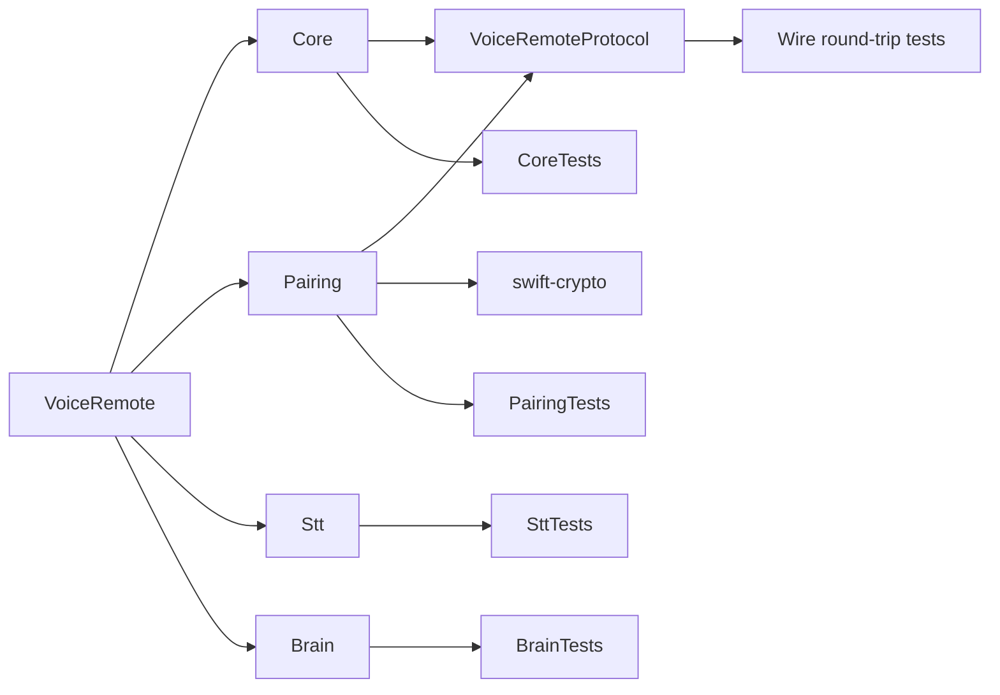

| Folder | What | Status |
|---|---|---|
| [Core](Core/README.md) | State, triggers, monotonic Auto routing, text history, registry/re-pair and literal dictation; depends on Protocol | ✅ Linux tested; UI adapters pending |
| [Pairing](Pairing/README.md) | Noise XX, QR, four-word phrase and both-screen confirmation; depends on Protocol and swift-crypto | ✅ Cacophony + desktop snow vectors; live pairing unverified |
| [Protocol](Protocol/README.md) | Generated validating wire codecs from SYS schemas | ✅ Linux round-trip tests |
| [Stt](Stt/README.md) | Validated audio sample count | ✅ Portable skeleton |
| [Brain](Brain/README.md) | Explicit inference-engine availability | ✅ Portable skeleton |

Start with each `Package.swift`; run `swift test -j 4 --package-path SW/ios/Packages/<name>`.
Core and Pairing depend on Protocol; Core has no Brain dependency. These three packages
set an iOS 26 minimum and remain testable on Linux. No Apple frameworks are used.
Trace: Core REQ-3/4/5/8/16/17/18/25/56/60; Pairing REQ-22–25/60/61; Protocol REQ-59/61.
On-device integrations and STT/brain accuracy or performance remain **unverified**.
