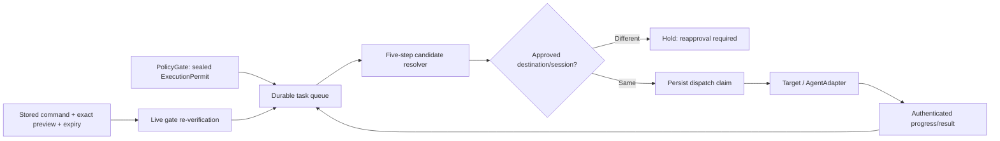

| Path | What | Status |
|---|---|---|
| [Package.swift](Package.swift) | Plain Swift 6; Protocol + Policy dependencies | ✅ Linux tested |
| [Sources/](Sources/README.md) | Candidate routing, binding, holds, durable queue and plugins | ✅ Unit tested |
| [Tests/](Tests/README.md) | Real Policy-issued permits; Journey E and cross-review regressions | ✅ Linux tested |

Start with `TaskRouter.enqueue(_:rules:destinations:)`. It accepts **only Policy's sealed ExecutionPermit**. REQ-28/31/34/42–45/60/61; design plan task 13. The earlier public receipt protocol has been removed.

| Journey E / §5.2 example | Result |
|---|---|
| Research in Claude; laptop online | Approved laptop session; exact command forwarded |
| Research in Claude; laptop offline; cloud candidate allowed | Visible **reapprovalRequired** hold; a new cloud-targeted approval is needed |
| Newly approved cloud execution | Cloud label always present; original local session is never carried forward |
| Show document on offline laptop | Queued machine hold; no substitute success |
| Explicit provider/machine/session unavailable | Hold; constraints preserved |
| Ambiguous request and offline preferred/default device | Hold before considering recent cloud sessions |
| Cloud fallback disabled | No implicit cloud candidate |

Preference: named destination → selected session → active field in dictation mode → recent available project session → default. `lastUsed > 0` marks previously used sessions. Provider-only/host-only overrides constrain every step; ordered permitted candidates break remaining ties, preferring a live local candidate. Cloud candidates require cloud-capable delegation and enabled fallback, or an explicit cloud destination. Local fallback follows configured provider order on the preferred host. These rules choose **candidates**, never broaden an approval.

| Boundary | Enforced behavior / integration obligation |
|---|---|
| Authority | Live `PolicyGate.verifyExecution` checks its issued-permit registry, exact command (including destination/authority fields), retained preview SHA-256, expiry, proposal state, session/grant revocation and audit integrity. Enqueue, load and every queued dispatch reverify. Forged Codable records hold without dispatch. |
| Destination/session binding | Explicit/selected target mismatch or a different resolved destination/pinned provider session means hold and ask for reapproval. The router never rewrites command IDs, payload, hash or authority. A fallback needs a new Policy-issued command approving that destination/session. |
| Restart | Queue reopen against the same live gate can proceed. A new PolicyGate restores replay tombstones but no permits: stored work holds for reapproval with a new request/command. Old records remain for deduplication. |
| Durability | Private 0600 file, exclusive lease, atomic rename, file/directory flush and compare-and-swap. Persist dispatch before one plugin call. Storage uncertainty stops writes/dispatch until reopen. Caller supplies an existing app-private directory. |
| At most once | An uncertain call remains `deliveryUnknown`; never blind-resend on reconnect. Crash between claim and delivery may lose an attempt. Downstream adapters also enforce command idempotency keys; this is not exactly-once execution. |
| Cancellation | Held tasks cancel locally. Submitted tasks retain `cancellationPending` until executor acknowledgement. Cancellation-only keys permit idempotent retries. A failed cancellation cannot block an unrelated queued task. |
| Status | Authenticated adapter calls `receive(_:from:)`; command/account/session and forward state checks apply. Remote timestamps are metadata, never causal ordering. Only an executor `ok` outcome can establish success. `snapshot()` supplies UI state independently of capture. |
| Composition | Router and Policy run on MainActor; plugin calls enqueue transport work promptly. Pairing/registry code authenticates destination metadata and status sources. Model/Brain/Stt code has no authority entry point. |
| Supported operations | Delegation and machine-bound open-resource commands. Actual dictation insertion remains Core/KeyboardBridge; Send/select/wire-cancel tools have separate executors. |
| Privacy / verification limits | No logs/audio/capture state. Storage contains approved payloads; encryption/relay replication, real-device UI, Apple compilation and live providers remain **unverified**. Power-loss durability is **unverified** beyond file round-trip/failure tests. |

```sh
swift test -j 4 --package-path SW/ios/Packages/Router
swift test -j 4 --package-path SW/ios/Packages/Router --filter Journey
```

On hwgeekom prefix commands with `HEAVY_CPUS=4 heavy`.

Queue dependency IDs are bound by the trusted phone composition. Reconnect releases a successor only after a matching authenticated `ok` predecessor outcome. Restored successful predecessors need fresh receipt confirmation. Replacement approval retires the old queued item atomically with the new reservation. Fresh cancellation permits can mark an expired/restored original task without reviving its execution authority.

Phone owner completion is a separate sealed Policy receipt, bound to the exact command/preview/full provider session and anchored in audit. Queue snapshots alone cannot restore that success. Selected/default session identities feed the resolver; changed destinations stay held until a new Policy approval. See [tests](Tests/README.md); live effects remain **unverified**.
