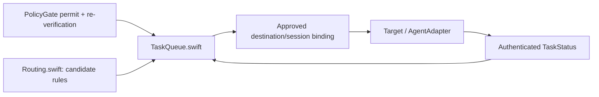

| File | What | Status |
|---|---|---|
| [Routing.swift](Routing.swift) | Complete session identity, five-step candidate resolver and cloud labels | ✅ Linux tested |
| [TaskQueue.swift](TaskQueue.swift) | Sealed Policy permit ingress, load/dispatch verification, durable claims, holds, cancellation/status | ✅ Linux tested |

Start with `TaskRouter.enqueue`. Different routing candidates require a new approved command. See the [integration contract](../README.md); REQ-28/31/34/42–45/60/61. Device/UI/provider integration remains **unverified**.

Routing identity includes optional canonical executionWorkspace, distinct from project ID. TaskQueue adds predecessor holds, authenticated success confirmation, atomic reviewed replacement and fresh cancellation permits for restored tasks.

TaskQueueStore exposes an app-owned retention filter for routing snapshots. RetainedTaskStore removes expired/tombstoned task payloads from live UI/reapproval views as well as disk; compare-and-swap persistence retains its original baseline.

Authenticated `dispatched/dispatched` may finish a CLI handoff after running, with bounded app reply retained by the app store. It cannot satisfy `succeeded/ok` predecessor checks. Status-only queries do not erase a previously received reply.
