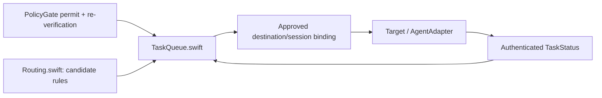

| File | What | Status |
|---|---|---|
| [Routing.swift](Routing.swift) | Complete session identity, five-step candidate resolver and cloud labels | ✅ Linux tested |
| [TaskQueue.swift](TaskQueue.swift) | Sealed Policy permit ingress, load/dispatch verification, durable claims, holds, cancellation/status | ✅ Linux tested |

Start with `TaskRouter.enqueue`. Different routing candidates require a new approved command. See the [integration contract](../README.md); REQ-28/31/34/42–45/60/61. Device/UI/provider integration remains **unverified**.
