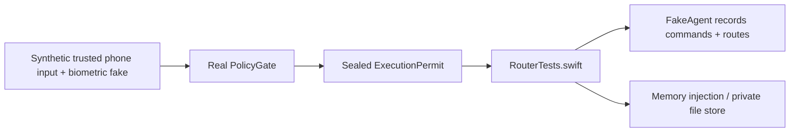

| File | What | Status |
|---|---|---|
| [RouterTests.swift](RouterTests.swift) | Journey E/preference tables; destination/session/hash binding; forged storage; cloud/ambiguity; cancellation isolation; skewed status; durable dedup | ✅ Linux tests |

Start with `testJourneyETableAndNewApprovalForCloud`, then the `testReview*` regressions. Eight review scenarios failed before implementation. Fakes now retain exact commands, and hashes come from Policy's approved preview. REQ-28/31/34/42–45/60/61. Live provider behavior remains **unverified**.
