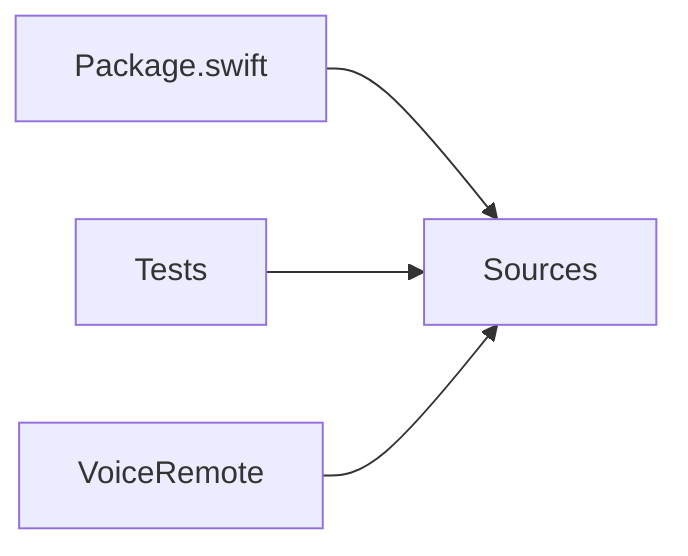

| Path | What | Status |
|---|---|---|
| [Package.swift](Package.swift) | Swift 6 library, no platform dependencies | ✅ Scaffold |
| [Sources/](Sources/README.md) | Stt skeleton | ✅ Linux build |
| [Tests/](Tests/README.md) | Boundary/default behavior test | ✅ Linux test |

Start with the manifest. Run `swift test --package-path SW/ios/Packages/Stt`.
Functional integrations remain unimplemented; see the [iOS map](../../README.md).
