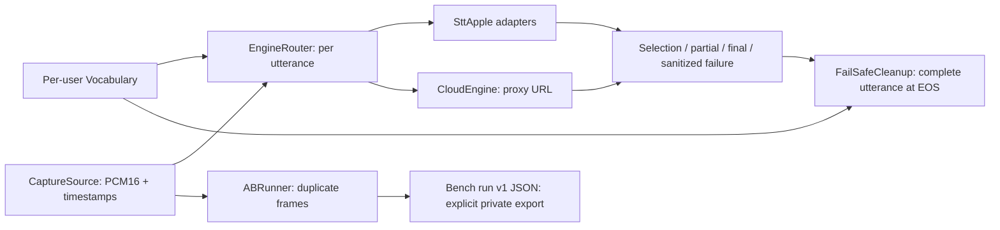

| Path | What | Status |
|---|---|---|
| [Sources/](Sources/README.md) | Portable protocols, routing, vocabulary, cleanup, A/B, proxy clients | ✅ Linux synthetic tests |
| [Tests/](Tests/README.md) | Router/cleanup, schema validation, local RFC6455 server | ✅ Synthetic only |
| [Package.swift](Package.swift) | Swift 6, Foundation only; no Apple SDK dependency | ✅ Linux |
| [../SttApple/](../SttApple/README.md) | Apple SpeechAnalyzer, WhisperKit, optional licensed Argmax | 🟡 Apple CI **unverified** |

Start with [SttEngine](Sources/SttEngine.swift) and [EngineRouter](Sources/EngineRouter.swift).
Task 7 implementation order: portable contracts → routing/vocabulary → guarded cleanup →
A/B schema export → proxy clients → Apple adapters → debug picker → Linux tests / coordinator CI.
Trace: [REQ-9], [REQ-10], [REQ-11], [REQ-12], [REQ-21]; requirement fulfilment and
phone accuracy/latency/battery remain **unverified**, pending owner bench runs.

```sh
HEAVY_CPUS=4 heavy swift test -j 4 --package-path SW/ios/Packages/Stt
HEAVY_CPUS=4 heavy swift test -j 4 --package-path SW/ios/Packages/Stt --filter Router
```

Purpose: task 7 portable result. Inputs: system design (Speech-to-text; Learnings),
requirements, bench README/run schema and linked current vendor docs in source comments.
Verification: Linux unit tests and synthetic loopback WebSockets; no live engine measurements.

Contracts and assumptions:

- Each utterance gets its own stream/socket. PCM is mono signed 16-bit little-endian, 16 kHz;
  capture adapters resample, timestamps are capture-relative monotonic seconds. No raw audio writes.
- The host lists only ready engines. Offline selection never chooses cloud or surfaces failures.
  Cloud consent defaults to denied; neither the picker nor power/accuracy rules can bypass it.
  The router emits `.selected(EngineDescriptor)` (including `isCloud`) before capture/text so the host
  can show cloud use. Explicit debug choice overrides automatic routing only when consent/network permit it.
  A/B also requires explicit `cloudConsent: true` before either cloud engine consumes audio.
- User identity/persistence come from the host. Vocabulary snapshots remain separate per utterance;
  matching cleanup terms changes case only. Engine-specific prompting is advisory.
- Cleanup permits only the exact conservative rule output or exact raw text. It never generates
  actions. Any other rewrite, added control/newline, lexical change, failure or timeout returns raw.
  Engine segment finals are combined and displayed as partials until EOS, then cleaned once;
  on engine failure, stable segments received so far still commit once, before any online failure event.
  Offline failures stay silent; unconfirmed partials are not committed by the router. Consumer cancellation
  ends delivery. Only isolated comma-marked leading um/uh can be removed; bare mentions, repeated negatives
  and vocabulary terms are protected.
  Single digits convert only after “number”; compound numbers remain words. No fuzzy spelling substitutions. Semantic quality on owner
  speech remains **unverified**; cleanup cannot recover words already lost by recognition.
- A/B fans out a live source once into two streams. Exports match
  [run v1](../../../bench/schemas/run.schema.json); failures/timeouts produce empty text as that
  contract requires. `BenchRun.aggregate(runs)` / `merging` combine case exports into one `write(to:)` file;
  mixed cohorts, repeated cases, changed engines/versions and incomplete result sets are rejected.
  Public initializers also allow recorder-driven assembly. A synthetic test aggregates 200 cases.
  `first_text_ms` measures first delivered audio → first nonempty text; `final_after_eos_ms` measures
  capture-stream EOS → last final event on a monotonic clock (zero if the final already arrived).
  Empty input/missing final measurements remain absent/TBD; no latency is invented for failed runs.
  Host capture marks EOS promptly at speech end and paces replay audio for representative measurements.
  Synthetic status, device, source, expected text and private export destination are explicit inputs.
- Proxy URLs identify an owner-controlled vendor route; vendor wire messages/query parameters pass
  through and the future relay injects credentials. App accepts no vendor keys. Authentication and
  deployment of that proxy are later work. Insecure transport is allowed only for explicit loopback tests.
- ElevenLabs commits in acknowledged 20-second audio batches, below its documented automatic
  commit interval, then commits the residual EOS audio. AssemblyAI explicitly selects 3.5 rather than
  the current default model. Its PCM is rechunked into 50 ms messages (within the documented 50–1000 ms
  range); only a final short tail is padded with silence. Keep reading through `Termination`; its latest
  unfinished partial is retained if no nonempty final superseded it, including empty closing turns.
  See [AssemblyAI message sequence](https://www.assemblyai.com/docs/streaming/message-sequence).
  Nonfatal ElevenLabs warning/derived metadata and AssemblyAI speaker/liveness/LLM metadata are ignored;
  provider errors still fail. The configured cloud timeout is inactivity in either direction, including
  connection establishment; ongoing audio or replies reset it, so it does not cap dictation duration.
  `SttIdleClock` is injectable; production uses `ContinuousIdleClock`. The shared socket wrapper records
  successful sends and receives synchronously, including Apple's `URLSessionWebSocketTask` adapter.
  Activity and expiry are serialized; a stale timer wake rechecks the latest deadline. Tests advance
  virtual time through explicit I/O/sleep checkpoints, never competing wall-clock sleeps and deadlines.
  The reported macOS active-stream test failure exercised a fake socket, not URLSession timing.
  Both live integrations remain **unverified**.
- Linux requires an injected socket factory. Tests use a stdlib Python bridge over a real local
  WebSocket server; Apple's default URLSession transport awaits CI/device verification.

Scalar-safety audit: benchmark IDs and the offline schema helper now inspect the entire scalar
sequence instead of regex anchors. Vocabulary checks original scalars before whitespace trimming,
so boundary CRLF cannot evade rejection. Cleanup already checked scalars and retains raw input
on failure; regression tests cover CRLF, embedded CRLF and control + combining marks. Raw cleanup
fallback is not insertion permission: Core sanitizes and Protocol/KeyboardBridge validate the
final boundary. Apple execution remains **unverified** pending coordinator CI.

Task 6 capture interruption addition ([REQ-5], [REQ-50], [REQ-56]): `CaptureSource.events()`
carries frames or terminal `.interrupted`; finite legacy sources default to frame wrapping.
Live sources must implement interruption events. EngineRouter discards all uncommitted text
on loss (including offline), and A/B refuses to export an interrupted run. Consumers use
events rather than stripping the loss signal via `frames()`. Existing engine PCM interfaces
remain unchanged. [InterruptedCaptureTests](Tests/InterruptedCaptureTests.swift) cover
loss/late-frame rejection and A/B failure; Apple/BLE behavior is **unverified**.
