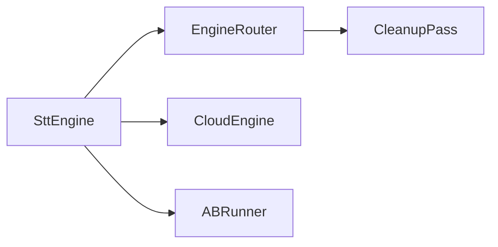

| File | What | Status |
|---|---|---|
| [SttEngine.swift](SttEngine.swift) | PCM frames, events, capture/engine protocols, scalar-checked user vocabulary, scripted doubles | ✅ Synthetic tests |
| [EngineRouter.swift](EngineRouter.swift) | Consented selection announcement, stable-text retention and whole-utterance cleanup | ✅ Linux tests |
| [CleanupPass.swift](CleanupPass.swift) | Conservative rules and timeout/content fail-safe | ✅ Synthetic rejection tests |
| [CloudEngine.swift](CloudEngine.swift) | Proxy-only vendor protocols, injectable sockets, valid PCM chunks, termination retention and idle timeout | 🟡 Local server tested; live **unverified** |
| [ABRunner.swift](ABRunner.swift) | Identical-audio fanout, monotonic timings and multi-case bench v1 export with scalar ID validation | ✅ Schema test |
| [AudioSampleCount.swift](AudioSampleCount.swift) | Existing nonnegative sample count | ✅ Unit test |

Start with SttEngine; see [package assumptions](../README.md). [REQ-9]–[REQ-12], [REQ-21].
Purpose: source map. Inputs: task 7 contracts. Verification: Linux synthetic tests only.
