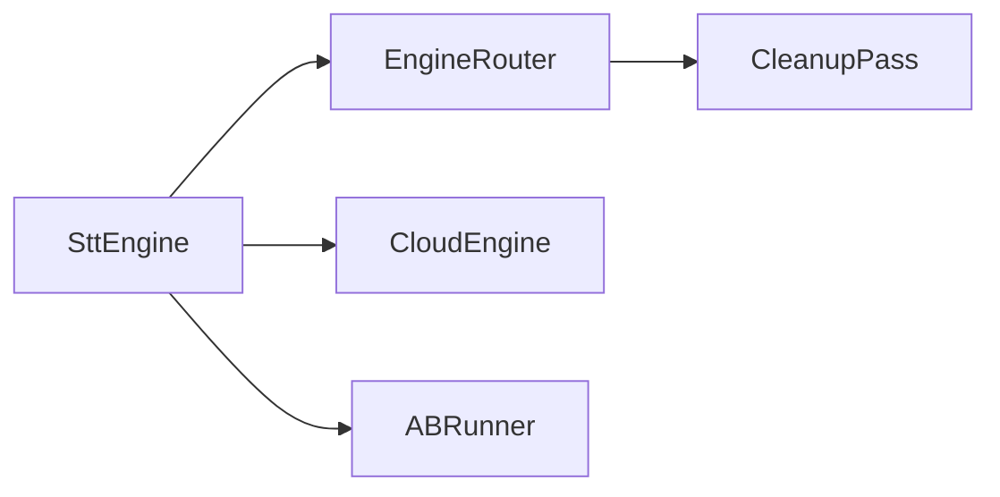

| File | What | Status |
|---|---|---|
| [SttEngine.swift](SttEngine.swift) | PCM frames, events, capture/engine protocols, scalar-checked user vocabulary, scripted doubles | ✅ Synthetic tests |
| [EngineRouter.swift](EngineRouter.swift) | Consented selection announcement, stable-text retention and whole-utterance cleanup | ✅ Linux tests |
| [CleanupPass.swift](CleanupPass.swift) | Conservative rules and timeout/content fail-safe | ✅ Synthetic rejection tests |
| [CloudEngine.swift](CloudEngine.swift) | Proxy-only vendor protocols, injectable sockets/clock, valid PCM chunks, termination retention and idle timeout | 🟡 Local server tested; live **unverified** |
| [IdleTimeout.swift](IdleTimeout.swift) | Injected monotonic clock; atomic activity/expiry/stop; continuous production clock | ✅ Virtual-time tests |
| [ABRunner.swift](ABRunner.swift) | Identical-audio fanout, monotonic timings and multi-case bench v1 export with scalar ID validation | ✅ Schema test |
| [AudioSampleCount.swift](AudioSampleCount.swift) | Existing nonnegative sample count | ✅ Unit test |

Start with SttEngine; see [package assumptions](../README.md). [REQ-9]–[REQ-12], [REQ-21].
Purpose: source map. Inputs: task 7 contracts. Verification: Linux synthetic tests only.

Task 6 capture interruption addition ([REQ-5], [REQ-50], [REQ-56]): `CaptureSource.events()`
carries frames or terminal `.interrupted`; finite legacy sources default to frame wrapping.
Live sources must implement interruption events. EngineRouter discards all uncommitted text
on loss (including offline), and A/B refuses to export an interrupted run. Consumers use
events rather than stripping the loss signal via `frames()`. Existing engine PCM interfaces
remain unchanged. [InterruptedCaptureTests](../Tests/InterruptedCaptureTests.swift) cover
loss/late-frame rejection and A/B failure; Apple/BLE behavior is **unverified**.
