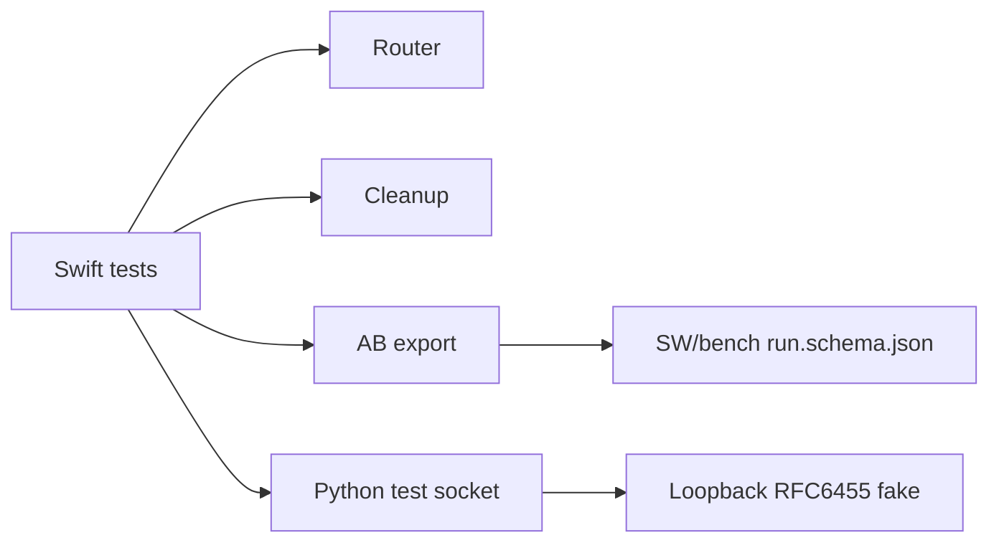

| File | What | Status |
|---|---|---|
| [RouterTests.swift](RouterTests.swift) | Consent/selection, stable text after failure, offline silence, cleanup composition | ✅ Synthetic |
| [CleanupTests.swift](CleanupTests.swift) | Meaning edits, Send, CRLF/control clusters, vocabulary, raw/error/timeout fallback | ✅ Synthetic |
| [ABRunnerTests.swift](ABRunnerTests.swift) | Identical PCM, 200-case aggregation, measured timing, scalar ID and offline schema validation | ✅ Synthetic |
| [CloudTests.swift](CloudTests.swift) | Both vendor protocols, valid chunks, warning/EOS retention, cancellation, idle timeout/errors | ✅ Loopback |
| [BenchSchemaValidator.swift](BenchSchemaValidator.swift) | Foundation/CoreFoundation validator for the STT schema keywords; invalid fixtures too | ✅ Offline |
| [FakeWebSocket.py](FakeWebSocket.py) | Stdlib masked WebSocket server/bridge; invented text/PCM only | ✅ Loopback |
| [SttTests.swift](SttTests.swift) | Existing sample-count boundary checks | ✅ Synthetic |

Start with [package test commands](../README.md). Benchmark schema tests use Foundation/CoreFoundation
only, reading the authoritative schema without external tools or installation. Python 3 is needed
only for the stdlib local WebSocket fixture; `uv` is not required, including on CI.
No vendor traffic or owner recordings. [REQ-9]–[REQ-12], [REQ-21].
Purpose: test map. Inputs: synthetic fixtures and authoritative bench schema. Verification:
Linux only; phone inference, native URLSession WebSockets and Apple builds remain **unverified**.
