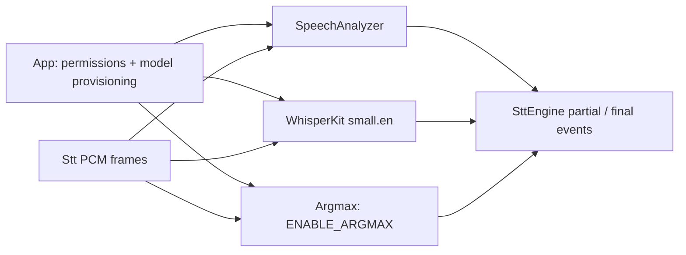

| Path | What | Status |
|---|---|---|
| [Sources/](Sources/README.md) | Apple-only engine adapters | 🟡 CI/device **unverified** |
| [Tests/](Tests/README.md) | Provisioning and adapter boundary checks | 🟡 Apple CI **unverified** |
| [Package.swift](Package.swift) | Stt + pinned MIT WhisperKit 0.14.1; optional private registry SDK | 🟡 Resolution/build **unverified** |

Start with [AppleSpeechEngine](Sources/AppleSpeechEngine.swift). [REQ-9], [REQ-11], [REQ-12].
This package is linked into the app by `project.yml`, and is never built on Linux.
The coordinator pushes an `ios-ci-*` tag to compile it and the app. Package test execution
requires `swift test -j 4 --package-path SW/ios/Packages/SttApple` on macOS separately;
the existing hosted-app scheme does not automatically discover package tests.

Purpose: task 7 Apple result. Inputs: linked Apple/Argmax public docs and pinned WhisperKit APIs.
Verification: source inspection/cross review only. No Apple compilation, SDK licence, model
inference or phone measurements available here; all remain **unverified**.

- Host requests microphone/speech consent, supplies usage descriptions, captures/resamples PCM,
  and refreshes router availability. `prepare(allowDownload: true)` is an explicit on-demand step;
  transcription never initiates model downloads. Models are never resources in the app bundle.
- Apple SpeechAnalyzer uses installed locale assets, volatile/final results, timestamped format
  conversion and EOS drain. Vocabulary bias is unsupported here; portable cleanup still receives it.
- WhisperKit loads small.en on demand or from a host-selected cached model folder and uses vocabulary
  prompt tokens. It emits rolling whole-utterance partials once per audio second and one final at EOS.
  The in-memory utterance cap is 120 seconds; the host splits longer capture sessions. Performance,
  battery, recognition quality, clipping at boundaries and offline tokenizer caching are **unverified**.
- WhisperKit is an unmodified [MIT SwiftPM dependency](https://github.com/argmaxinc/WhisperKit/blob/v0.14.1/LICENSE).
  No upstream source was copied into this package.
- Argmax is excluded by default. After licensing, configure the registry per
  [vendor installation](https://app.argmaxinc.com/docs/guides/installation), then resolve/build with
  `ENABLE_ARGMAX=1` (manifest adds the dependency and Swift build flag). Host initializes the licensed
  SDK, downloads/loads Parakeet v2 and its vocabulary model, and injects the loaded kit. The adapter
  follows public docs; its API version compatibility and result segment semantics are **unverified**.
  Streaming vocabulary bias is specifically **unverified**: the adapter calls `setCustomVocabulary`
  before starting the stream, but the public [vocabulary documentation](https://app.argmaxinc.com/docs/examples/custom-vocabulary)
  does not prove partial/final streaming behavior for this pinned SDK/model. Verify term accuracy and
  updates on the licensed SDK/device; do not claim that streaming vocabulary works from this adapter alone.
- Active [SettingsView](../../App/Settings/SettingsView.swift) exposes engine selection,
  model preparation and the private recorder; the separate EnginePickerView is superseded.
  Apple UI/device execution remains **unverified**.

Licensed availability boundary: after SDK/model preparation, the host calls `ArgmaxBuild.install(loadedKit:)`. Runtime and active Settings list Argmax only while `ArgmaxBuild.engine` is present; `remove()` withdraws it. Both ENABLE_ARGMAX and an importable licensed SDK are required. This checkout supplies no licence, kit initialization or model; native API compatibility remains **unverified**.
