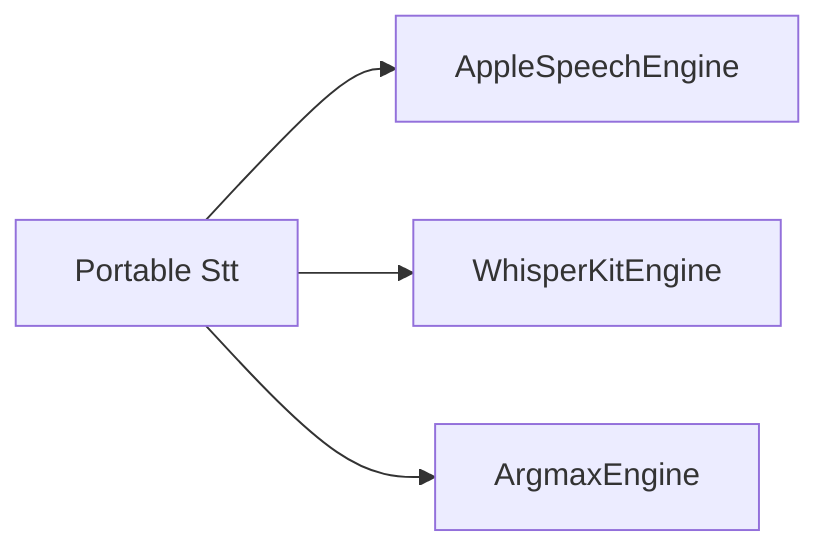

| File | What | Status |
|---|---|---|
| [AppleSpeechEngine.swift](AppleSpeechEngine.swift) | SpeechAnalyzer assets, streaming, conversion/timestamps | 🟡 Apple CI/device **unverified** |
| [WhisperKitEngine.swift](WhisperKitEngine.swift) | Explicit small.en provisioning, prompt tokens, rolling partials/final | 🟡 Apple CI/device **unverified** |
| [ArgmaxEngine.swift](ArgmaxEngine.swift) | Licensed streaming adapter under ENABLE_ARGMAX | 🟡 Licence/API **unverified** |

Start with [package integration notes](../README.md). [REQ-9], [REQ-11].
Purpose: source map. Inputs: vendor public APIs linked in code. Verification: cross review only.

ArgmaxBuild registers a loaded licensed kit on MainActor. The app reads its optional engine for routing/picker availability; a build flag alone does not mark a model ready. SDK/device verification remains **unverified**.
