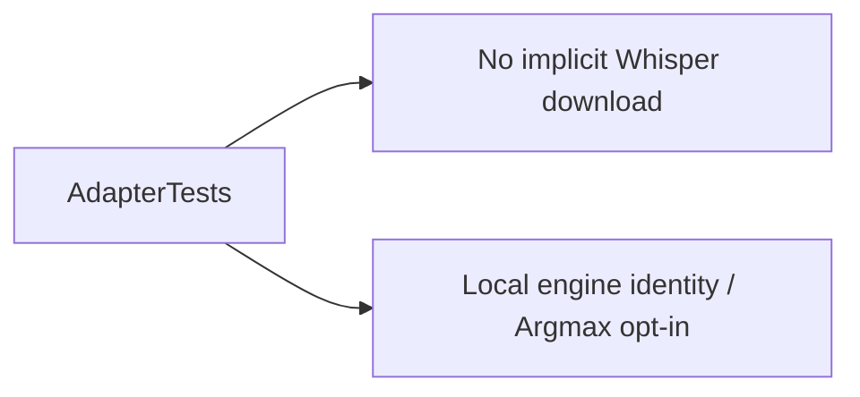

| File | What | Status |
|---|---|---|
| [AdapterTests.swift](AdapterTests.swift) | Unprepared-model and adapter boundary tests; no downloads/audio | 🟡 macOS execution **unverified** |

Start with the [package handoff](../README.md). [REQ-9], [REQ-10].
Purpose: test map. Inputs: synthetic empty capture. Verification: source inspection only;
requires Apple runner; simulator inference and on-device accuracy are **unverified**.

AdapterTests also checks that an unlicensed build has no registered Argmax engine and withdrawal leaves it absent. Native Apple execution **unverified**.
