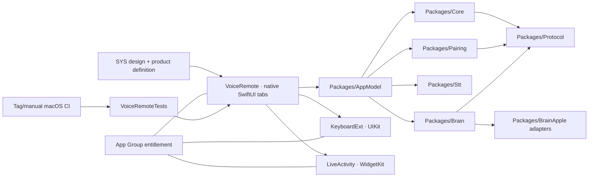

| Path | What | Status |
|---|---|---|
| [project.yml](project.yml) | XcodeGen targets, one bundle prefix, marketing version | ✅ Scaffold |
| [App/](App/README.md) | Home, Devices, History, Suggestions, approval, Settings and benchmark recorder | 🟡 macOS build **unverified** |
| [KeyboardExt/](KeyboardExt/README.md) | Status, globe/space/delete; committed-text insertion; no mic/network/Send | 🟡 Linux bridge tested; Apple compile/device **unverified** |
| [Packages/KeyboardBridge/](Packages/KeyboardBridge/README.md) | Bounded App Group queue, Darwin wakeup, private crash receipts, copy/share APIs | ✅ Linux tests; main-app wiring **unverified** |
| [LiveActivity/](LiveActivity/README.md) | ActivityKit listening/destination, recording intent and Action Button | 🟡 Apple/device **unverified** |
| [Configuration/](Configuration/README.md) | Shared App Group entitlement; generated Info plists | ✅ Configuration |
| [Packages/AppModel/](Packages/AppModel/README.md) | Plain Swift composition, epoch cancellation, suggestions/Policy, recorder, BLE parsing and source scoring | ✅ Synthetic Linux tests; device behavior **unverified** |
| [Packages/Core/](Packages/Core/README.md) | Independent mode/capture, triggers, Auto target, text history, registry and safe dictation | ✅ Linux unit tests; UI adapters pending |
| [Packages/Pairing/](Packages/Pairing/README.md) | Noise XX, QR checks, four-word phrase and both-screen confirmation gate | ✅ Cacophony/Linux tests; live desktop pairing **unverified** |
| [Packages/Router/](Packages/Router/README.md) | Policy-permit routing, destination-bound holds, labelled cloud candidates and durable task queue (REQ-34/42–45/60) | ✅ Linux Policy integration tests; UI/provider wiring **unverified** |
| [Packages/Protocol/](Packages/Protocol/README.md) | Generated validating wire codecs | ✅ Linux round-trip tests |
| [Packages/Policy/](Packages/Policy/README.md) | Deterministic gate, bounded grants, durable revocation, payload-bound approval and authenticated audit recovery; REQ-28–35 | ✅ Linux tests; phone/checkpoint integration **unverified** |
| [Packages/Stt/](Packages/Stt/README.md) | Streaming engines, router, per-user vocabulary, guarded cleanup, A/B bench export, proxy clients ([REQ-9]–[REQ-12]) | ✅ Linux synthetic tests; live use **unverified** |
| [Packages/SttApple/](Packages/SttApple/README.md) | SpeechAnalyzer, MIT WhisperKit small.en, optional licensed Argmax; debug picker ready for UI embedding | 🟡 Coordinator `ios-ci-*` build and device use **unverified** |
| [Packages/Brain/](Packages/Brain/README.md) | Strict non-executable proposals, relay Claude client, router, incremental suggestion cards and benchmark hook | ✅ Synthetic Linux tests; live/UI/Policy integration **unverified** |
| [Packages/BrainApple/](Packages/BrainApple/README.md) | Foundation Models + optional on-demand MLX adapters | 🟡 Apple CI/device behavior **unverified** |
| [UITests/](UITests/README.md) | Scripted light/dark/large-type gallery, real Policy with synthetic adapters, accessibility findings | 🟡 Coordinator `ios-ui-*` run **unverified** |
| [Tests/](Tests/README.md) | Hosted app unit test | 🟡 macOS test **unverified** |
| [ci/](ci/README.md) | Tested release guard and simulator discovery | ✅ Linux helper tests |
| [ios.yml](../../.github/workflows/ios.yml) | Unsigned simulator tests; optional TestFlight release | 🟡 GitHub run **unverified** |

Start with `project.yml`. Design: [Components and Repo](../../SYS/system-design-v1.md#components),
[product definition](../../SYS/product-definition-v0.2.md). Core logic traces to REQ-3/4/5/8/16/17/18/25/56/60; Pairing traces to REQ-22–25/60/61.
Package tests prove portable logic; Apple SDK compilation and on-device behavior remain **unverified**.

Linux checks (Swift 6+, no Apple frameworks):

```sh
for p in Protocol Core Pairing Stt Brain; do swift test -j 4 --package-path SW/ios/Packages/$p || exit 1; done
python3 -m unittest discover -s SW/ios/ci -p 'test_*.py'
```

The coordinator pushes an `ios-ci-*` tag or dispatches the workflow. Only `ios-ci-*`, `ios-ui-*`,
`ios-v*` tags and manual dispatch run it; no PR, branch, schedule or automatic macOS build.
Each macOS job has a 30-minute timeout and uses at most four build jobs. XcodeGen is installed
with Homebrew; generated projects, Info plists and placeholder icon catalog are ignored.
`Configuration/generate_icon.py` supplies an opaque waveform icon for archive validation.
The workflow discovers an available iPhone on iOS 26+ and runs `xcodebuild test ... CODE_SIGNING_ALLOWED=NO`.
No Apple account is needed for that job. Test results are retained for seven days.

UI review: the separate `ui-gallery` job runs only on `ios-ui-*` or manual dispatch,
with `VoiceRemoteUI`, Debug and `CODE_SIGNING_ALLOWED=NO`. `ios-ui-*` skips the ordinary
simulator job. Download **ios-screenshots** for named PNGs, `index.json` and all
report-only accessibility findings; **ios-ui-results** preserves the xcresult even
on test failure. [Coverage and limits](UITests/README.md). Demo arguments and fakes
are compiled out without DEBUG (Linux source guard tested). Apple compilation,
UI behavior, actual exports and accessibility acceptance remain **unverified**
until the coordinator's run. No Apple account or provider credentials are needed.

Only SwiftPM downloads are cached; no simulator state, signing data or DerivedData is cached.

Runner choice checked 2026-11-02: [`macos-26`, Xcode 26.6 inventory](https://github.com/actions/runner-images/blob/main/images/macos/macos-26-Readme.md#xcode).
The selected Xcode path is explicit; simulator model/OS patch versions are discovered at runtime.
Recheck that inventory when updating the pinned Xcode.

For TestFlight the owner must add:

1. An active Apple Developer Program team and accepted agreements; an App Store Connect
   app record for the main bundle identifier. In `project.yml`, change `BUNDLE_ID_PREFIX`
   if necessary (default `com.harwasch.voiceremote`). The app uses that exact ID;
   extensions append `.keyboard` and `.liveactivity`; tests append `.tests`.
2. Register the app and both extension identifiers and `group.<BUNDLE_ID_PREFIX>` in
   the developer portal; enable App Groups and assign the group to all three identifiers.
3. An App Store Connect **team API key** with App Manager access and permission to
   manage certificates/profiles and use cloud-managed distribution signing. Signing and
   provisioning must be available to that team; the workflow requests automatic provisioning.
   See [Apple’s API-key and cloud-signing walkthrough](https://developer.apple.com/videos/play/wwdc2021/10204/).
4. Repository Actions secrets: `APPLE_TEAM_ID` (team identifier), `ASC_KEY_ID` (key ID),
   `ASC_ISSUER_ID` (issuer UUID), `ASC_KEY_P8` (complete multiline `.p8` contents).
   No base64 encoding. The key is written only to the runner temp directory and removed
   on step exit. Never put keys, certificates or profiles in this tree.
5. Set `MARKETING_VERSION` in `project.yml`, then have the coordinator push an exact
   `ios-v<MARKETING_VERSION>` tag, for example `ios-v0.1.0`. Any mismatch fails preflight,
   even without secrets. Build numbers use `<run_number>.<run_attempt>` for retry uniqueness.

The release job runs only after simulator tests succeed and all four secrets exist;
otherwise it skips before allocating another macOS runner. It archives and uploads with
`xcodebuild -allowProvisioningUpdates` and API authentication. Apple-side processing,
compliance questions and tester assignment remain in App Store Connect. The entire signed
archive/upload path is **unverified** until run with the owner's team credentials.

Keyboard task 9 ([REQ-16], [REQ-46–48], [REQ-56]):

| Decision / check | Consequence / evidence |
|---|---|
| Full Access off (`RequestsOpenAccess: false`) | [Current Apple open-access documentation](https://developer.apple.com/documentation/uikit/configuring-open-access-for-a-custom-keyboard) checked 2026-11-02: shared App Group **reading is permitted** without Full Access; writing is restricted. This supersedes the archived guide's broader restriction. App owns shared writes; extension receipts stay private. |
| Privacy | Keyboard has no microphone or network access, no audio storage, no ML, and never reads host field contents. Only committed text and listening state cross the shared queue; Darwin notification has no text payload. No Full Access permission is requested. |
| Crash safety | Receipt is persisted before insertion: at most one attempt per immutable segment ID within seven days; a crash in that gap can lose text. Recover explicitly from app history. See [queue contract](Packages/KeyboardBridge/README.md). |
| Small memory | Queue/ledger capped at 256 KiB each, 1,024 records, 16 KiB per segment; measured extension footprint **unverified**. |
| Seven-day expiry | Reader skips expired text; app must call `maintain` at launch and periodically to physically prune it. OS background scheduling cannot guarantee deletion at the exact boundary. No audio accepted by the bridge. |
| No Send | Tests reject controls and newline scalars at enqueue and drain. UI only has globe, space, delete; no Return/Send key or command path. |
| Unsupported fields | Main-app explicit copy/share APIs provided; main-app package dependency, history buttons and producer wiring belong to the app owner and remain **unverified**. Secure fields and apps can reject keyboards; no arbitrary background insertion promise. |
| Linux check | `swift test -j 4 --package-path SW/ios/Packages/KeyboardBridge` (through `heavy` here): ordering, ID dedup, crash/restart, seven-day expiry, capacity, controls and newline rejection. |
| Owner real-device check | **Unverified:** enable keyboard with Full Access off; dictate synthetic text in main app; activate in Messages and Mail, confirm text at caret and **no auto-send**; exercise globe, space/delete, suspension/restart, and copy/share in a rejecting field. |
| Coordinator CI | **Unverified:** `ios-ci-*` tag run compiles UIKit/Darwin adapters and keyboard target; Linux does not compile Apple-only code. |

Task 6 owner acceptance ([design plan](../../SYS/system-design-v1.md#plan),
[product P0](../../SYS/product-definition-v0.2.md#p0--iphone--windows-experience-first-priority)):

| Owner check | Status |
|---|---|
| AirPods remain connected to iPhone while committed text goes to the PC; switch back to iPhone without reconnecting headset (task 6 done-when) | **Unverified** |
| QR pair on home LAN and an external network, no manual IP; goal under one minute | **Unverified**; relay + LAN protocol paths pass local E2E; complete code supported; short-code lookup absent from relay v1 |
| Four words match on both screens; enrollment waits for both; role/capabilities and revoke work | **Unverified** |
| Revocation immediately blocks the next message and removes peer credentials/relay membership | **Unverified**; signed relay revoke + local enrollment cleanup implemented; local protocol E2E passed |
| Windows correct field: Notepad, Chrome, Teams; text insertion never presses Send/Enter | **Unverified** |
| Clear destination before first word: named target and Auto; phone fallback after stale focus; desktop tray/remote presentation | **Unverified**; merged wire protocol has no tray display acknowledgement |
| OFF/HOLD/CONTINUOUS and Dictation/AI Control are separate; mode switch preserves target; short taps/hold/double-tap match shared trigger | **Unverified** on phone; portable tests cover state boundaries |
| Immediate Stop while idle, preparing, listening, finishing, interrupted or failed; deny microphone access; unplug AirPods; take a call; no automatic restart or late text | **Unverified** on phone |
| Continuous dictation segments reach history/field while microphone remains on; source loss drops only unfinished text | **Unverified** on phone; segmentation thresholds **TBC** |
| Action Button unlocked/locked, warm/cold start, microphone indicator and Live Activity; document observed limitations and fallbacks | **Unverified**; intent requests foreground opening; cold start has no proven guarantee |
| Messages/Mail keyboard inserts committed text at caret with Full Access off; no auto-send; copy/share in unsupported fields | **Unverified** |
| Text-only history, manual delete, held/unconfirmed text retained until deletion; private temporary remote sync audio until STT succeeds | **Unverified** on phone; synthetic retention/delete tests |
| Speech model provisioning, offline on-device path, cloud consent/indicator, vocabulary, speech/brain pickers and A/B | **Unverified**; signed proxy access passes real local Worker + fake upstream tests; deployed vendor behavior **unverified** |
| Meeting suggestions do nothing untouched, deduplicate/expire, mute, edit destination, review and dismiss | **Unverified** on phone; conservative inferred-only app activation |
| Exact action/destination/recipient/consequences remain visible during approval; tier 3 requires fresh Policy Face ID/passcode; cancellation/failure never executes; remote cannot approve | **Unverified** on phone; synthetic Policy integration tests |
| Benchmark prompts, same-audio A/B, run-schema JSON share, audio local and removed after successful export unless kept | **Unverified** on phone; synthetic schema and deletion tests |
| BLE authenticated Numeric Comparison enrollment, version/snapshot/display-write barrier, raw Opus, OFF/disconnect/loss/watchdog, release then fresh trigger | **Unverified**; explicit Numeric Comparison confirmation and persisted protected-peripheral pin implemented; draft contract/PR #9 untested on hardware |
| Dynamic Type largest sizes, VoiceOver all controls and approval details, dark mode | **Unverified** |
| Owner speech/brain benchmark gate: named iPhone/AirPods, WER/terms/first words/latency/battery; no engine selected on synthetic scores | **Unverified** |
| Privacy/recording consent, cloud retention and encryption policy reviewed before release | **Unverified** |

Task 6 integration limits: computer enrollment metadata and revocation tombstones persist
in protected files; keys remain in Keychain. Relaunch restores Core and performs a fresh,
pinned Pairing SessionResume handshake at launch and reconnect over the saved relay or LAN; real-device resumption remains **unverified**. Account identifier
must match the receiver (Settings; restart after change). Provider-session executors are not yet supplied: supported machine actions queue against
paired registry destinations and hold visibly; unsupported/pinned unknown sessions report
queue-confirmation failure and retain the approval permit for a verified retry.
Tier 2 wake/grant automation stays disabled pending authenticated actor/scope integration.
The app uses the merged Core trigger window; draft BLE trigger ambiguity remains unresolved.
BLE capture requires protected access plus a saved pin established by explicit both-screen Numeric Comparison confirmation. CoreBluetooth method/bond attestation is unavailable; firmware must enforce authenticated SC bonding. Opus integration and all Apple APIs await the
coordinator's `ios-ci-*` tag. No commit, push, merge or PR was performed by this worker.

Scoped portable checks: `swift test -j 4 --package-path SW/ios/Packages/AppModel` and
`swift test -j 4 --package-path SW/ios/Packages/Stt` (through `HEAVY_CPUS=4 heavy` on hwgeekom).
In this restricted worktree, export `CLANG_MODULE_CACHE_PATH=/tmp/voiceremote-clang-cache`
and `SWIFTPM_MODULECACHE_OVERRIDE=/tmp/voiceremote-swift-cache` so compiler caches are writable.
Apple observation, microphone controls and approval screens still need cross review and CI.

Cross-review regression evidence lives in [AppModel tests](Packages/AppModel/Tests/README.md):
HOLD failure/cancellation, Auto presentation, real Router queue/retry, persisted enrollment
restoration, PairingFlow, revoke cleanup, consent withdrawal and cold-runtime bootstrap.
Apple route reconfiguration, local Bindable fixes, gestures and BLE display writes remain
**unverified** until `ios-ci-*` and phone checks. No Core package modification was needed.

Swift 6 follow-up audits all App, LiveActivity, KeyboardExt and intent sources:
ActivityKit ID-only operations, serial camera ownership, synchronous main-queue BLE
delegates, and explicit Sendable callbacks. Reconnect requests an Input snapshot in
the first state write after subscriptions. Portable regression reproduced failing
first; Apple SDK compilation and device execution of these changes **unverified**.

Integration (2026-11-02): [App map](App/README.md) covers relay pairing, exact signed speech/Claude proxy requests, durable held/unconfirmed dictation and draft 1.1 remote offline sync. [AppModel regressions](Packages/AppModel/Tests/README.md) prove interruption/resume, delete after STT + durable history, short discard, same-major/capability rules and offline text isolation. [SYS E2E](../../SYS/tests/e2e/README.md) proves signing bytes against the production Worker with synthetic upstreams. No relay source edits. Short-code lookup and positive insertion acknowledgments need contracts; existing TaskStatus failures now map by segment_id; BLE authenticated enrollment and all changed Apple SDK/device behavior remain **unverified**.

Cross-review: relay 403 suspends without deleting credentials; cleanup always attempts self-revoke. Deferred sync uses protected append-only audio and visible Retry/Discard; silent/oversized records do not starve later recordings, and live PTT preemption resumes. Unicode splits are durable before encoding; Copy handles offline IDs. Remote enrollment has a real confirmation/pinning UI; CoreBluetooth method attestation and OS bond removal remain API gaps, not authentication exceptions.

| Phone sleep/wake, archive and BLE | Implementation / evidence | Status |
|---|---|---|
| APNs + reconciliation | [Delegate/signing setup](App/README.md), fresh XX, durable identity queries, queued-permit invalidation; fixed wake carries no content | ✅ Portable safety tests; signing/APNs/locked phone **unverified** |
| Audit copy + recovery | Phone AES-GCM, exact signed upload/checkpoint/read, protected keys/anchors/pending bytes, scheduled read-back, visible loss, fresh biometric restore with preserved originals | ✅ [Adapter tests](Packages/AppModel/Tests/PhoneAdaptersTests.swift); Keychain/Apple UI **unverified** |
| Named remote sources | M5 StopWatch/Waveshare info, `RemoteBLECaptureSource`, qualified PTT/mode/target controls, source telemetry/selection and separate named-source benchmark export; remote tier 3 denied | ✅ Synthetic vectors; board/audio/throughput **unverified** |

Push defaults off; an owner-signed profile and opt-in entitlement/environment are required. Background verification is best effort; foreground and reconnect also check. New authority after irrecoverable loss needs an executor fence and is unavailable here. The shared bench schema has no remote enum: named board exports use `voiceremote-named-source-benchmark-v1`, not a false phone-mic cohort.

Cross-review: push registration shares the live relay socket, background-only resume preserves biometric-sheet approvals, remote controls use control-event acknowledgements, and source selection pins before async setup with a visible active microphone. [Portable regressions](Packages/AppModel/Tests/CrossReviewTests.swift) cover REC/target/HOLD, upgrade and presentation boundaries; [socket tests](Packages/AppModel/Tests/SignedPhoneTransportTests.swift) enforce replacement/drain behavior. Apple SDK/device checks remain **unverified**.
