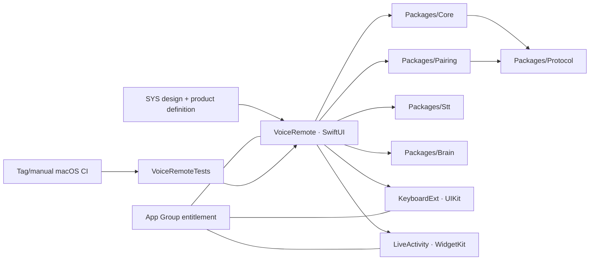

| Path | What | Status |
|---|---|---|
| [project.yml](project.yml) | XcodeGen targets, one bundle prefix, marketing version | ✅ Scaffold |
| [App/](App/README.md) | “Voice Remote / Ready for setup” screen | 🟡 macOS build **unverified** |
| [KeyboardExt/](KeyboardExt/README.md) | Next-keyboard button; no capture, network or text insertion | 🟡 Stub |
| [LiveActivity/](LiveActivity/README.md) | ActivityKit lock-screen and Dynamic Island views; no activity started | 🟡 Stub |
| [Configuration/](Configuration/README.md) | Shared App Group entitlement; generated Info plists | ✅ Configuration |
| [Packages/Core/](Packages/Core/README.md) | Independent mode/capture, triggers, Auto target, text history, registry and safe dictation | ✅ Linux unit tests; UI adapters pending |
| [Packages/Pairing/](Packages/Pairing/README.md) | Noise XX, QR checks, four-word phrase and both-screen confirmation gate | ✅ Cacophony/Linux tests; live desktop pairing **unverified** |
| [Packages/Protocol/](Packages/Protocol/README.md) | Generated validating wire codecs | ✅ Linux round-trip tests |
| [Packages/](Packages/README.md) | Stt and Brain skeletons; portable package map | 🟡 Feature implementations pending |
| [Tests/](Tests/README.md) | Hosted app unit test | 🟡 macOS test **unverified** |
| [ci/](ci/README.md) | Tested release guard and simulator discovery | ✅ Linux helper tests |
| [ios.yml](../../.github/workflows/ios.yml) | Unsigned simulator tests; optional TestFlight release | 🟡 GitHub run **unverified** |

Start with `project.yml`. Design: [Components and Repo](../../SYS/system-design-v1.md#components),
[product definition](../../SYS/product-definition-v0.2.md). Core logic traces to REQ-3/4/5/8/16/17/18/25/56/60; Pairing traces to REQ-22–25/60/61.
Package tests prove portable logic; app targets remain scaffolds and on-device behavior is **unverified**.

Linux checks (Swift 6+, no Apple frameworks):

```sh
for p in Protocol Core Pairing Stt Brain; do swift test -j 4 --package-path SW/ios/Packages/$p || exit 1; done
python3 -m unittest discover -s SW/ios/ci -p 'test_*.py'
```

The coordinator pushes an `ios-ci-*` tag or dispatches the workflow. Only `ios-ci-*`,
`ios-v*` tags and manual dispatch run it; no PR, branch, schedule or automatic macOS build.
Each macOS job has a 30-minute timeout and uses at most four build jobs. XcodeGen is installed
with Homebrew; generated projects, Info plists and placeholder icon catalog are ignored.
`Configuration/generate_icon.py` supplies an opaque waveform icon for archive validation.
The workflow discovers an available iPhone on iOS 26+ and runs `xcodebuild test ... CODE_SIGNING_ALLOWED=NO`.
No Apple account is needed for that job. Test results are retained for seven days.
Only SwiftPM downloads are cached; no simulator state, signing data or DerivedData is cached.

Runner choice checked 2026-11-02: [`macos-26`, Xcode 26.6 inventory](https://github.com/actions/runner-images/blob/main/images/macos/macos-26-Readme.md#xcode).
The selected Xcode path is explicit; simulator model/OS patch versions are discovered at runtime.
Recheck that inventory when updating the pinned Xcode.

For TestFlight the owner must add:

1. An active Apple Developer Program team and accepted agreements; an App Store Connect
   app record for the main bundle identifier. In `project.yml`, change `BUNDLE_ID_PREFIX`
   if necessary (default `com.harwasch.voiceremote`). The app uses that exact ID;
   extensions append `.keyboard` and `.liveactivity`; tests append `.tests`.
2. Register the app and both extension identifiers and `group.<BUNDLE_ID_PREFIX>` in
   the developer portal; enable App Groups and assign the group to all three identifiers.
3. An App Store Connect **team API key** with App Manager access and permission to
   manage certificates/profiles and use cloud-managed distribution signing. Signing and
   provisioning must be available to that team; the workflow requests automatic provisioning.
   See [Apple’s API-key and cloud-signing walkthrough](https://developer.apple.com/videos/play/wwdc2021/10204/).
4. Repository Actions secrets: `APPLE_TEAM_ID` (team identifier), `ASC_KEY_ID` (key ID),
   `ASC_ISSUER_ID` (issuer UUID), `ASC_KEY_P8` (complete multiline `.p8` contents).
   No base64 encoding. The key is written only to the runner temp directory and removed
   on step exit. Never put keys, certificates or profiles in this tree.
5. Set `MARKETING_VERSION` in `project.yml`, then have the coordinator push an exact
   `ios-v<MARKETING_VERSION>` tag, for example `ios-v0.1.0`. Any mismatch fails preflight,
   even without secrets. Build numbers use `<run_number>.<run_attempt>` for retry uniqueness.

The release job runs only after simulator tests succeed and all four secrets exist;
otherwise it skips before allocating another macOS runner. It archives and uploads with
`xcodebuild -allowProvisioningUpdates` and API authentication. Apple-side processing,
compliance questions and tester assignment remain in App Store Connect. The entire signed
archive/upload path is **unverified** until run with the owner's team credentials.
