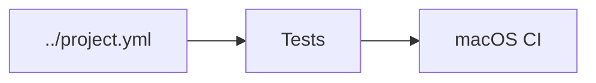

| File | What | Status |
|---|---|---|
| [VoiceRemoteTests.swift](VoiceRemoteTests.swift) | Hosted product-name unit test, run by the VoiceRemote scheme. | 🟡 macOS test unverified |

Start with the linked file; see the [iOS map](../README.md) for design and validation.
