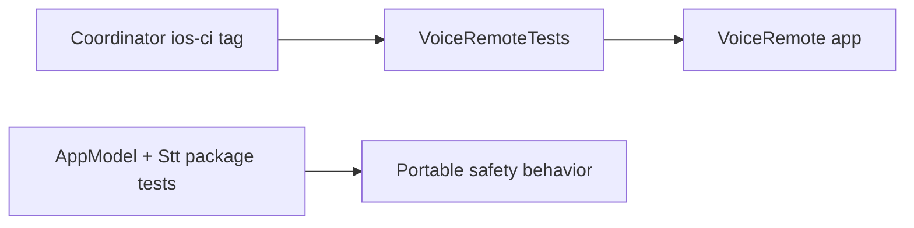

| File | What | Status |
|---|---|---|
| [VoiceRemoteTests.swift](VoiceRemoteTests.swift) | Hosted product-name check; app model test evidence lives in its plain package | 🟡 Apple CI **unverified** |

Start with [AppModel tests](../Packages/AppModel/Tests/README.md); coordinator runs `ios-ci-*`
for SDK compilation. Purpose: task 6 validation map; inputs: app/portable package contracts;
verification: portable Linux tests only. REQ-2/4/5/7/28/29; microphone/approval UI **unverified**.
