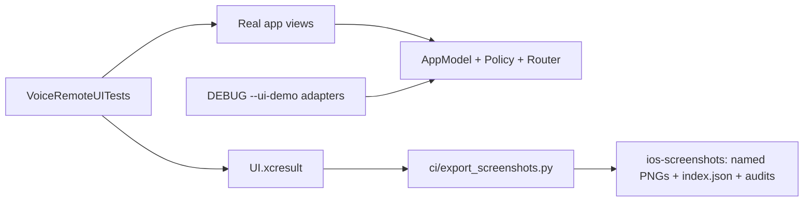

| File / output | What | Status |
|---|---|---|
| [VoiceRemoteUITests.swift](VoiceRemoteUITests.swift) | Light-only flow assertions, largest Dynamic Type main screens, named screenshots and accessibility inventory | 🟡 Apple compile/simulator **unverified** |
| [DemoAdapterProbe.swift](DemoAdapterProbe.swift) | Linux-only real-model/Policy smoke probe using the exact app demo adapters; excluded from Xcode target | ✅ Synthetic Linux probe; UI **unverified** |
| `ios-screenshots` artifact | `gallery__light__default__home.png` and other labelled PNGs; `index.json` maps files/tests and contains every audit finding | 🟡 Await coordinator `ios-ui-*` run |
| `ios-ui-results` artifact | Full xcresult, including failure diagnostics and XCTest audit attachments | 🟡 Await coordinator run |

Start with `VoiceRemoteUITests.swift` and the [demo adapters](../App/UIDemo.swift).
Inputs: existing app flows and portable contracts. Trace: REQ-3–5/8/16–18/22–25/28–35/56/60.
No new product requirements or device-performance claims.

| Walk | Assertions / review images |
|---|---|
| Startup recovery | Synthetic storage failure shows the real blocked recovery screen; unavailable copy retains the block |
| First run / permissions | Explicit consent; disabled recording; microphone/speech, camera and Bluetooth denied states |
| Home / destination | Real HOLD gesture; destination exists before capture/first text; Auto/iPhone/computer selection; mode/capture switches |
| Stop | Idle, preparing, listening, finishing, failed and interrupted; OFF/HOLD/CONTINUOUS; no unfinished history commits |
| Devices | Paste synthetic invitation through the system menu; compare four words; confirm then revoke |
| History | Held and unconfirmed text; explicit resend stays visibly unconfirmed |
| Suggestions / Policy | Connected/offline sessions, real scoped grant/revoke, tier 3 exact preview, fake biometric success/refusal, task delivery/completion review/cancel |
| Settings / recorder | Cloud consent off/on/off; withdrawal stops capture; synthetic-only recorder prompt and completion |

Screenshots and audits run in light mode; routine CI omits dark to avoid repeating all interactions/audits. The five tabs plus Settings,
destination picker and approval also run at `.accessibility5`; the debug instrumentation is behind a small disclosure and scales normally. The audit uses Apple's
[`performAccessibilityAudit`](https://developer.apple.com/documentation/xcuiautomation/xcuiapplication/performaccessibilityaudit(for:_:))
with **report-only** issue handling: every issue is retained, no finding is waived,
and no accessibility pass is claimed. Audit infrastructure errors fail the test.
System share/Files sheets, actual audit restoration, OS permission prompts and hardware
acceptance are **unverified**; synthetic adapters do not prove those integrations.

CI uses the separate `VoiceRemoteUI` Debug scheme, unsigned, serial tests and at
most four build jobs. Only `ios-ui-*` tags and manual dispatch run the gallery.
The owner reviews the artifact; this worker does not trigger CI or publish images.

Fault arguments (all require `--ui-demo` and DEBUG): `--ui-first-run`,
`--ui-permission-denied`, `--ui-biometric-refuse`, `--ui-slow-prepare`,
`--ui-slow-finish`, `--ui-capture-failure`, `--ui-interrupt`, `--ui-storage-denied`.
Presentation: `--ui-dark`, `--ui-largest`. Slow adapters await cancellation; they
cannot emit late text after Stop. No network, BLE or LocalAuthentication prompt
is required for these synthetic paths.

Revamp coverage: native segmented Capture/Mode; one primary control per state;
Home gear → Settings; separate Agents tab; invitation/confirmation pairing sheet;
keyboard dismissal and visible four words; History More menu; Phone details and
help sheets. All toggles under test use the native child switch or its trailing
edge, with native value assertions; segmented selection uses `isSelected`, not its empty `value`. Consent also asserts real/saved model state; its
binding is unchanged. OFF cancels every state; Preparing keeps a disabled talk control/spinner and a separate Stop; Finish is only available while recording. Stop also cancels finishing.

`testTalkStateGallery` covers holding, live transcript, continuous, finishing,
Off and Hold-ready in light/default/AX5. Holding preview uses the DEBUG
`--ui-holding-preview` argument through the same phone press handler; the real
hold gesture is tested separately. `--ui-reduce-transparency` previews the custom
Hold control’s opaque fallback; it does **not** set the OS preference (read-only
SwiftUI environment). Native bar preference handling, VoiceOver and motion/haptics
remain **unverified**. Normal demo launches no longer pin Dynamic Type. The forced
AX5 fixture can still produce audit “unsupported font size” findings; no findings
are suppressed. [First-run audit triage](../../../AI/SW/2026-11-04-liquid-glass-research.md#first-run-audit-triage).

UI2 fixes: diagnostics use separately identified expansion buttons; identifiers no
longer replace descendant labels. Tests explicitly expand, scroll and wait for
real/saved consent and destination ordering. The seed capture resets its ordering
flag so a later assertion must observe a new capture. Header waits first bring
Home’s heading into view after Finish. No fixed animation delays are used.

Flows and Stop fault states are separate XCTest cases. Independent default/AX5
main-screen inventories preserve the other tabs after layout assertion failures;
screenshots precede layout assertions and failure helpers attach extra snapshots.
AX5 includes lower controls on every tab, pairing words/confirmation, approval
and recorder. Home geometry assertions reject intersecting controls. Debug AX5 is
applied at sheet roots, too. The Linux adapter probe now exercises all five Stop
faults in addition to real Policy approval/refusal. Updated Apple execution and
accessibility acceptance remain **unverified** pending the coordinator’s run.
