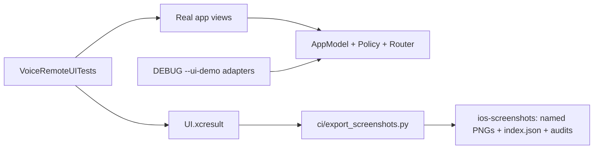

| File / output | What | Status |
|---|---|---|
| [VoiceRemoteUITests.swift](VoiceRemoteUITests.swift) | Light/dark flow assertions, largest Dynamic Type main screens, named screenshots and accessibility inventory | 🟡 Apple compile/simulator **unverified** |
| [DemoAdapterProbe.swift](DemoAdapterProbe.swift) | Linux-only real-model/Policy smoke probe using the exact app demo adapters; excluded from Xcode target | ✅ Synthetic Linux probe; UI **unverified** |
| `ios-screenshots` artifact | `gallery__light__default__home.png` and other labelled PNGs; `index.json` maps files/tests and contains every audit finding | 🟡 Await coordinator `ios-ui-*` run |
| `ios-ui-results` artifact | Full xcresult, including failure diagnostics and XCTest audit attachments | 🟡 Await coordinator run |

Start with `VoiceRemoteUITests.swift` and the [demo adapters](../App/UIDemo.swift).
Inputs: existing app flows and portable contracts. Trace: REQ-3–5/8/16–18/22–25/28–35/56/60.
No new product requirements or device-performance claims.

| Walk | Assertions / review images |
|---|---|
| Startup recovery | Synthetic storage failure shows the real blocked recovery screen; unavailable copy retains the block |
| First run / permissions | Explicit consent; disabled recording; microphone/speech, camera and Bluetooth denied states |
| Home / destination | Real HOLD gesture; destination exists before capture/first text; Auto/iPhone/computer selection; mode/capture switches |
| Stop | Idle, preparing, listening, finishing, failed and interrupted; OFF/HOLD/CONTINUOUS; no unfinished history commits |
| Devices | Paste synthetic invitation through the system menu; compare four words; confirm then revoke |
| History | Held and unconfirmed text; explicit resend stays visibly unconfirmed |
| Suggestions / Policy | Connected/offline sessions, real scoped grant/revoke, tier 3 exact preview, fake biometric success/refusal, task delivery/completion review/cancel |
| Settings / recorder | Cloud consent off/on/off; withdrawal stops capture; synthetic-only recorder prompt and completion |

Screenshots and audits run for every visited screen in light/dark. The five tabs,
destination picker and approval also run at `.accessibility5`; the small debug
instrumentation panel keeps its own fixed size. The audit uses Apple's
[`performAccessibilityAudit`](https://developer.apple.com/documentation/xcuiautomation/xcuiapplication/performaccessibilityaudit(for:_:))
with **report-only** issue handling: every issue is retained, no finding is waived,
and no accessibility pass is claimed. Audit infrastructure errors fail the test.
System share/Files sheets, actual audit restoration, OS permission prompts and hardware
acceptance are **unverified**; synthetic adapters do not prove those integrations.

CI uses the separate `VoiceRemoteUI` Debug scheme, unsigned, serial tests and at
most four build jobs. Only `ios-ui-*` tags and manual dispatch run the gallery.
The owner reviews the artifact; this worker does not trigger CI or publish images.

Fault arguments (all require `--ui-demo` and DEBUG): `--ui-first-run`,
`--ui-permission-denied`, `--ui-biometric-refuse`, `--ui-slow-prepare`,
`--ui-slow-finish`, `--ui-capture-failure`, `--ui-interrupt`, `--ui-storage-denied`.
Presentation: `--ui-dark`, `--ui-largest`. Slow adapters await cancellation; they
cannot emit late text after Stop. No network, BLE or LocalAuthentication prompt
is required for these synthetic paths.
