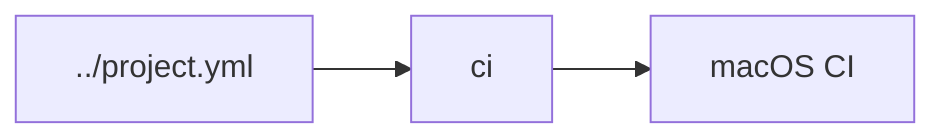

| File | What | Status |
|---|---|---|
| [export_screenshots.py](export_screenshots.py) | xcresulttool + atomic runner checkpoints → named PNGs, index.json, audits and export status; fixtures cover timeout/missing-bundle recovery and deduplication | ✅ Linux fixture tests; Xcode export **unverified** |
| [check_demo_adapters.py](check_demo_adapters.py) | Reproducible Linux smoke probe of exact app demo adapters through real AppModel/Policy/router; run after AppModel tests | ✅ Local synthetic probe; Apple UI **unverified** |
| [test_icon.py](test_icon.py) | PNG headers/pixels/transparency, grayscale tinted appearance and native catalog references | ✅ Linux fixture tests; Apple icon rendering **unverified** |
| [checks.py](checks.py) | iOS/desktop version guards, accepted-main ancestry check and compatible available iPhone selection; test_checks.py exercises rejection and selection. | ✅ Linux tested |

Start with the linked file; see the [iOS map](../README.md) for design and validation.

Release tags require accepted `origin/main` ancestry; `ios-ci-*` and
`desktop-ci-*` branch checks skip that release-only gate. Guard tests use disposable
local git history, mismatched tags/bundles and missing commits/main references.

```sh
python3 -m unittest discover -s SW/ios/ci -p 'test_*.py'
# Linux, after swift test --package-path SW/ios/Packages/AppModel:
HEAVY_CPUS=4 heavy python3 SW/ios/ci/check_demo_adapters.py
# macOS, after the VoiceRemoteUI test scheme:
python3 SW/ios/ci/export_screenshots.py SW/ios/build/UI.xcresult SW/ios/build/ios-screenshots
```

The `ios-screenshots` artifact has named PNGs, all per-screen audit JSONs and an
`index.json` mapping labels to test names/files and findings. Empty/malformed
exports fail. Partial galleries can accompany test failures: check the job and
`ios-ui-results` bundle. Audits inventory existing issues; they do not waive them
or establish accessibility acceptance. Actual simulator/export **unverified**.

Routine UI CI is light-only, default and largest Dynamic Type; sharing a test
session does not eliminate dark-flow/audit repetition. The Linux demo probe also
walks all five Stop fault states and rejects late/unfinished history. The source
guard rejects dark launch arguments in the routine suite. Apple UI results remain
**unverified** until the coordinator runs the updated suite.

UI compilation uses unsigned `build-for-testing` without a shell watchdog. After
building, CI shuts down the selected simulator if needed, erases it, boots it and
waits for `bootstatus -b` (a separate three-minute step limit). Both Xcode actions
use the same simulator ID and DerivedData. Only `test-without-building` runs under
GNU `gtimeout` (600 s, SIGINT, SIGKILL after 20 s), with XCTest timeouts enabled and
90 s default/maximum per test. Ten minutes allows headroom over the expected
five-to-eight-minute test walk; that timing remains **unverified**.
Build/module/source-package caches are restored and saved even after test failure;
compiler indexing is disabled. The job retains its 30-minute outer ceiling; an
outer job cancellation can still prevent recovery. The **target** is under 12
minutes including export; cold-build and new UI timing remain **unverified**.
Time limits are failures, never a successful acceptance run.

Each screenshot/audit is also written atomically to the UITest runner's
`Documents/ios-ui-checkpoints`, with per-file metadata. The always-run export gets
that container using `simctl`; its 45-second xcresulttool call falls back to these
checkpoints when `Info.plist` is missing or the tool times out. Identical label/data
pairs are deduplicated. `export-status.json` records bundle problems; an interrupted
run can export PNGs before its first audit. No artifacts are represented as a pass.
Both artifact uploads always run, with PNG recompression disabled. A blank gallery
still fails after writing its index/status, making the failure reviewable.
