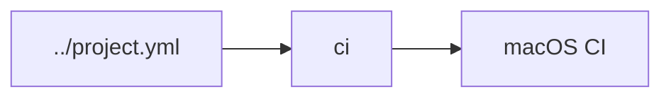

| File | What | Status |
|---|---|---|
| [checks.py](checks.py) | iOS/desktop version guards, accepted-main ancestry check and compatible available iPhone selection; test_checks.py exercises rejection and selection. | ✅ Linux tested |

Start with the linked file; see the [iOS map](../README.md) for design and validation.

Release tags require accepted `origin/main` ancestry; `ios-ci-*` and
`desktop-ci-*` branch checks skip that release-only gate. Guard tests use disposable
local git history, mismatched tags/bundles and missing commits/main references.
