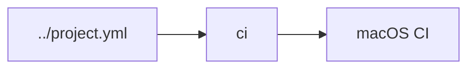

| File | What | Status |
|---|---|---|
| [export_screenshots.py](export_screenshots.py) | xcresulttool attachment export → labelled PNGs, index.json and every accessibility finding; test_ui_gallery.py covers naming, collisions, malformed input, release isolation and job configuration | ✅ Linux fixture tests; Xcode export **unverified** |
| [check_demo_adapters.py](check_demo_adapters.py) | Reproducible Linux smoke probe of exact app demo adapters through real AppModel/Policy/router; run after AppModel tests | ✅ Local synthetic probe; Apple UI **unverified** |
| [checks.py](checks.py) | iOS/desktop version guards, accepted-main ancestry check and compatible available iPhone selection; test_checks.py exercises rejection and selection. | ✅ Linux tested |

Start with the linked file; see the [iOS map](../README.md) for design and validation.

Release tags require accepted `origin/main` ancestry; `ios-ci-*` and
`desktop-ci-*` branch checks skip that release-only gate. Guard tests use disposable
local git history, mismatched tags/bundles and missing commits/main references.

```sh
python3 -m unittest discover -s SW/ios/ci -p 'test_*.py'
# Linux, after swift test --package-path SW/ios/Packages/AppModel:
HEAVY_CPUS=4 heavy python3 SW/ios/ci/check_demo_adapters.py
# macOS, after the VoiceRemoteUI test scheme:
python3 SW/ios/ci/export_screenshots.py SW/ios/build/UI.xcresult SW/ios/build/ios-screenshots
```

The `ios-screenshots` artifact has named PNGs, all per-screen audit JSONs and an
`index.json` mapping labels to test names/files and findings. Empty/malformed
exports fail. Partial galleries can accompany test failures: check the job and
`ios-ui-results` bundle. Audits inventory existing issues; they do not waive them
or establish accessibility acceptance. Actual simulator/export **unverified**.
