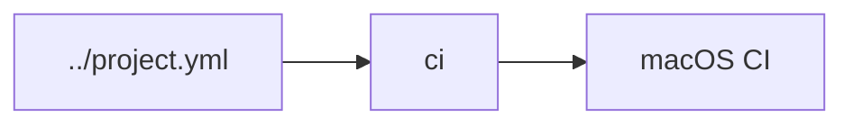

| File | What | Status |
|---|---|---|
| [checks.py](checks.py) | Version guard and compatible available iPhone selection; test_checks.py exercises rejection and selection. | ✅ Linux tested |

Start with the linked file; see the [iOS map](../README.md) for design and validation.
