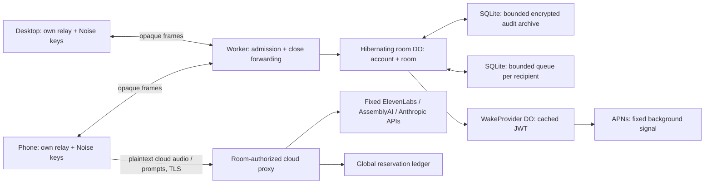

| File / folder | What it is | Status |
|---|---|---|
| [src/](src/README.md) | Enrollment, hibernating sockets, per-device queues, APNs | ✅ local runtime |
| [test/](test/README.md) | Real room/socket regressions and security mutations | ✅ |
| [relay-join.md](../../SYS/protocol/relay-join.md) | First-pair/client signing contract and transport limits | ✅ implemented; client pairing unverified |
| [audit-archive.md](../../SYS/protocol/audit-archive.md) | Phone-writer ciphertext archive, signed rollover/handoff, TTL and per-room limits, recovery checkpoints and stale-frame reconciliation | ✅ local tests; phone adapters unverified |
| [SECURITY.md](SECURITY.md) | Trust, storage, cloud endpoint/auth contract and spend configuration | ✅ synthetic tests; live vendors unverified |
| [ci/](ci/README.md) / [relay.yml](../../.github/workflows/relay.yml) | Daily/tag/manual CI; version, credential and main-ancestry deployment guards | ✅ local guards; hosted run unverified |
| [wrangler.jsonc](wrangler.jsonc) | Room, Admission, WakeProvider and CloudBudget SQLite bindings/migrations | ✅ dry-run configuration |
| [package.json](package.json), [package-lock.json](package-lock.json), [tsconfig.json](tsconfig.json), [vitest.config.ts](vitest.config.ts) | Pinned tooling; strict TypeScript; ≤4 parallel workers | ✅ |

Start: `npm ci --prefix SW/relay --ignore-scripts`, then
`npm --prefix SW/relay test`. Negative checks:
`npm --prefix SW/relay run test:mutations`. Use `heavy` for builds/tests on the
owner machine. `npm --prefix SW/relay run dev` starts the local Worker;
`npm --prefix SW/relay run build` only bundles. In the sandbox, set
`XDG_CONFIG_HOME` and `WRANGLER_LOG_PATH` inside `SW/relay/.wrangler/`.

Owner supplies before deployment:

- Cloudflare account/Worker route/domain; CI `CLOUDFLARE_ACCOUNT_ID` and
  `CLOUDFLARE_API_TOKEN` secrets with Worker/DO deployment access.
- Optional Worker `RELAY_PROVISION_SECRET` (≥32 random characters). If unset,
  self-signed creation is open with IPv4/IPv6-/64 rate limits; if set, trusted
  creation tooling also supplies its bearer. No sign-up is implemented.
- Optional Worker `APNS_TEAM_ID`, `APNS_KEY_ID`, `APNS_PRIVATE_KEY` (PKCS#8 P-256
  PEM), `APNS_TOPIC`, plus a push-enabled app/device registration. Partial/absent
  secrets disable wake. One DO persists each provider JWT for 50 minutes across
  wakes/hibernation; the private key stays in env. This fits
  [Apple's provider-token refresh limits](https://developer.apple.com/documentation/usernotifications/establishing-a-token-based-connection-to-apns).
- Endpoint Noise XX, QR scanning/phrase confirmation and device keys using
  [the client contract](../../SYS/protocol/relay-join.md). The phone supplies its
  own relay key at redemption; the desktop needs no phone identity beforehand.
- A `relay-v` tag matching the package version whose commit is an ancestor of
  `origin/main`; the workflow refuses tags outside accepted main history.

APNs transport: [Cloudflare's fetch docs](https://developers.cloudflare.com/workers/runtime-apis/fetch/)
provide no way to require/inspect outbound HTTP/2. Its
[HTTP/2-to-origin docs](https://developers.cloudflare.com/speed/optimization/protocol/http2-to-origin/)
describe edge ALPN negotiation, not a per-fetch guarantee. A
[workerd maintainer](https://github.com/cloudflare/workerd/issues/4841) confirms
local workerd lacks HTTP/2 and production uses the Cloudflare proxy stack.
**Local direct APNs is unsupported; production APNs negotiation/wake is unverified.**
For local or guaranteed HTTP/2, use an owner-controlled authenticated gateway
with an explicit Node `http2`/nginx HTTP/2 upstream, receiving only the fixed wake
signal and device registration. No gateway is built here.

Cloud proxy: `GET .../proxy/elevenlabs`, `GET .../proxy/assemblyai` (WebSocket)
and `POST .../proxy/anthropic` (Messages), for current room members using the same
Ed25519 challenge flow. Cloud access requires configured trusted provisioning,
a room created through it, paired redemption, and two current members. See [SECURITY.md](SECURITY.md#cloud-proxy-contract) for
canonical query signing and headers, fixed destinations, caps and client integration changes.
Worker secrets `ANTHROPIC_API_KEY`, `ELEVENLABS_API_KEY`, `ASSEMBLYAI_API_KEY` stay
off the phone. Missing keys disable their provider; checked-in zero policy vars
disable all cloud calls. Limits/reservation prices are **TBC** before deployment.

**Room frames remain ciphertext-only. Cloud proxy audio, vocabulary, transcripts,
and prompts are plaintext to the Worker and selected vendor by design**, over TLS;
the proxy does not log or store them. **The app must show when cloud is in use**
(REQ-56/58); app integration/indicator and provider retention are **unverified**.
The Worker never approves or executes model output. Synthetic fake-upstream tests
cover authentication, revocation, forwarding, secret/content containment and caps;
live vendor access and billing calibration remain **unverified**.

Trace: REQ-9/11, REQ-22–26, REQ-37, REQ-56/58, REQ-61. **Real-network test across two networks: unverified until
deployed.** Actual client Noise/phone wake, delivery latency and hosted CI remain
**unverified**. No deployment performed.
