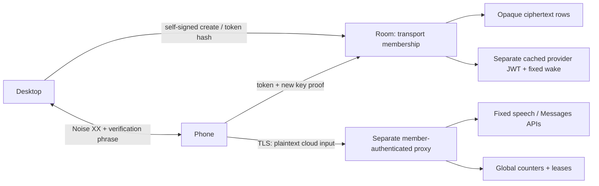

# Relay boundary

Exact requests, signing bytes, enrollment, expiry and limits:
[SYS/protocol/relay-join.md](../../SYS/protocol/relay-join.md).

| Boundary | Enforcement / evidence |
|---|---|
| First pair | Creator proves its Ed25519 key; optional env provisioning bearer. Desktop registers its own token hash/deadline without knowing phone identity. Phone supplies a new key/proof; binding and one-use consumption are serialized and persisted. |
| Trust | Relay signing keys are separate from Noise static keys. Membership proves transport access, not human identity or product authority. Noise XX, QR Noise-key checking and phrase confirmation remain endpoint responsibilities. |
| Tenants | DO name binds account + fresh random 128-bit room ID. Account is a pre-sign-up namespace, not proof of a human account. |
| Expiry | SQLite deadlines survive hibernation; trusted-clock high-water rejects observed rollback. Never-paired rooms are deleted at the last invite deadline (creation + two minutes before any invite). |
| Revoke | Any signed member can remove another. Atomically remove membership, key/wake registration, issued invites/challenges and queued frames sent by/to it. Per-frame membership/generation checks remain independent of socket closure. Ingress forwards closes for silent sockets too. |
| Ciphertext | Schema-closed RelayFrame variants reject outer text/transcript/inner-payload fields before forwarding/storage. Endpoints must encrypt; arbitrary client bytes cannot be distinguished from encryption by the relay. |
| Privacy evidence | AES-GCM interoperability proves opaque forwarding and endpoint decryption, not absence of plaintext by itself. Separate schema injection tests inspect all room KV/SQL rows/logs. Tests fail when closed-field validation or payload-safe logging is removed. |
| Logging | Only fixed event names and numeric count/bytes. No IDs, bodies, ciphertext bytes, push tokens, headers or exception text. Wrangler observability is disabled. |
| Stored metadata | IDs, public signing keys, generations, invite hashes/deadlines, temporary challenges, APNs registration/environment, sizes/times and overflow counters. A separate singleton WakeProvider stores its short-lived bearer JWT and credential fingerprint; no private key/content enters that cache. |
| Queue | SQLite rows bounded per offline recipient. Overflow drops only its oldest frames and persists a reconnect drop count. Other queues/live delivery continue; sender stays connected. TTL is enforced on access/alarms. |
| Delivery | Send/replay has no application acknowledgment. Crash/reconnect races may lose/duplicate frames; endpoints retry/deduplicate. Relay delivery is not task execution. Previously delivered/in-flight data cannot be recalled. |
| Admission | Creation uses IPv4/IPv6-/64 buckets. Failed-token buckets are per source/room, charged after mismatch. Valid tokens bypass exhausted failure buckets. Challenge allocation requires key possession and per-device slots. |
| Hibernation | acceptWebSocket, serialized attachments and getWebSockets; no RAM-only membership/deadline registry. Actual eviction tests redeem tokens and exchange frames. |
| APNs | Optional env secrets; fixed background payload only; singleton cache reuses JWTs for 50 minutes across eviction. Errors become count-only metrics. HTTP/2 limitations/alternative are in [README.md](README.md). |
| Providers | Separate cloud routes in services.ts reuse room authentication. Cloud content is plaintext to the Worker/vendor by design; room RelayFrame validation/storage remains ciphertext-only. No policy/execution authority is granted by the proxy. |
| Cloud privacy | No content logging, caching, queues or persistence on the proxy path. Fixed errors and close reasons; no upstream headers/errors forwarded. Body/query hashes only in short-lived challenges. The app must show when cloud is in use (REQ-56/58). Provider-side retention is a separate release review; no zero-retention claim is made. |
| Cloud revoke | Current member/generation checked at authorization, after reservation/upstream handshake and on every speech frame. Revoke aborts HTTP and closes both ends of live streams, including silent streams. Bytes already sent cannot be recalled. |
| Cloud spend | Singleton durable ledger reserves full worst-case cost before any upstream attempt; no refunds, even on failure. Global and signing-key-based device counters span rooms/accounts. Timed leases cap concurrent requests/streams. Monetary calibration remains **TBC/unverified**. |

Run `npm --prefix SW/relay test` and
`npm --prefix SW/relay run test:mutations`. The latter requires five assertion
failures when membership, generation, queue purge, plaintext-field rejection or
payload-safe logging are removed in test bundles; production files are untouched.
All fixtures are synthetic. Real network deployment, endpoint Noise/pairing and
fragmentation, phone wake, hosted CI and performance remain **unverified**.

Sources: [wire contract](../../SYS/protocol/wire-contract.md),
[DO storage](https://developers.cloudflare.com/durable-objects/api/sqlite-storage-api/),
[hibernating sockets](https://developers.cloudflare.com/durable-objects/best-practices/websockets/),
[Apple provider tokens](https://developer.apple.com/documentation/usernotifications/establishing-a-token-based-connection-to-apns).

## Cloud proxy contract

The authoritative signing/challenge/header contract is
[SYS/protocol/relay-join.md](../../SYS/protocol/relay-join.md#cloud-proxy-signing-and-admission).
Base: `/v1/accounts/{account}/rooms/{room}`. Cloud operations use the existing
one-use Ed25519 challenge flow. Messages hash the exact UTF-8 body. Speech hashes
`?` plus the ordered `URLSearchParams.toString()` form serialization (or empty
string for no pairs), **not raw URL bytes**. Preserve pair order/repeated keys;
percent-encode UTF-8 except ASCII alphanumerics and `*-._`, encode spaces as `+`,
and use uppercase `%HH`. Raw apostrophes and `%27` sign identically. The shared
contract includes a Swift algorithm and digest vector. No query vocabulary is
stored in challenges; only its digest is retained.

| Route | Fixed destination / accepted input |
|---|---|
| `GET /proxy/elevenlabs` | `https://api.elevenlabs.io/v1/speech-to-text/realtime` with Worker-only `xi-api-key`. Required single query values: `model_id=scribe_v2_realtime`, `audio_format=pcm_16000`, `commit_strategy=manual`; optional repeated `keyterms` (≤100; ≤256 UTF-8 bytes each). Text audio-chunk messages only, matching CloudEngine: `message_type=input_audio_chunk`, `audio_base_64`, `sample_rate=16000`, boolean `commit`. |
| `GET /proxy/assemblyai` | `https://streaming.assemblyai.com/v3/ws` with Worker-only `Authorization`. Required: `speech_model=universal-3-5-pro`, `sample_rate=16000`, `encoding=pcm_s16le`, `include_partial_turns=true`; optional single `keyterms_prompt` JSON string array (same term bounds). Even-length binary PCM16 and text `{"type":"Terminate"}` only. No configuration/LLM gateway controls. |
| `POST /proxy/anthropic` | `https://api.anthropic.com/v1/messages` with Worker-only `x-api-key`, fixed configured model/API version. `application/json`, matching `anthropic-version`. Only `model`, `max_tokens`, string `system`, string-content `messages`, client `tools` (`name`, `description`, `input_schema`) and auto `tool_choice`. No streaming flag, images, URLs as media, server tools, caching or beta headers. Validated JSON is reserialized to prevent duplicate-key parser disagreement. Returns bounded nonstreaming Messages JSON, as ClaudeBrain expects. |

Client-supplied destinations, extra paths/query options, alternate models and
redirects are refused. Client headers are never copied upstream. Vendor errors
and redirects become `502 upstream_failed`; vendor response headers/close reasons
are discarded. Known provider-key markers in successful frames/bodies also cause
failure. Invalid proof/non-member/revoked device or cloud-ineligible room: 403. Missing key: 503
`provider_not_configured`; absent/invalid/zero limits: 503 `cloud_not_configured`.
Caps return 429 `budget_exceeded` or `concurrency_exceeded`; oversized input 413,
oversized speech frames/session 1009. Errors are content-free `no-store` JSON.

**Client integration needed, without client changes in this worktree:**
`CloudEngine` must use an injected `SttSocketFactory` that obtains/signs a challenge
for the canonical form query of its final URL and sends proof headers using URLRequest; its
current default URL-only factory cannot authenticate. Point ProxySettings at the
provider route. Inject a signing `BrainHTTPTransport` around ClaudeBrain's exact
body, target `/proxy/anthropic`, and align the configured model/version with the
Worker allowlist. Current brain defaults (`claude-opus-5-5`, `2026-10-21`) require
explicit matching deployment vars; availability is **unverified**. The app cloud
indicator and on-device policy gate remain client responsibilities.

## Cloud configuration and spend

All numeric Worker vars are positive decimal integers; zero/unset disables the
relevant feature. Checked-in values are intentionally zero/empty, **TBC**. Keys
are Worker secrets, never vars. Set each enabled feature's reservation amount; features fail closed independently.

| Worker var | Meaning / hard implementation ceiling |
|---|---|
| `CLOUD_DEVICE_DAILY_MICROUSD`, `CLOUD_GLOBAL_DAILY_MICROUSD` | Daily reservation caps in millionths of USD; UTC admission day. Device identity is SHA-256 of its Ed25519 public key, shared across rooms/accounts. |
| `CLOUD_SPEECH_RESERVATION_MICROUSD` | Full worst-case cost per admitted speech attempt, for either vendor under the configured byte/time bounds. |
| `CLOUD_ANTHROPIC_RESERVATION_MICROUSD` | Full worst-case cost of a Messages attempt with the allowlisted model, body and output limits. |
| `CLOUD_DEVICE_CONCURRENT`, `CLOUD_GLOBAL_CONCURRENT` | Concurrent HTTP/stream leases; ceilings 100 / 1,000. |
| `CLOUD_MAX_BODY_BYTES` | POST body and speech query cap; ceiling 1 MiB. Two-second upload read timeout. Upstream headers/body share `CLOUD_MAX_DURATION_MS`. |
| `CLOUD_MAX_FRAME_BYTES`, `CLOUD_MAX_STREAM_BYTES` | Speech frame cap (≤1 MiB) and aggregate both-direction bytes (≤16 MiB). |
| `CLOUD_MAX_DURATION_MS` | Upstream request/stream wall time (≤300,000 ms); expired leases have 5 seconds of teardown grace. |
| `CLOUD_ANTHROPIC_MODEL`, `CLOUD_ANTHROPIC_VERSION` | Exact model and API-version allowlist; no client-selected version/header passthrough. |
| `CLOUD_MAX_OUTPUT_TOKENS` | Messages output bound (2,048–8,192; lower disables Anthropic). Response body is capped at 1 MiB. |

Reservations persist across DO eviction, are serialized across all rooms, and
are never refunded; release frees concurrency only. A new UTC day resets spend
counters while retaining active leases. A request spanning midnight is charged to
its admission day. An observed backward clock fails closed. Ledger storage holds
only hashed public keys, counters, random lease IDs and times; no content/secrets.
Lost cleanup leaves a bounded lease until timeout. Active speech uses ordinary
accepted WebSockets and timers; these objects stay resident during sessions,
unlike hibernating ciphertext room sockets.

**Before enabling, the owner must calibrate reservation upper bounds against
current vendor pricing, billing minimums, body/output tokens, speech bytes sent
faster than real time, wall duration and teardown overhead.** The counters enforce
reserved spend; exact billed-dollar caps are **unverified** until that calibration
and live testing. New key enrollment can acquire a new device allowance; the
global cap remains the final backstop. **Cloud endpoints fail closed with 503
unless `RELAY_PROVISION_SECRET` is configured (≥32 characters).** A room also
needs recorded trusted provisioning at creation, completed token redemption,
and at least two current members. An unpaired creator or historically open/
unmarked room cannot spend; recreate legacy rooms through trusted provisioning
and pair again. If membership drops below two, all remaining cloud streams close.
Open self-signed creation remains available for ciphertext transport only when
provisioning is unset. The phone never receives the provisioning secret.
No vendor call grants action authority or executes tools.

Sources for the upstream seams: [ElevenLabs realtime](https://elevenlabs.io/docs/api-reference/speech-to-text/v-1-speech-to-text-realtime),
[AssemblyAI streaming](https://www.assemblyai.com/docs/streaming/api-spec/streaming-websocket),
[Anthropic Messages](https://platform.claude.com/docs/en/api/messages),
[Cloudflare WebSockets](https://developers.cloudflare.com/workers/examples/websockets/).
Both adapters explicitly use `binaryType=arraybuffer` before accepting sockets,
preserving PCM under the [current binary-message default](https://developers.cloudflare.com/changelog/post/2026-04-21-websocket-standard-binary-type/).
Tests: [services.test.ts](test/services.test.ts); all content and key markers are
synthetic. Live compatibility, billing and end-to-end app behavior are **unverified**.
