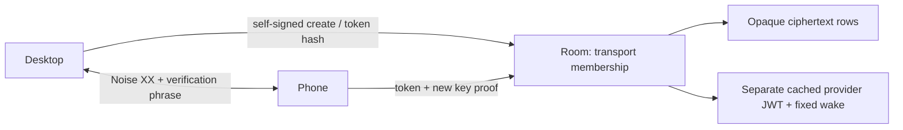

# Relay boundary

Exact requests, signing bytes, enrollment, expiry and limits:
[SYS/protocol/relay-join.md](../../SYS/protocol/relay-join.md).

| Boundary | Enforcement / evidence |
|---|---|
| First pair | Creator proves its Ed25519 key; optional env provisioning bearer. Desktop registers its own token hash/deadline without knowing phone identity. Phone supplies a new key/proof; binding and one-use consumption are serialized and persisted. |
| Trust | Relay signing keys are separate from Noise static keys. Membership proves transport access, not human identity or product authority. Noise XX, QR Noise-key checking and phrase confirmation remain endpoint responsibilities. |
| Tenants | DO name binds account + fresh random 128-bit room ID. Account is a pre-sign-up namespace, not proof of a human account. |
| Expiry | SQLite deadlines survive hibernation; trusted-clock high-water rejects observed rollback. Never-paired rooms are deleted at the last invite deadline (creation + two minutes before any invite). |
| Revoke | Any signed member can remove another. Atomically remove membership, key/wake registration, issued invites/challenges and queued frames sent by/to it. Per-frame membership/generation checks remain independent of socket closure. Ingress forwards closes for silent sockets too. |
| Ciphertext | Schema-closed RelayFrame variants reject outer text/transcript/inner-payload fields before forwarding/storage. Endpoints must encrypt; arbitrary client bytes cannot be distinguished from encryption by the relay. |
| Privacy evidence | AES-GCM interoperability proves opaque forwarding and endpoint decryption, not absence of plaintext by itself. Separate schema injection tests inspect all room KV/SQL rows/logs. Tests fail when closed-field validation or payload-safe logging is removed. |
| Logging | Only fixed event names and numeric count/bytes. No IDs, bodies, ciphertext bytes, push tokens, headers or exception text. Wrangler observability is disabled. |
| Stored metadata | IDs, public signing keys, generations, invite hashes/deadlines, temporary challenges, APNs registration/environment, sizes/times and overflow counters. A separate singleton WakeProvider stores its short-lived bearer JWT and credential fingerprint; no private key/content enters that cache. |
| Queue | SQLite rows bounded per offline recipient. Overflow drops only its oldest frames and persists a reconnect drop count. Other queues/live delivery continue; sender stays connected. TTL is enforced on access/alarms. |
| Delivery | Send/replay has no application acknowledgment. Crash/reconnect races may lose/duplicate frames; endpoints retry/deduplicate. Relay delivery is not task execution. Previously delivered/in-flight data cannot be recalled. |
| Admission | Creation uses IPv4/IPv6-/64 buckets. Failed-token buckets are per source/room, charged after mismatch. Valid tokens bypass exhausted failure buckets. Challenge allocation requires key possession and per-device slots. |
| Hibernation | acceptWebSocket, serialized attachments and getWebSockets; no RAM-only membership/deadline registry. Actual eviction tests redeem tokens and exchange frames. |
| APNs | Optional env secrets; fixed background payload only; singleton cache reuses JWTs for 50 minutes across eviction. Errors become count-only metrics. HTTP/2 limitations/alternative are in [README.md](README.md). |
| Providers | services.ts remains an unimplemented separate seam. No STT/LLM call or policy/execution authority is wired into rooms. |

Run `npm --prefix SW/relay test` and
`npm --prefix SW/relay run test:mutations`. The latter requires five assertion
failures when membership, generation, queue purge, plaintext-field rejection or
payload-safe logging are removed in test bundles; production files are untouched.
All fixtures are synthetic. Real network deployment, endpoint Noise/pairing and
fragmentation, phone wake, hosted CI and performance remain **unverified**.

Sources: [wire contract](../../SYS/protocol/wire-contract.md),
[DO storage](https://developers.cloudflare.com/durable-objects/api/sqlite-storage-api/),
[hibernating sockets](https://developers.cloudflare.com/durable-objects/best-practices/websockets/),
[Apple provider tokens](https://developer.apple.com/documentation/usernotifications/establishing-a-token-based-connection-to-apns).
