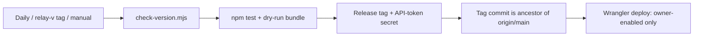

| File | What it is | Status |
|---|---|---|
| [check-version.mjs](check-version.mjs) | Release tag must equal `relay-v` + package version | ✅ unit tested |
| [check-mutations.mjs](check-mutations.mjs) | Five security mutations must fail their invariant assertions | ✅ verified |
| [../../../.github/workflows/relay.yml](../../../.github/workflows/relay.yml) | Daily/tag/manual test workflow; deployment gated on tag and secret | ✅ local guards; hosted run unverified |
| [../test/ci.test.ts](../test/ci.test.ts) | Version/trigger/deployment guard regression checks | ✅ |

Start with `npm --prefix SW/relay run check-version -- relay-v0.1.0` and
[deployment inputs](../README.md). GitHub schedules run from the default branch;
daily coverage starts when this workflow reaches it. No PR or branch-push trigger.
Deploy fetches origin/main with full history and refuses a tag outside its
accepted history. No deployment was performed in this task.
