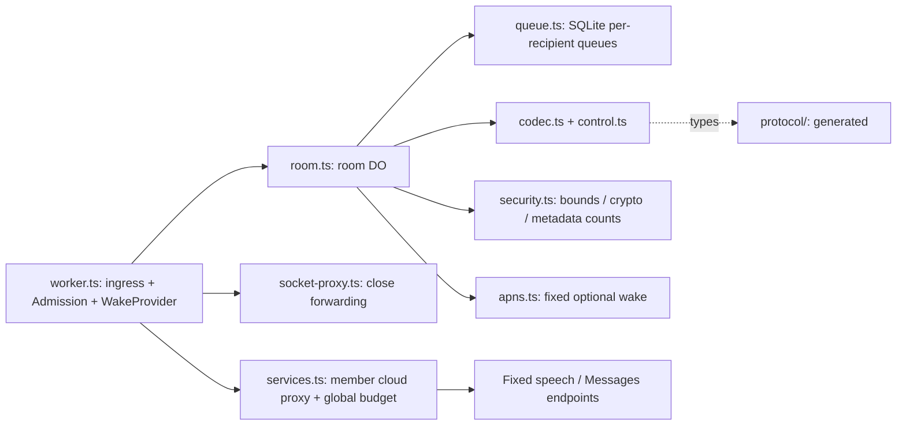

| File / folder | What it is | Status |
|---|---|---|
| [worker.ts](worker.ts) | Routing, optional provisioning, IPv6-/64 admission and persistent APNs signer/cache | ✅ |
| [room.ts](room.ts) | Self-signed creation, persisted enrollment, orphan cleanup, hibernating sockets and revoke | ✅ local runtime |
| [queue.ts](queue.ts) | SQLite rows, per-recipient bounds, oldest eviction and drop counters | ✅ |
| [socket-proxy.ts](socket-proxy.ts) | Bidirectional ingress close forwarding and explicit ArrayBuffer binary delivery, including silent devices | ✅ real network client |
| [security.ts](security.ts) | Input bounds, Ed25519 helpers, hashing and count-only metrics | ✅ |
| [codec.ts](codec.ts), [control.ts](control.ts) | Strict flat transport adapter/control JSON parser | ✅ shared-vector and mutation checks |
| [protocol/](protocol/README.md) | Generated schema types/codecs; unchanged | ✅ |
| [apns.ts](apns.ts) | Optional env credentials, 50-minute provider cache, fixed push and contained failures | ✅ mocked outbound; phone wake unverified |
| [services.ts](services.ts) | Provisioned/paired cloud endpoints, canonical query signing, body/frame/time bounds, revocable sessions and persistent singleton spend/concurrency ledger | ✅ fake upstreams; live use unverified |

Start with [../../../SYS/protocol/relay-join.md](../../../SYS/protocol/relay-join.md) for client signing inputs and transport
semantics. Cloud signing/configuration: [SECURITY.md](../SECURITY.md#cloud-proxy-contract).
Cloud content is plaintext to the Worker by design; room frames stay opaque.
Trace: REQ-9/11, REQ-37, REQ-56/58, REQ-22, REQ-24–26, REQ-61. Run `npm --prefix SW/relay test`.
