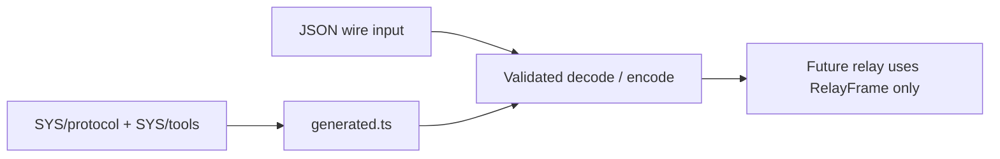

| File | What it is | Status |
|---|---|---|
| [generated.ts](generated.ts) | Generated types, bundled schema, Ajv codec | ✅ Node |

Start with `decode("RelayFrame", json)` / `encode("RelayFrame", value)`.
The relay uses only the outer union; inner types are shared contract artifacts,
not permission to decrypt. TypeScript interfaces alone never validate input.

Run `make -C SYS check`, or install pinned direct dependencies from `SW/relay`
with `npm install --ignore-scripts --no-package-lock` then run `npm test`.
The package typechecks and runs Vitest with at most four workers.
Trace: product §4/§7; `[REQ-n]` is TBD. Room auth, encryption, APNs, and Worker
integration are **unverified** future work.
