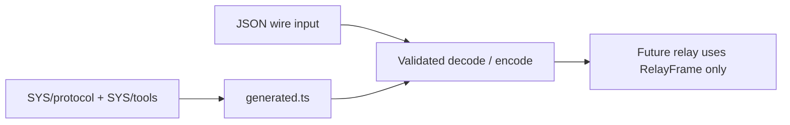

| File | What it is | Status |
|---|---|---|
| [generated.ts](generated.ts) | Generated types, bundled schema, Ajv codec; audit archive block/read/page | ✅ Node |

Start with `decode("RelayFrame", json)` / `encode("RelayFrame", value)`.
The relay uses only the outer union; inner types are shared contract artifacts,
not permission to decrypt. TypeScript interfaces alone never validate input.

Run `make -C SYS check`, or install pinned direct dependencies from `SW/relay`
with `npm install --ignore-scripts --no-package-lock` then run `npm test`.
The package typechecks and runs Vitest with at most four workers.
Trace: product §4/§7; [REQ-59](../../../../SYS/requirements.md#extensibility), [REQ-61](../../../../SYS/requirements.md#extensibility). Room auth, encryption, APNs, and Worker
integration are **unverified** future work.

Strict parsing rejects duplicate keys and invalid Unicode; lexical integer paths feed the private Ajv integer check.

Generated Records now include delivery/readiness/control variants (capture requests require sequence and absolute expiry) and activity-age/listening metadata. Shared-vector tests validate against the original schemas; relay execution and room APIs are unchanged.

Paired agent inventory, exact-session retained-preview dispatch and durable task queries are generated from SYS/protocol. Shared vectors cover the new typed records and reject added authority fields.

Generated TaskStatus now carries dispatched outcomes and bounded app replies; shared vectors distinguish delivery from verified success.
