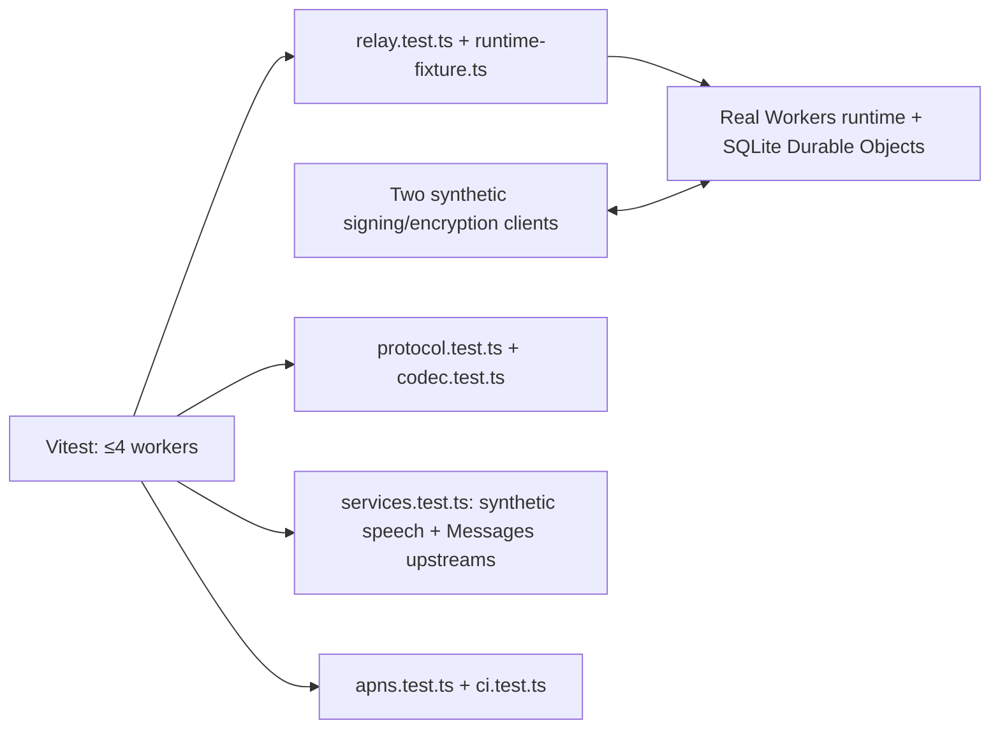

| File | What it verifies | Status |
|---|---|---|
| [relay.test.ts](relay.test.ts) | Encrypted archive member admission, exact retries, eviction, enrollment writer/handoff/rejoin, signed epoch pruning, memberless/TTL cleanup, count/byte caps and nondestructive paging; first pair, eviction-safe deadlines, orphan cleanup, stale membership/generation, actual queue purge, silent closure, per-recipient drops, legal maximum frames, schema-closed payloads and APNs cache eviction | ✅ local runtime + native network socket |
| [services.test.ts](services.test.ts) | Provisioned/pair admission, upstream abort/reader-cancel proofs, normalized query binding, bidirectional speech, Messages, allowlists, missing configuration, secret/content containment, persisted daily budgets and concurrency/body/frame/time caps | ✅ synthetic vendors; live use unverified |
| [runtime-fixture.ts](runtime-fixture.ts) | Test-only subclasses for room/ledger inspection, clock and expiry injection; never the Wrangler entrypoint | ✅ |
| [codec.test.ts](codec.test.ts) | Worker adapter agreement with generated codec, shared vectors and variant/field mutations | ✅ |
| [protocol.test.ts](protocol.test.ts) / [protocol-README.md](protocol-README.md) | Existing generated contract/vector suite | ✅ unchanged |
| [apns.test.ts](apns.test.ts) | Absent/partial/invalid credentials disable or contain wake without sensitive logs | ✅ |
| [ci.test.ts](ci.test.ts) | Negative release version and actual workflow ancestry checks in disposable local git history; trigger scope and deploy secret/tag gates | ✅ local guards; hosted CI unverified |
| [mutations.ts](mutations.ts) / [../ci/check-mutations.mjs](../ci/check-mutations.mjs) | Remove membership, generation, queue purge, closed fields, payload-safe logging or cloud revoke in test bundles; require assertion failures | ✅ five room probes; cloud-revoke assertion probe |

Start with `npm --prefix SW/relay test`. Synthetic keys are generated in memory;
no real keys, audio or transcripts are fixtures. Test expiry injection ages stored
deadlines; the local runtime's clock is not mocked. The hibernation test uses
Miniflare's actual eviction API. Each room uses a unique account; storage
inspection bypasses ingress **only in the test bundle**. Run
`npm --prefix SW/relay run test:mutations` to reproduce the five room negative checks.
`RELAY_TEST_MUTATION=cloud-revoke npm --prefix SW/relay test -- --run test/services.test.ts -t 'revoke cancels the upstream response body immediately'`
requires an assertion failure when the device abort is removed; production files
remain untouched.
The exchange test makes no claim that encrypting its own marker proves relay
privacy; explicit schema rejection and payload-log mutations test that boundary.
Unknown-room join probes also verify that rejected requests create no persistent
application tables; SQL schema initialization follows authenticated creation.

Cloud tests contain synthetic markers only; no real audio, transcripts or keys.
Reservation calibration and live billing remain unverified.

Trace: REQ-9/11, REQ-37, REQ-56/58, REQ-22, REQ-24–26, REQ-61. Two distinct real networks, actual Noise/client
pairing, real APNs phone wake and delivery performance remain **unverified**.
