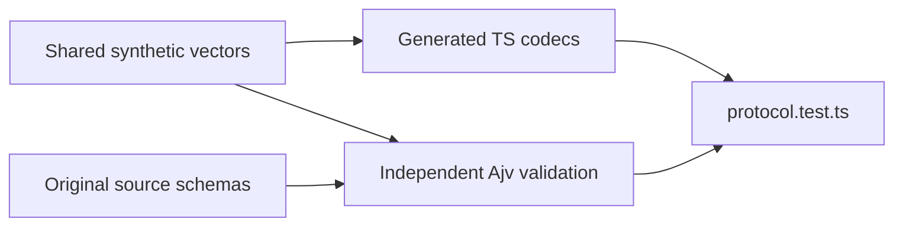

| File | What it is | Status |
|---|---|---|
| [protocol.test.ts](protocol.test.ts) | Shared round trips/rejections, original-schema oracle, TS compile checks | ✅ |

Start with the tests and run `npm test` from `SW/relay` after installation, or
`make -C SYS check` from the repo root. Trace: product §4/§7; [REQ-59](../../../SYS/requirements.md#extensibility), [REQ-61](../../../SYS/requirements.md#extensibility).
This name stays within the task's `test/protocol*` ownership; parent README files
are outside this task's scope.

Raw fixtures test syntax independently of the source-schema Ajv oracle; mutation probes verify control and duplicate guards.
