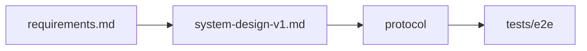

# SYS: ground truth

| File | What | Status |
|---|---|---|
| [product-definition-v0.2.md](product-definition-v0.2.md) | What the product is and its safety rules | ✅ |
| [system-design-v1.md](system-design-v1.md) | Architecture and the 15-task plan | ✅ |
| [requirements.md](requirements.md) | Numbered requirements, decisions, questions and plan traceability | 🟡 Draft, awaiting owner review |
| [hil-safety-review.md](hil-safety-review.md) | Task 15: hworker command boundary, hazards and commissioning gates; [REQ-54–55] | 🟡 Awaiting owner approval. No HIL code may be written until approved. |
| [tests/](tests/README.md) | Real relay/desktop/Swift WebSocket and LAN end-to-end gate | ✅ Linux local |
| [figures/](figures/) | Architecture diagram and remote concept image | ✅ |

