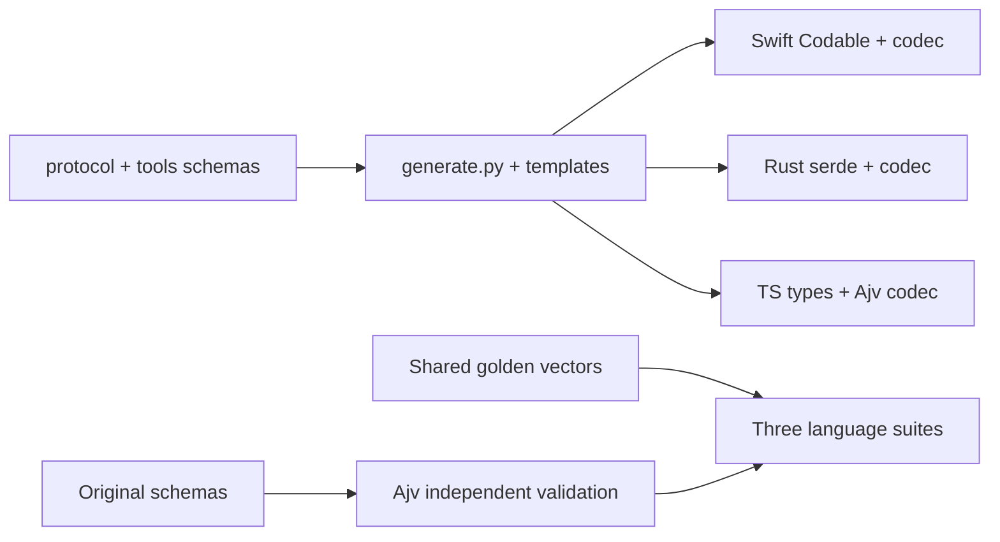

| File / folder | What it is | Status |
|---|---|---|
| [generate.py](generate.py) | Python stdlib generator; deterministic in-memory stale check | ✅ |
| [templates/](templates/) | Runtime validators and wire codecs, emitted beside generated types | ✅ |
| [test_contract.py](test_contract.py) | Transitive authority, relay, dictation, account and stale-output tests | ✅ |
| [dialect.md](dialect.md) | Supported schema subset and maintenance boundaries | ✅ |
| [../Makefile](../Makefile) | Sequential checks, four-worker builds | ✅ Linux |

Start: `make -C SYS generate`, then `make -C SYS check`.
Inputs are the two schema files and templates; no timestamp or machine path is
embedded. `--check` regenerates all three files in memory, compares their exact
bytes, and exits nonzero without overwriting stale files. Tests also deliberately
make an output stale and check rejection/restoration.

Checks use Python 3 stdlib, cargo, Linux Swift/Foundation, Node/npm. Builds run
through `heavy`, four workers maximum, one heavy job at a time even under `make -j`.
TS installs exact direct versions with lifecycle scripts disabled; lockfiles are
outside this task's package scope, so transitive dependency reproducibility is
**unverified**. The Rust recipe removes a newly created workspace lockfile, and
preserves any preexisting one. No production relay implementation is included.

Trace: product §4/§7 and design task 1; `[REQ-n]` is **TBD**. Local contract checks
are evidence for the schema only; see [runtime obligations](../protocol/wire-contract.md).
