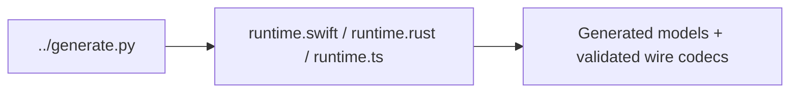

| File | What it is | Status |
|---|---|---|
| [runtime.swift](runtime.swift) | Strict JSON parser, Foundation validator and Codable wire codec | ✅ Linux tested |
| [runtime.rust](runtime.rust) | Strict JSON parser, serde validator and typed wire codec | ✅ Linux tested |
| [runtime.ts](runtime.ts) | Strict JSON parser, lexical integer/Ajv validation and typed wire codec | ✅ Node tested |

Start with [the dialect](../dialect.md); edit here, regenerate, then run
`make -C SYS check`. `@MODELS@` and `@SCHEMA@` are the only substitutions.
Trace: product §4/§7; requirements [REQ-59](../../requirements.md#extensibility) and [REQ-61](../../requirements.md#extensibility).
