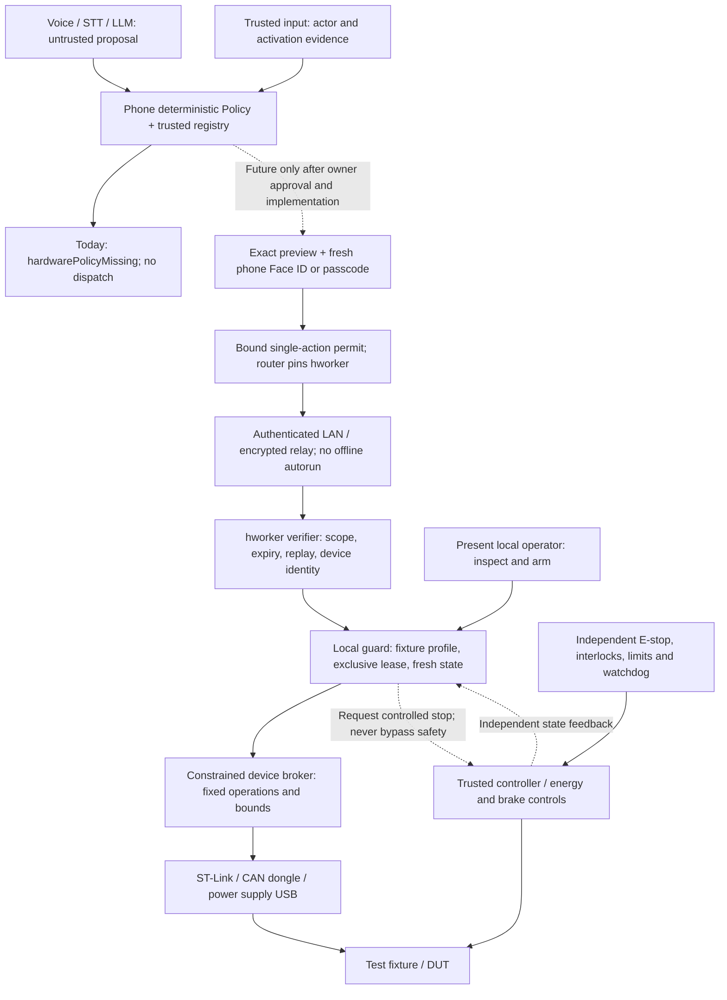

# HIL adapter on hworker — design and safety review

**Awaiting owner approval. No HIL code may be written until approved.**

**Purpose:** Plan task 15, owner review of the proposed hardware-control boundary.  
**Date:** 2026-11-02. **Approval:** owner only; decision, approved revision and date **TBD**.  
**Inputs:** repository sources listed below, task scope (ST-Link, CAN dongle, power supply USB), official standards catalogue summaries.  
**Verification:** repository policy and test source inspected; tests not run for this document-only change. Lab configuration, physical protections and all proposed HIL behavior are **unverified**. This document does not authorize energization or establish requirement compliance.

The dotted future path is a proposal, not a functioning adapter. Safety controls act on the physical system without requiring the phone, network, LLM or hworker process. Their existence and suitability in this lab need evidence.

## Basis and approval boundary

| Source | Review consequence |
|---|---|
| [Product §§4.3, 5.1, 8 and P4](product-definition-v0.2.md) | Hardware commands prepare for separate approval; hworker is the constrained lab destination; physical stopping is independent of job cancellation. |
| [System design: Components and task 15](system-design-v1.md#components) | Same desktop distribution with a HIL adapter; allowlisted commands only; approved written review precedes code. |
| [REQ-54–55](requirements.md#hil) | Primary trace: review gate and independent hardware protections. Neither requirement is proven met by this draft. |
| [REQ-28–36](requirements.md#authorization-and-policy), [REQ-40–43](requirements.md#agents-and-routing) | Trusted authorization, immutable preview, audit, deduplication, cancellation, dependencies and explicit destination. REQ-40 is in the preceding LLM section. |
| [Security model](security-model.md), [Policy README](../SW/ios/Packages/Policy/README.md) | Hardware and unknown destinations deny; software delegation cannot infer whether arbitrary instructions affect hardware. |
| [PolicyGate.build / installGrant](../SW/ios/Packages/Policy/Sources/Policy/PolicyGate.swift), [GateTests.hardwareAndDictationNeverRun](../SW/ios/Packages/Policy/Tests/PolicyTests/GateTests.swift), [registry regression test](../SW/ios/Packages/Policy/Tests/PolicyTests/ReviewRegressionTests.swift) | Source inspection confirms `.hardwarePolicyMissing` for non-software destinations, rejection of hardware grants, and regression coverage in source. No test execution or on-device proof claimed here. |
| Requested `SW/desktop/crates/agents/README.md` | **Absent in this checkout.** [Desktop README](../SW/desktop/README.md) is the available boundary description; [core](../SW/desktop/crates/core/src/lib.rs) defines an empty `AgentAdapter` trait. No implemented agent/HIL execution path is assumed. |

All controls below are **proposed design choices for owner review**, tracing to existing requirements, not new approved requirements. Keep the current hardware denial until a later authorized implementation passes its gates. Owner approval of this revision permits only the implementation scope explicitly recorded; commissioning and each energized run need separate authorization and evidence.

## Candidate allowlist and isolation

Initial scope is one named fixture and one active hardware job on hworker. Actual inventory, identifiers, commands and electrical limits are **TBD**; the operational allowlist remains empty until reviewed. The equipment names come from the task, not a verified lab survey. Operation labels below are conceptual, not new protocol tools.

| Interface | Candidate operations after approval | Bounds and exclusions |
|---|---|---|
| Inventory / status | Identify enrolled instrument and read documented status | Exact instrument/channel/fixture mapping; bounded polling. Even queries need vendor review for side effects and bus loading. No scan of arbitrary connected hardware. |
| ST-Link | Identify target; program and verify a locally staged, owner-approved firmware digest on a physically inhibited fixture | Pin probe and target identity, image digest, address ranges, tool version and reset behavior. Debug attachment, halt, erase, flash and reset are potentially actuating. No user-supplied CLI flags, arbitrary memory writes, option-byte/security changes, or flashing a live motion controller. A digest proves identity, not safe firmware behavior. |
| CAN dongle | Verified listen-only capture of bounded diagnostic metadata; later fixed diagnostic transactions on an isolated test bus | Pin bus, bitrate, node IDs, frame IDs, payload layouts, units, rates and transaction duration. Verify listen-only behavior for the actual dongle. No arbitrary frames, broadcast writes, controller reconfiguration, bridge to a live vehicle/machine, or continuous torque/velocity loop from the PC. |
| Power supply USB | Identify/read channel; select an approved bounded output profile; explicitly enable output; request fixture-specific shutdown | Pin model/serial/channel and wiring; range-check voltage, current, polarity and duration against a local profile. Profile changes with output disabled and safely discharged. Independent limits cannot be raised by this path. No arbitrary SCPI/USB passthrough, recall of unreviewed presets, or automatic output restoration. Output-off is not proof of zero energy or safe motion. |
| Bounded HIL recipe | Execute a reviewed sequence of the above operations with explicit preconditions and terminal state | Bind immutable recipe/version and all steps to the preview; recheck safety before every side effect. No generated scripts, unbounded loops, adaptive model changes or unattended runs. Motion-enabled recipes need a separate fixture-specific review; they are outside the initial allowlist. |
| Cancel / stop request | Cancel a known owned job; invoke its predetermined local stopping procedure | Fixed safety response, never model-generated compensation. Independent E-stop remains available even if software authorization, logging or transport fails. |

**Enforcement proposal:** fixed executable/API operations with typed arguments, explicit units and closed enums; reject missing, non-finite, out-of-range or unknown values. No shell interpolation or free-form command strings. Resolve reviewed artifact digests from protected local storage, not model paths or URLs. Acknowledge actual device effects separately from process exit status.

The shared desktop binary is a packaging choice, not a safety boundary. Run the future hardware role with separate least-privilege credentials and a constrained device broker; general agents, shells and desktop injection sessions have no USB/CAN/instrument access, remote hardware credentials, or writable access to profiles, firmware approvals or the broker. Deny software-to-hardware delegation, URLs and cloud fallback routes. Lock the fixture and all shared buses/channels for the entire job, including stopping and reconciliation; a second process or manual instrument control cannot silently race it. Isolation effectiveness is **unverified** pending deployment tests.

## What stays outside the adapter

| Protection | Proposed responsibility and evidence needed |
|---|---|
| Physical E-stop and interlocks | Independent wired safety path to the appropriate controller/energy controls, accessible to the present operator; guards and fixture-presence checks where needed. Opening a guard or pressing E-stop overrides software. Circuit design, failure behavior and stopping tests **TBD**. |
| Electrical protection | Physical/instrument protections selected for the actual source, wiring and DUT: independent maximum current/voltage, appropriate protection and isolation. A USB-set current value alone gets no safety credit. Account for backfeed, batteries and stored charge. Ratings and measurements **TBD**. |
| Trusted motor controller | Local bounded motion, travel/speed/torque limits, command expiry, brakes and fault handling. No reliance on the flashed DUT firmware as its own independent protection. Controller identity, safety functions and independence **TBD**; “trusted” is a design obligation, not a certification claim. |
| Stored/mechanical energy | Guarding, restraint/support, discharge and isolation procedure appropriate to gravity, inertia, springs or other actual energy sources. Power removal is not assumed safe for a suspended load or a braking sequence. Lab hazards **TBD**. |
| Reset and access | Local deliberate reset after fault investigation; reset only permits later arming, never restarts a job. Physical isolation and verification before servicing; software cancellation or an E-stop indication alone is not permission to touch the fixture. |

## Hazards and required evidence

Severity is provisional worst credible consequence, **unverified** until the owner identifies the rig: **critical** = possible fatal/permanent injury; **serious** = injury/fire/significant equipment damage. Likelihood and residual risk are **TBD**; mitigations below are not evidence that risk is acceptable.

| Hazard | Cause | Severity | Proposed mitigation | What proves it before relevant use |
|---|---|---|---|---|
| H1 Unintended start or wrong operation | Misheard voice, playback, injected instructions, wrong units | Critical if actuation attached | Tier 3 exact preview; closed allowlist; local arming and hard limits | Synthetic voice/proposal negatives, unit/boundary tests, no-output observation without both approvals |
| H2 Wrong fixture or channel energized | USB renumbering, swapped cables, duplicate IDs, stale registry | Critical | Bound identities plus locally verified wiring; reject ambiguous/replaced devices | Swap/replug tests, wiring inspection and channel measurements; software IDs alone insufficient |
| H3 Repeat or late actuation | Retry, replay, delayed relay queue, crash after device write | Critical | Durable reservation at side-effect boundary; finite validity; no offline autorun or uncertain retry | Crash each dispatch stage, replay after reboot, delayed-message tests; count physical effects |
| H4 Motion persists after cancel/loss | Job killed but controller latched, lost stop packet, frozen PC | Critical | Independent controller/watchdog stop; separate job and physical states | Kill/unplug/freeze tests; independently measure stopping and residual energy |
| H5 Unsafe stop, dropped load or stored energy | Blind supply-off, loss of brake power, inertia/backfeed | Critical | Fixture-specific controlled stop, restraint and isolation procedure | Review load/energy inventory; measured brake/stop/discharge behavior under credible faults |
| H6 Electrical/thermal damage or fire | Wrong output profile, supply retains output, failed limit, short | Serious; critical if hazardous energy present | Independent limits/protection, default inhibited output, guarded commissioning | Vendor evidence plus safe dummy-load tests for output, limit, disconnect and restart behavior |
| H7 Flash/debug changes physical behavior | Reset GPIO transient, wrong image, halt disables control loop | Critical | Actuator energy physically inhibited; approved artifact and reset sequence | Observe pins/outputs during attach, halt, reset and interrupted programming on isolated fixture |
| H8 CAN affects unintended controller | Arbitrary frame, wrong node, bus flood, falsely passive dongle | Critical | Isolated bus, fixed transactions, rates, controller-local limits | Bus analyzer observations, wrong-node/rate/bus-off tests, verified listen-only mode |
| H9 Safety state falsely reported | Stale sensor, stuck feedback, broken interlock, forged status | Critical | Fresh independent feedback; discrepancy latches fault; UI says unknown | Disconnect/stuck-signal tests, status freshness checks, independent physical measurements |
| H10 Guard bypass or concurrent control | Agent shell, writable profiles, second process, front-panel change | Critical | Privilege separation, protected profiles, exclusive ownership, hardware protection | Attempt bypass through each path; confirm denied access and detect unexpected instrument changes |
| H11 Operator absent or unexpected restart | Remote approval treated as presence; power recovery/reconnect | Critical | Present local operator, local enable, no automatic rearm; loss of presence initiates safe transition | Leave/release-enable tests; restart every component and verify no output restoration |
| H12 Stop blocked by common failure | E-stop shares failed PC/USB/power domain; welded switching element | Critical | Independent safety design and feedback appropriate to credible faults | Circuit/common-cause review and controlled fault tests; unavailable evidence blocks energized use |

## Failure behavior, stopping and safe states

Proposed states: **Inhibited → locally Armed → Running → Stopping → Safe confirmed**. Any discrepancy enters **Fault / physical state unknown** and prevents new starts. Startup and reconnect begin Inhibited; no restored approval or queued start. “Safe confirmed” requires the fixture's measured conditions, not merely a healthy connection. Fault reset and each subsequent arm/start are distinct deliberate actions.

| Failure or event | Before execution | During execution / recovery |
|---|---|---|
| Voice/STT ambiguity, silence, microphone OFF or failed capture | No newly authorized hardware action; incomplete requests remain proposals | Capture is not a dead-man control. An already authorized bounded job follows its local plan; spoken “stop” is only a best-effort request. Physical stop remains locally available. |
| LLM unavailable, wrong output or prompt injection | Invalid proposal denied; no fallback that bypasses policy | Model is absent from real-time execution and stopping. No dynamic recipe changes or model-generated recovery. |
| Network loss, delay, duplicate or relay failure | No dispatch while offline; discard expired start authority, reapprove after reconnect | Proposed conservative policy: missed authenticated supervision lease initiates the locally defined stop. Independent controller protection handles hworker failure. No automatic retry of an uncertain device operation. |
| Phone crash, lock/suspension, battery loss or approval failure | No fresh valid approval, no start | Loss of phone supervision has the same bounded local stop response. No reliance on iOS background uptime or APNs for safety. Stopping microphone capture alone does not revoke a healthy supervision lease. |
| hworker crash, hang, USB disconnect, driver stall or power loss | Deny start without fresh device/safety state | Independent protection executes the fixture-specific safe response. On restart, preserve replay reservations; report uncertainty until reconciled locally. |
| Operator leaves, local enable lost, E-stop or interlock trips | Inhibit immediately through independent controls | Local safety path controls stopping; inhibit further recipe steps and latch fault. Releasing E-stop or restoring the guard never resumes motion. |
| Audit/storage failure, stale telemetry, revocation or identity mismatch | Deny new work | Prevent further hazardous steps; request local stop. Safety response does not wait for an audit write, a biometric prompt or a remote acknowledgement. |

**Cancellation is not physical stopping.** Before dispatch, cancel removes authority and reserves a cancellation tombstone. During a job, cancel blocks remaining steps and requests the predetermined local stop; do not simply kill the process that is needed to complete that stop. A raced/uncertain dispatch remains potentially active. Track “cancel requested”, “stop requested”, “physical state unknown” and “safe confirmed” independently from the software job's terminal status. A `Cancelled`/`Succeeded` message, CAN acknowledgement or power-supply reply cannot establish physical safety. Missing confirmation means fault/unknown, clear operator escalation to the local procedure, and no restart.

**Watchdogs:** use an independent controller/safety mechanism whose expiry cannot be suppressed by a hung adapter, plus an hworker supervisory timer. A generic background heartbeat is insufficient if a wedged job can keep it alive; renewal needs fresh job progress, valid supervision and safety inputs. Repeated stale packets cannot renew a lease. Loss of heartbeat triggers the locally reviewed stopping sequence, not a universal “cut all power.” Independence, wiring and implementations remain **unverified**.

**Timing and limits:** supervision timeout, controller watchdog deadline, worst-case stop time/distance, brake timing, discharge time, telemetry freshness, approval validity and electrical/motion limits are **TBD**. Any later proposed numeric value is **TBC** until justified by the rig assessment and measurement. The measured detection + reaction + stopping time needs to fit the fixture's hazard-derived bound under worst credible load/faults. Voice/network latency targets in the product are not safety deadlines.

**Operator presence:** phone possession, a biometric result, microphone activity or network presence does not establish someone is at the fixture. Initial energized use assumes a trained local operator with sight of the hazard zone, accessible E-stop and a reviewed local arming/enable method. Presence sensing and any hold-to-run device are **TBD**. No unattended or remote-only energization is proposed.

## Tier 3 path and changes needed later

Today, Policy rejects hardware before building an executable proposal, and hardware grants cannot be installed. Phone Face ID/passcode does not override that denial. General sensitive software approval exists, but it is not a HIL authorization mechanism.

| Future stage | Proposed check and necessary change |
|---|---|
| 1. Review gate | Owner records approval against this exact revision and permitted scope; resolve implementation-blocking questions below. Keep unsupported hardware denied. |
| 2. Mechanical contract | Define narrow HIL tools/capabilities, fixed units, recipe/profile versions, equipment identities, expiry and separate job/physical status in SYS. Regenerate Swift/Rust/TypeScript and update round-trip tests with any schema change [REQ-59]. No schemas are changed here. |
| 3. Phone policy and preview | Explicit hardware registry role; all initial HIL commands treated as tier 3, including diagnostic access. Tier 1 needs a deliberate approval event; wake/PTT alone never enables HIL. Display actor/project, hworker, fixture/channel, exact parameters/units, artifact/recipe digest, expected effect and stop behavior. Fresh Face ID/passcode per immutable action; no remembered sensitive grant. Local enable is additional, not a replacement for phone authentication. |
| 4. Authority binding and delivery | Trusted code alone sets `authenticated_actor`, `activation_kind`, `approval_credential_class`, `granted_scope_id`. Bind scope, preview bytes/hash, policy version, target, local profile/recipe revision and expiry. Edits or target/profile changes invalidate approval. Design authenticated cross-process permit verification: a Swift sealed type or a bare hash is not proof received by Rust. Reject replay, revocation and stale authority at hworker immediately before effects. |
| 5. Local admission and execution | Validate exact allowlist and firmware/tool versions, exclusive lease, local operator enable and fresh independent safety state. Authenticate supervision renewals separately from one-shot start authority; no expansion of actions/duration. Reserve idempotency durably before effects; unknown completion requires local reconciliation, never retry. No cross-machine fallback, offline autorun or automatic restart. |
| 6. Evidence and audit | Extend policy denial tests only for explicitly approved operations; retain unknown/unsupported hardware denials. Add authority-forgery, confused-deputy, replay, cancellation and fault-injection tests. Integrate phone authentication UI, secure audit/checkpoint storage and receiver verification. Log command IDs, digests, fixed statuses and measured safety evidence without real speech, audio, keys or arbitrary vendor payloads. Storage/retention design **TBD**. |

A local protective stop/E-stop cannot depend on obtaining fresh tier 3 approval. New starts and changes remain gated; the preapproved protective response remains executable when the phone, audit or authority service is unavailable.

## Test and commissioning gates

Everything below is **planned, unverified**. No tests on lab equipment were performed. Each gate records exact rig/wiring/profile/firmware versions, expected outcome, observations and owner disposition. Future evidence and reproduction scripts belong together in `AI/HW/` or `AI/SW/`, with links from the reviewed result; none are created in this task.

| Gate | Work and evidence | Exit condition |
|---|---|---|
| A — before any HIL code | Owner reviews this document, fills the inventory and approves a concrete implementation boundary | Recorded owner approval of a named revision; unresolved hazards that affect implementation keep that portion blocked |
| B — before connecting controlled equipment | After A: synthetic adapters/fake devices; policy and protocol tests; bounds/units/identity tests; crash/replay/cancel races; malicious software delegation and file/device access attempts | Unauthorized cases produce no side effects; supported sequence and fault states verified; no real lab data in fixtures/logs |
| C — before first energized commissioning | Local physical inspection with energy isolated: wiring, guards, E-stop/interlock design, independent limits, controller/watchdog/brake design, emergency access, operator procedure and isolation plan. Review actual vendor manuals and fixture-specific hazard analysis | Owner accepts a bounded first-power commissioning procedure with known energy limits and independent protections; no unknown safety-critical wiring or limit. No blanket “safe” finding |
| D — controlled first power, before hazardous DUT/motion use | Treat commissioning itself as energized use requiring C approval. Begin with isolated dummy loads/test fixtures and restrained/disconnected actuators as appropriate. Measure output default/limits, stop and watchdog timing, feedback, USB/CAN/phone/network loss, power recovery, E-stop/interlock behavior and no auto-restart. Use safe fault simulation; do not create an uncontrolled hazard to test a safeguard | Actual instrument traces and observations meet all fixture-specific bounds; every relevant hazard row has evidence; any failure returns to Inhibited and review |
| E — before first hazardous energized run | Review D evidence and residual risks; obtain separate owner release for the exact fixture/recipe and attended incremental run. Validate needed safety functions under representative conditions within an approved guarded procedure | Owner accepts residual risk and run envelope; local operator inspects/arms; per-action tier 3 approval. Motion stays excluded until separately reviewed |
| F — changes and repeat use | Pre-use safety checks; invalidate acceptance after relevant wiring, firmware, instrument, profile, controller or protection changes; rerun affected fault tests | Evidence matches the installed configuration; reconnect/power restoration alone never grants permission |

No first-power procedure can be specified safely from the current inventory gaps. Stop-time, current-limit and watchdog acceptance bounds need definition **before** their tests; passing a mock test does not prove a physical protection works.

## Assumptions, exclusions and owner decisions

**Planning assumptions, unverified:** hworker is the sole hardware gateway; the named interfaces can be isolated from general agents; one attended fixture can have independent safeguards and a defined safe state. None asserts that equipment, wiring or safeguards already exist. If any assumption fails, revise the design before implementation or commissioning as applicable.

**Explicitly out of scope:** code, schema edits, deployment, connecting/operating lab equipment, changes to other repo documents, general-purpose shell/USB/CAN control, live vehicle or industrial-bus access, arbitrary firmware, autonomous motion planning, real-time control over voice/network, unattended operation, bypassing safety devices, remote E-stop reset, selecting hardware ratings without inventory, and certification or a claim of standards compliance.

| Owner question / missing evidence | Blocks |
|---|---|
| What are the exact ST-Link/probe, target board, CAN dongle, supply and controller models, firmware, serial mapping and vendor manuals? What approved diagnostic/programming/output operations are actually needed? | Concrete allowlist and implementation |
| Which fixtures and energy sources exist: voltage/current, batteries/backfeed, capacitors, moving axes, inertia, gravity loads, thermal, pneumatic or other hazards? Who can enter the area? | Safe-state selection and commissioning |
| What E-stop, guards, interlocks, independent limits, brakes, watchdogs and feedback exist? Supply domains, schematics, failure behavior and test history? Can the DUT/debugger alter any safety controller? | Independence assessment and energized use |
| What local operator qualification, presence/enable method and reset/isolation procedure will be used? Is attended-only scope accepted? | Arming design and energized use |
| What are acceptable stop behavior and hazard-derived timing/energy bounds for each fixture? What calibrated instruments and safe test loads are available to prove them? | Test acceptance criteria and first power |
| Can hworker enforce separate hardware credentials, device access and exclusive ownership, including manual instrument controls and other users/services? | Deployment design and bypass tests |
| Which exact recipe/image/profile revisions can receive approval? How are approvals, revocations, audit evidence and local configuration changes protected and retained? | Permit contract and implementation |
| Who records the owner's design approval and later commissioning release, where is the reviewed revision identified, and which residual risks are accepted? | Approval gate; no implied approval from document completion |

## External reference boundary

Only official catalogue summaries were consulted on 2026-11-02; no full standard or lab-specific compliance assessment was performed. No applicable local copies were found in `DOCS/`.

| Real source | Limited use in this review |
|---|---|
| [ISO 13850:2015 — Emergency stop function, principles for design](https://www.iso.org/standard/59970.html) | Identifies a reference covering emergency-stop design across energy types. The catalogue explicitly excludes several other protective functions; an E-stop alone is not a complete safety case. |
| [IEC 60204-1:2016 — Electrical equipment of machines](https://webstore.iec.ch/en/publication/26037), [Amendment 1:2021](https://webstore.iec.ch/en/publication/66124) | References for an eventual assessment of machine electrical equipment and control functions. Applicability, required edition and detailed provisions need determination against the actual fixture. |

No performance level, safety integrity level, stop category, numerical safety rating or regulatory conformity is assigned. Selection and verification of the independent safety system remain owner review items, supported by a suitably qualified person for the actual apparatus.
