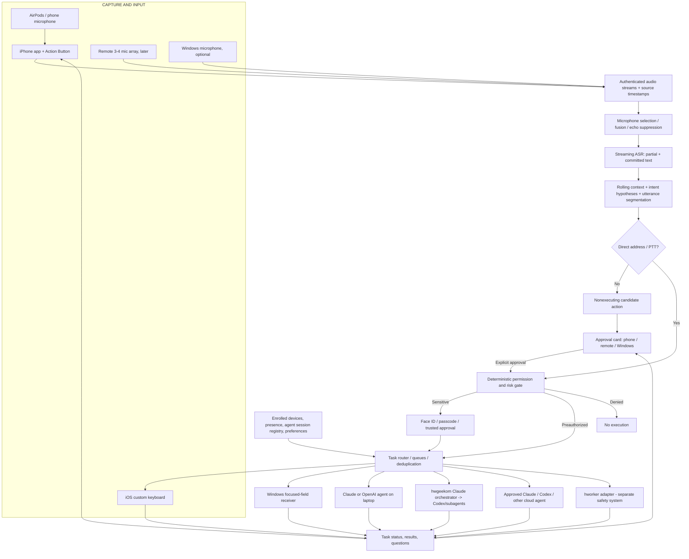

# Voice Control Fabric — Product Definition v0.2

**Status:** Design discussion draft; NOT an implementation specification or authorization  
**Date:** 2026-11-02  
**Supersedes:** v0.1 (2026-11-02)  
**Scope of this revision:** one-step iPhone/Windows pairing, iPhone-wide text dictation, distributed microphones and remote array, two-tier continuous-listening authority, approval UI, and local/cloud execution selection.

> **Product statement:** A universal voice layer that works from an iPhone alone, turns speech into text on whichever of your devices you intend, and directs deliberate requests into persistent AI-agent sessions—with optional premium hardware for quieter capture and optional field-I/O control later. Voice input, authorization and agent execution are distinct.

## 1. Decision ledger

| Decision | Status | Detail |
|---|---|---|
| iPhone-only mode | **Agreed** | All fundamental voice, routing, and approval features must work without the dedicated remote. |
| Windows laptop first | **Agreed** | Native receiver and optional local agent executor, not a macOS-first product. |
| Phone ↔ computer pairing | **Agreed goal** | QR-code scan or short CLI/pairing code, no manual network address configuration. |
| iPhone dictation | **Agreed goal** | Text into Messages, Mail and other compatible third-party text fields via a custom keyboard extension; system restrictions remain. |
| Continuous tier 1 | **Agreed** | Infer candidate actions from ambient speech; display a suggestion, **do not dispatch** without a deliberate tap/approval. |
| Continuous tier 2 | **Agreed** | Recognized assistant activation phrase or explicit PTT permits automatic dispatch of *preauthorized* actions. |
| High-sensitivity approval | **Agreed** | Use iPhone UI and, where secure enough, dedicated remote UI; some actions require Face ID/passcode or desktop confirmation. |
| Microphone cooperation | **Agreed goal** | AirPods/iPhone/desktop/voice remote can contribute; selection and combination based on measured signal quality. |
| Hardware microphone array | **Proposed direction** | 3–4 digital MEMS microphones is a prototype starting point, not a committed BOM or guaranteed beamforming performance. |
| Agent integration | **Agreed direction** | Thin router, native provider/session interfaces first, Claude orchestration on `hwgeekom`, computer-use fallback. |
| Local/cloud fallback | **Agreed goal** | User-configurable preference, availability-based failover, explicit handling when session cannot genuinely migrate. |
| USB/appliance gateway | **Later track** | Model capability-limited control; physical safety is never delegated to an LLM. |

## 2. Intended experience: concrete user journeys

### Journey A — pair a new Windows computer in approximately one minute

1. Install and launch **Voice Receiver** on Windows. Choose **Pair a phone**; display a rotating QR code and a short alphanumeric code.
2. Open the iPhone app, choose **Add computer**, and scan the QR code (or enter the code if camera access is unavailable).
3. Both devices display the same human-readable verification phrase. Confirm on both; the connection is authenticated, encrypted and enrolled as a named computer.
4. Set its role: **text receiver**, **local agent executor**, or both. Configure default provider and whether this machine may be selected automatically.
5. For advanced users and headless workers, a conceptual CLI provides `voice-fabric pair --qr` or `voice-fabric pair --code`; commands are illustrative design, not existing software.
6. Pairing should work through local discovery when possible and an authenticated relay for remote networks. It must not require open inbound ports or expose SSH broadly. Keys are revocable; pairing tokens are one-use and expire shortly after issue.

**Security rules:** QR payload carries enrollment metadata and an ephemeral challenge, never an indefinite bearer credential. Bind the enrolled device to a cryptographic identity; reject a code replay; support device removal and key rotation. Remote devices require explicit approval before acquiring capabilities beyond receiving text.

### Journey B — dictate into an iPhone message or email

1. Start a recording session in the main iPhone app, using on-screen control or a supported Action Button workflow.
2. Open Messages or Mail and activate the **Voice Fabric keyboard**, once installed and enabled.
3. Speech is transcribed by the main app / shared voice service; committed text appears at the current caret through the keyboard's `UITextDocumentProxy`.
4. The user may switch from typing into the phone to dictating into the Windows laptop without reconnecting AirPods.
5. **Dictation is not message sending.** The default action inserts text but never presses Send automatically, unless an explicitly authorized send command is processed separately.

**Platform limits:** iOS cannot inject into arbitrary apps without an active supported text-input integration. Third-party keyboards are not available in secure fields and can be rejected by some apps. A networked keyboard requires separate user permission for full access; its privacy disclosures must be unusually clear. Keyboard extensions do not themselves capture microphone input; the parent application runs audio capture. The Action Button can trigger a recording-related App Intent, but a cold background start must be prototyped on real hardware rather than assumed reliable. A Live Activity must be maintained while using `AudioRecordingIntent`.

**Fallbacks:** for fields rejecting the keyboard, provide copy/share or app-specific supported integrations; do not promise systemwide background insertion on iOS.

### Journey C — continuous meeting mode with non-executing suggestions

Conversation: “It might be interesting to compare those two motors.” The intent interpreter produces a **candidate only** and shows a discreet card:

> **Suggested:** Compare these two motors  
> **Destination:** Claude / Arm design  
> **Actions:** `Start` · `Dismiss` · `Edit target`

No task begins if untouched. Repeated conversation about the same idea updates or deduplicates that card rather than spamming more suggestions. Suggestions should be rate limited; the user can mute them during a meeting.

Conversation: “**Assistant**, show the motor curves on my laptop.” The recognized activation word establishes explicit address, so a **preauthorized read/display** task is submitted automatically and acknowledged. A spoken request to send financial data or energize a motor does **not** bypass the separate high-risk approval procedure.

### Journey D — continuous sequence of multiple instructions

“**Assistant**, open the project dashboard on my laptop. Ask the existing arm-design Claude session to compare the alternatives. Then summarize the result when it finishes.” The engine recognizes three linked requests and dispatches them with explicit dependencies. It keeps recording while the tasks execute and supports “cancel the second one.” A disfluent, incomplete or revised command is not launched prematurely.

### Journey E — local or cloud agent fallback

“**Assistant**, research this in Claude.” By default, route to the configured preferred available Claude session (for example the Windows laptop). If the laptop is unavailable, offer or automatically use an approved cloud alternative for cloud-compatible work. The selected target must be visible.

“**Assistant**, show the document on my laptop.” If the laptop is offline, do **not** silently substitute a cloud agent and report success. Queue the task for the laptop, offer another online display, or clearly explain that opening its screen is unavailable.

### Journey F — privileged approval

When an operation exceeds an already granted scope, the iPhone shows an exact action, affected destination, consequences and available approvals. Ordinary approval can be a tap. Sensitive approval should use an authenticated foreground prompt (Face ID or passcode where appropriate). The dedicated remote may display the action and offer **approve/deny** for medium-sensitivity operations only if the remote-to-phone/user authentication protocol is sufficient; it cannot substitute a trusted biometric for high-risk actions merely because it has a button.

## 3. Hardware and audio architecture

### 3.1 Capture devices

- **First-class:** iPhone built-in microphone; AirPods paired to iPhone; optional Windows microphone.
- **Later:** Slim aluminum dedicated voice remote with small screen, physical `OFF / HOLD / CONTINUOUS` switch, side PTT, future camera aperture, charging and data connection, and optional magnetic stand that places microphone close to the mouth.
- **Remote microphone array:** prototype **three or four digital MEMS microphones** on separated apertures along the upper/top/edge surfaces. Final count, spacing, sealing, sample rate, preamp/codec and DSP remain test-driven.

### 3.2 Multiple microphone strategy

Not all signal fusion is equivalent:

1. **Per-utterance source selection (MVP):** independently estimate signal-to-noise ratio, speech intelligibility, clipping, proximity and dropouts; choose the strongest valid stream. Allows a voice remote on a stand to beat AirPods when whispering.
2. **Transcript/feature fusion (next):** decode two or more sources and reconcile disagreement with confidence metrics and appropriate latency limits.
3. **Coherent beamforming (only when justified):** suitable mainly for an array within one synchronized device. AirPods, iPhone and a remote can have unrelated clocks, variable Bluetooth latency and changing geometry, so naïve waveform beamforming across them is not realistic. Cross-device phase alignment is a research/engineering task, not an assumed capability.
4. **Echo and source-origin filtering:** reduce playback/reverberation; do not mistake an agent's own spoken response for a user command.

Apple documents a `dualRoute` AVAudioSession mode for simultaneous built-in and supported secondary audio devices, under a `multiRoute` category, but we must test whether the actual hardware/OS combination exposes streams with the quality, isolation and timing required. Independent clients sending timestamped streams to the ingest service remain the general design.

### 3.3 Recording modes and independence

`OFF` physically disables the *remote's* microphone (other app/device sessions have independent controls). `HOLD` records while PTT is depressed. `CONTINUOUS` captures until stopped and never means automatic authorization of overheard speech. iOS always has its own explicit recording control/indicator. The phone and remote show recording state and destination.

## 4. Activity and authorization architecture

**Two separate pipelines:**

- **Observation:** encrypted audio ingress → streaming transcription → incremental intent detection → candidate actions/utterances. Continues during conversation even if a previous task is running.
- **Authority and execution:** finalized task → activation evidence → permissions and risk policy → selected agent/field → acknowledged outcome. Never automatically treats an LLM's confidence as user authorization.

### 4.1 Activation tier semantics

| State | Evidence | UI | Execution |
|---|---|---|---|
| **Tier 0: ordinary speech** | No actionable request | Optional transcript | None |
| **Tier 1: inferred request** | Model identifies a possible action but no direct assistant address | Suggested-action card on phone/remote/desktop | **None until deliberate approval** |
| **Tier 2: explicitly addressed** | Activation phrase from the enrolled user *or* deliberate PTT intent | Quick acknowledgement; show target | Auto-run **only within granted scope** |
| **Tier 3: sensitive** | Data release, purchases, external sends, destructive changes, secrets, device actuation or policy-designated risk | Exact action and recipient/target; biometric/passcode or trusted on-device approval as applicable | Execute only after required action-specific authorization and independent downstream checks |

The names Tier 0–3 are internal operational labels: the **two user-facing modes** remain inferred suggestion versus explicitly addressed command. High sensitivity is a **risk override**, not another activation phrase.

### 4.2 Speaker and command authenticity

Wake-word detection and speaker matching are helpful evidence for reducing mistakes, **not proof of authorization**. A TV, meeting participant, audio replay or synthesized voice could be recognized. Require cryptographic device/session identity, policy and stronger approval for consequential actions. Imported documents, web pages and agents' own outputs can never grant voice authority. While in active meeting mode, an unaddressed participant cannot trigger Tier 2 solely by speaking the wake word; ambiguous events downgrade to a suggestion or no action.

### 4.3 Example action policy, proposed defaults

| Action | Inferred speech | Explicit activation/PTT | Additional check |
|---|---|---|---|
| Summarize currently recorded discussion | Suggest | Start | Recording consent and source scope |
| Open a public image or dashboard on selected PC | Suggest | Start | Target PC online and authorized |
| Insert text into focused composer | Suggest / chosen dictation mode | Insert | Focus/caret verified; never automatically send |
| Continue preapproved Claude project research | Suggest | Start | Correct project/session; scoped agent permissions |
| Modify code/test within project workspace | Suggest | Delegate within configured scope | Downstream agent's file/command approvals still apply |
| Send an email/text, publish, pay, disclose sensitive data | Suggest | Prepare | Confirm recipient, exact content and effect |
| Delete significant files, change access rights | Suggest | Prepare | Explicit authenticated approval; least-privilege scope |
| Energize hardware, move actuators, initiate HIL | Suggest | Prepare | Separate trusted approval, safety state, interlocks/watchdogs, safe operator conditions |

A remembered approval must be scoped by **actor, project, machine, capability, risk class and expiry**, not a global “always allow.” Prohibit model-initiated expansion of permissions.

### 4.4 Proposal UI states

`Suggested` → `Edited / Approved / Dismissed / Expired`; `Approved` → `Queued` → `Dispatched` → `Running` → `Succeeded / Failed / Cancelled`.

Approvals bind to an immutable task preview and cannot authorize a subsequently changed action payload. A proposal can expire if conversation context, target, or speaker changes. Debounce/deduplicate repeated inferred actions and provide a reviewable list instead of notifying on every sentence.

## 5. Machine registry and local/cloud routing

### 5.1 Real initial topology

| Node | OS/role | Controls |
|---|---|---|
| **iPhone** | Mobile capture, iOS keyboard bridge, approvals, status | Microphone, Action Button, UI, Face ID/passcode |
| **Windows laptop** | Claude Desktop, focused-field dictation, optional Claude computer use and OpenAI computer-use driver | Native signed receiver, active-app/focus reporting, local execution permission |
| **`hwgeekom`** | Main Claude orchestrator with Codex/subagents | Session bridge and project registry; no unrestricted exposure |
| **`hworker`** | HIL PC, attached lab equipment | Separate, constrained hardware-execution adapter and safety guard |
| **Claude/Codex cloud** | Remote project-agent execution | Supported authenticated provider adapters, no magical access to offline laptop UI |
| **Additional mini PCs** | Expandable agent/compute fleet | Same enrollment/permission interface |

### 5.2 Provider policy per destination

On the **Windows laptop**, allow user-defined ordering, for example:

1. Resume relevant **Claude Desktop/Claude Code** session if available, with enabled computer-use capabilities and existing permissions.
2. Otherwise choose an **OpenAI computer-use agent** attached to an approved Windows desktop/browser driver (a driver and observations must be provided by our integration; the model itself does not directly possess laptop access).
3. If no approved local agent is reachable and task is cloud-capable, use preferred **Claude cloud / Codex cloud / other configured provider** and clearly label that choice.
4. If the request depends on the offline laptop screen/files and no approved remote access path exists, **hold or redirect** instead of falsely reporting it done.

Allow explicit spoken override: “Use Codex in the cloud,” “send this to Claude on the laptop,” “use the existing arm-design session on hwgeekom,” “start a separate ChatGPT conversation.” The router must respect the named provider and machine rather than silently switching.

**Session identity:** `(provider, account, host, workspace/project, provider_session_id, capability_profile)`. A new cloud execution can receive a structured handoff summary and artifacts **but cannot be described as continuing the identical local provider session** unless an official provider mechanism explicitly supports that transition.

**Existing products:** Claude Desktop's native computer use is documented for Windows; it requires the host awake and app running. Claude Code supports remote control and teleport workflows, but a developer integration still must use supported interfaces and respect authentication. OpenAI computer use requires an environment/driver you operate and enforce permissions on. These are useful building blocks, not interchangeable automatic cross-vendor thread APIs.

### 5.3 Preference logic

Priority: **explicit destination named by user** → active selected agent/session → active text field (dictation mode) → most recently used available project session → configured default. Provider or execution-location fallback occurs only according to per-action policy. No new agent for an ambiguous utterance merely because the preferred device is offline.

## 6. System architecture v0.2

*Execution never depends on keeping the microphone session open. The control layer stores task state separately from capture state. Each spoken command is an idempotent operation with observable progress and a cancellation path.*

## 7. Control-plane event schema, early contract

### Capture and transcription

`capture_session_id`, `source_id`, `source_type`, `source_clock`, `receive_timestamp`, `partial_revision`, `committed_segment_id`, `speaker_evidence`, `recording_consent_state`, `segment_text`.

### Candidate action

`candidate_id`, `parent_capture_session`, `segment_span_ids`, `proposed_task_kind`, `proposed_payload_hash`, `destination_hint`, `origin_confidence`, `proposed_risk_class`, `suggestion_expiry`, `card_visibility`, `candidate_state`.

### Authorized command

`command_id`, `candidate_id`, `immutable_task_payload`, `activation_kind` (`PTT`, `wake_word`, `approval_tap`), `authenticated_actor`, `approval_credential_class`, `policy_version`, `granted_scope_id`, `destination_id`, `provider_session_id`, `idempotency_key`, `execution_state`, `outcome`, `timestamps`.

**Invariant:** model output never writes `authenticated_actor`, `activation_kind`, `approval_credential_class`, or `granted_scope_id`. Trusted input/policy services populate them. Inferred candidates cannot enter the execution queue without an authenticated approval event. Unauthorized request to reassign computer/machine target is rejected rather than guessed.

## 8. Security, privacy, consent and physical safety

- Make microphone state conspicuous; give an immediate stop control; ensure a remote's physical OFF state truly disables its microphones. Phone and other sources remain independently controllable.
- Local-only audio/transcription mode is a product goal to evaluate, not an assertion about the chosen ASR engine. Specify cloud privacy policy, raw-audio retention, transcript retention and encryption before release. Meeting recording must respect participant awareness/consent and applicable rules.
- Store only the minimum necessary device presence/focus metadata. Do not capture the text in arbitrary password fields or inspect unrelated app contents by default.
- Approval screens reveal the actual operation, data/recipient affected and machine or agent; never approve invisible expanded tool access.
- Distinguish **software job cancellation** from stopping **active physical motion**. Physical interlocks, E-stop and trusted motor controllers remain independent of an LLM, network, phone or voice remote.
- Voice activation by itself is not biometric authentication. Handle playback, multiple speakers, impersonation and prompt-injection content as untrusted input.

## 9. Prototype milestones and acceptance tests

### P0 — iPhone ↔ Windows experience (first priority)

**Build:** Swift iPhone capture app + pairing, signed Windows receiver, streaming transcription, target presence, focused-field insertion, simple mode controls. Prove Action Button capture and session behavior on a locked and unlocked phone. Add optional transcript-to-keyboard insertion POC for iPhone Messages/Mail.

**Acceptance:** scanned pair succeeds on home LAN and an external network; revoked pair immediately fails; no manual IP entry; headset stays on iPhone; Windows text arrives in correct field; insertion never sends a message; clear on-screen destination; Action Button limitations documented from real-device testing.

### P1 — two-tier ambient command behavior

**Build:** incremental intent hypotheses, committed segments, Tier 1 suggestion cards, Tier 2 wake/gesture event, policy gate and audit log; concurrent listening and task execution, dedup, cancellation.

**Acceptance:** a curated corpus of meetings/TV playback does not cause dispatch absent explicit authorization; an unaddressed action proposal never autoexecutes; a wake-word command runs only allowlisted actions; multiple commands are independently tracked and at-most-once logically dispatched on reconnect; every high-risk candidate waits for correct approval.

### P2 — local/cloud agent selection

**Build:** provider session registry, Windows computer-use adapters where supported, `hwgeekom` session bridge and existing Claude → Codex delegation, cloud fallback policies; no automatic claims of session continuity across unrelated providers.

**Acceptance:** named project continues in place; offline Windows request produces a visible hold/fallback state; generic cloud-capable task uses configured fallback; Windows UI action succeeds only on an awake/authorized host; tasks and outcomes remain traceable.

### P3 — audio accessory experiment

**Build:** multi-MEMS remote test rig and near-mouth stand, source scoring; compare with AirPods and iPhone. Measure WER including names/numbers/negations, clipped-first-words, latency, false activations, battery, perceived audibility and privacy.

**Acceptance:** hardware earns inclusion only if it significantly outperforms the best off-the-shelf microphone for realistic whispering and is comfortable to use.

### P4 — separate appliance/USB I/O workstream

Design a narrowly scoped USB/Ethernet/CAN/serial gateway and safety architecture before integrating physical actuation. No direct general-purpose LLM control of uncontrolled hardware.

## 10. Product questions still open

1. What exact wake phrase should be used, and is it user-configurable? How should the system distinguish the owner from meeting participants in acoustically challenging environments?
2. Should suggestions appear immediately, only when a task is actionable, or in a quiet list during meetings? Maximum notification frequency and expiry?
3. Should a wake-word command default to selected agent or selected computer when neither is named? Must the destination always be spoken back?
4. Which consequences are preapproved per project and for how long? Should modification of code within an already-authorized engineering project be low- or medium-sensitivity?
5. Should the remote's physical hardware button approve only suggestions or also medium-risk operations? How will the phone authenticate remote-button approvals?
6. What is the intended default retention of audio/transcripts? Is encrypted local-first capture a strict requirement?
7. Which iOS keyboard experience is acceptable: replace the system keyboard, use a minimal companion keyboard, or ship both keyboard and share/copy fallback?
8. How should user-visible local/cloud handoffs handle projects requiring local files, live desktop controls or private data not permitted in cloud providers?

## 11. Verified references and implementation cautions

- Apple custom keyboard text insertion: https://developer.apple.com/documentation/uikit/handling-text-interactions-in-custom-keyboards
- Apple custom keyboard exceptions: https://developer.apple.com/design/human-interface-guidelines/virtual-keyboards
- Apple keyboard full-access/privacy: https://developer.apple.com/documentation/uikit/configuring-open-access-for-a-custom-keyboard
- Apple `AudioRecordingIntent`/Live Activity: https://developer.apple.com/documentation/appintents/audiorecordingintent
- Apple simultaneous audio route: https://developer.apple.com/documentation/avfaudio/avaudiosession/mode-swift.struct/dualroute
- Apple LocalAuthentication/Face ID: https://developer.apple.com/documentation/localauthentication/lacontext
- Claude Windows computer use: https://support.claude.com/en/articles/14128542-let-claude-use-your-computer-in-cowork
- Claude remote-control / cloud teleport: https://support.claude.com/en/articles/14554000-claude-code-power-user-tips
- OpenAI computer-use integrations and host-owned drivers: https://developers.openai.com/api/docs/guides/tools-computer-use

*The above sources document available primitives, not an integrated solution. Real-device validation and provider-adapter testing are required before declaring the proposed experience implemented.*
