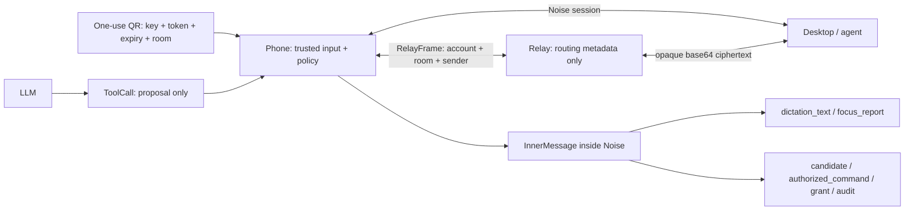

| File / folder | What it is | Status |
|---|---|---|
| [protocol.schema.json](protocol.schema.json) | Version 1 wire records, enums and discriminated unions | ✅ |
| [audit-archive.md](audit-archive.md) | Encrypted audit append/read, protected recovery anchors, signed rollover/writer handoff, TTL, padded storage, fenced loss acceptance and content-free wake reconciliation | ✅ local synthetic tests; phone adapters unverified |
| [relay-join.md](relay-join.md) | Room enrollment and exact cloud proxy challenge/header/query-normalization contract | ✅ synthetic relay tests; live client/vendor integration unverified |
| [noise.md](noise.md) | Exact Noise suite, enrollment, relay auth, fragment framing and published ciphertext vectors | ✅ synthetic Rust tests; Swift/deployment unverified |
| [wire-contract.md](wire-contract.md) | Boundaries, encoding rules and runtime obligations | ✅ contract; runtime integration unverified |
| [vectors/](vectors/) | Shared synthetic valid and invalid fixtures | ✅ |
| [../tools/](../tools/) / [../codegen/](../codegen/) | Model proposal contract / reproducible generator and checks | ✅ |

| Message type (`kind`) | Boundary | Minimal content |
|---|---|---|
| `ciphertext` | Relay | Room, sender, opaque encrypted bytes |
| `presence` / `wake_registration` | Relay | Online state / APNs wake token and environment |
| `pairing` | QR, not a relay frame | Desktop public key, one-use token, expiry, relay room |
| `dictation_text` | Noise | Partial/committed text, target, segment, revision; no send, C0/C1 controls or line separators |
| `focus_report` | Noise | Focus boolean and last activity; no field contents |
| `device_info` | Noise | Device role, platform, capabilities |
| `revoke` | Noise | Device, command, idempotency key, revocation time |
| `task_status` | Noise | Command, execution state, time, optional outcome code |
| `capture_segment` | Noise | Source clocks, segment text, speaker evidence, consent |
| `candidate_action` | Model proposal / Noise | Proposed task, hash, target hint, confidence, risk hint, expiry, card state |
| `authorized_command` | Trusted phone → Noise | Immutable task, authority, scope, idempotency key, execution state |
| `audit_entry` / `grant` | Trusted phone / Noise | Content-free audit / actor, device, project, capability, risk, expiry |
| `mode` / `capture_state` | Noise | `dictation\|ai_control` / `off\|hold\|continuous` |

Start with `make -C SYS check` from the repo root. It regenerates all outputs in
memory, rejects stale files, checks invariants, and runs the three language suites.
After a schema edit, run `make -C SYS generate`, update vectors, then check.

JSON with base64 bytes keeps this first contract inspectable with standard
Foundation, serde and JavaScript tooling; shared vectors verify that choice.
No measured bandwidth or latency advantage is claimed. A small generator avoids
a third-party generator runtime and fails on unsupported schema features.
[JSON Schema 2020-12](https://json-schema.org/draft/2020-12/json-schema-validation)
defines validation; [Ajv](https://ajv.js.org/json-schema.html) checks the original
schemas independently of the Swift/Rust interpreters.

Trace: [product definition §4, §7](../product-definition-v0.2.md#4-activity-and-authorization-architecture)
and [system design: Modes, Components, Pairing/security](../system-design-v1.md).
Trace: [REQ-59](../requirements.md#extensibility) (generated compatibility),
[REQ-61](../requirements.md#extensibility) (account IDs),
[REQ-16, REQ-18](../requirements.md#dictation-delivery-and-targets) (insertion/focus),
[REQ-22, REQ-24](../requirements.md#pairing-and-transport) (pairing/relay), and
[REQ-28–36](../requirements.md#authorization-and-policy) (authority contracts).
Contract checks and the desktop’s synthetic pairing/security tests are proven here; physical phone and deployed relay integration remain unverified.

The [delivery exchange](wire-contract.md#dictation-target-and-capture-exchange) defines prepare/ready, durable outcome/query, sequenced, expiring stop-only remote capture control and clock-skew-safe activity age. Physical display/native acceptance remains **unverified**.
