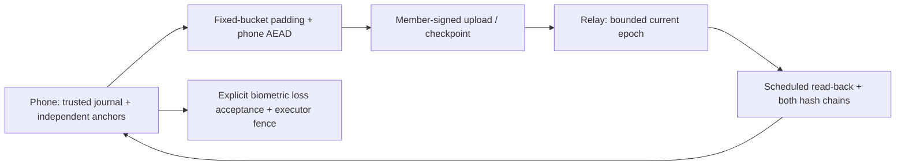

# Encrypted audit archive v2

Trace: REQ-29/32/34–35, REQ-54–55/61. Inputs: [security model](../security-model.md),
[member signing](relay-join.md), [generated records](protocol.schema.json).
Evidence: relay `relay.test.ts`/`codec.test.ts` and Policy `ArchiveTests.swift`.
Portable tests use synthetic data; production phone AEAD/HTTP/key/checkpoint,
executor-fence adapters, deployed retention and live APNs remain **unverified**.
This replaces the unreleased v1 draft; old hash/padding formats are not silently trusted.

| Boundary | Contract |
|---|---|
| Paths / proof | Account/room base + POST `archive/append`, `archive/read`, `archive/checkpoint`, `archive/writer`. No query. Use exact route operation in the existing one-use Ed25519 challenge flow, bound to exact body bytes. `Cache-Control: no-store`. |
| Phone writer enrollment | Creator is the desktop participant; the **first successfully redeemed phone pairing** binds `archiveWriterKey` before any archive upload. Pairing/Noise confirmation establishes the endpoint's phone role; this is not hardware attestation. Creator/other desktop members cannot claim block zero. Legacy paired rooms lacking this binding fail closed and need fresh pairing. |
| Membership / revocation | Only current members can read/upload/control. Revocation removes transport membership/challenges/wake registration, but retains the archive's public writer verification key. Same-key signed re-enrollment remains the writer regardless of enrollment generation/device ID. A new key cannot inherit writer status by reusing an ID. |
| Explicit key replacement | `AuditArchiveWriter`: account/room, enrolled target device/public key, `revision`, `old_signature`. Submit with a current member challenge. Old phone signs compact JSON `["voiceremote-audit-writer-v1", account, room, current_writer_public_key, target_device_id, target_public_key, revision]`. Verify target enrollment, old writer signature and exact monotonic revision; increment revision atomically with binding. Old key may sign offline after transport revocation. Replay/desktop signatures fail. If the old phone key is lost, **fresh pairing into a new room** establishes a new writer; do not weaken the old room's binding. Recovery reads can still use remaining members and retained phone decryption keys. |
| Block / epoch | Generated `AuditArchiveBlock`: account/room, optional `epoch` (absent means 0), zero-based `sequence`, `previous_hash`, `ciphertext`, `block_hash`. Epoch is authenticated and monotonically increases only at a checkpoint. No plaintext audit/key/task/transcript fields. |
| Hash / AAD | Hash = lowercase hex SHA-256 of exact compact UTF-8 JSON `["voiceremote-audit-archive-v2", account, room, epoch, sequence, previous_hash, ciphertext]`. AAD is the same array without its final ciphertext element. ASCII relay identifiers, decimal integer tokens, no slash escaping/whitespace. Genesis previous hash is 64 zeroes. |
| Encryption / padding | Phone-only AEAD with fresh nonce, e.g. AES-256-GCM; `ciphertext = base64(nonce || sealed_and_tag)`. Before encryption prefix plaintext with its 4-byte unsigned big-endian byte length, then zero-pad to the smallest power-of-two bucket from 2,048 through 1,048,576 bytes. Reject malformed size/length/nonzero padding after authentication. Single audit records share a bucket; exact event length is hidden, but bucket/timing/volume remain visible. No default cipher exists in Policy. |
| Ordinary append | Plaintext consists of canonical LF-terminated complete AuditRecord lines, up to 24,000 bytes per Policy batch. Ciphertext cap 65,536 base64 characters. Sequence must equal stored count, previous hash must equal stored head, epoch must be current. Normalize semantic field order for exact idempotent retries. Different contents conflict; exact retry succeeds even at capacity. |
| Signed rollover / pruning | `archive/checkpoint` accepts the same block type, with epoch **current+1**, sequence 0, previous hash equal to the current old-epoch head. Plaintext is a canonical compaction capsule + LF: original journal count/head, clock epoch and permanent replay/ownership/dismissal/revocation/authority-reset records. Phone validates the capsule against its independent checkpoint and the existing anchor's local prefix before signing; an unrelated empty journal cannot prune the archive. Only an explicitly fenced authorityReset can cross authority domains. A SQLite transaction replaces old blocks with this encrypted snapshot and advances epoch. Only this signed checkpoint authorizes pruning old detail; no blind eviction. New epoch appends continue the journal's original sequence/hash chain. |
| Crash / archive_full | Persist exact sealed append/checkpoint intent before network submission. On `archive_full` or 128 blocks, Policy stages rollover including **all current verified local state**, including the refused pending record. Read old tail to resolve lost append acknowledgement, link the actual old head, replace pending intent with the checkpoint intent, and retry exact bytes. Lost rollover acknowledgement is idempotent; only after confirmation durably advance the epoch anchor and clear pending. Never discard an uncertain intent without a replacement snapshot covering it. |
| Reads | `AuditArchiveRead`: account/room, optional epoch, starting sequence. `AuditArchivePage`: account/room/epoch and up to eight ascending blocks. Wrong epoch returns 409 `archive_epoch_mismatch`; read is nondestructive. Current epoch snapshot is sufficient for recovery/replay protection; pruned detail remains only in preserved local history or an owner-managed export. |
| Bounds | Current epoch: 128 rows / 2,097,152 canonical block bytes. Ciphertext schema cap 1,500,000 characters accommodates a single large checkpoint; ordinary append remains 65,536. Append body 66,560 bytes; checkpoint body 2,100,000; controls 4,096; two-second bounded read. Commit-time old/new pages may coexist transiently in SQLite transaction internals; application-visible retained bytes stay capped. SQL implementation overhead is excluded. |
| Expiration | Delete all room data immediately when the last member leaves. Paired rooms/archives expire after **30 days without authenticated activity (TBC)**, including alarm/on-access enforcement. Successful signed member controls, joins and valid socket frames refresh the deadline; unauthenticated traffic does not. Never-paired rooms retain the two-minute enrollment deadline. Expired rooms require fresh pairing and surface missing backup state. |
| Client errors / health | HTTP adapters map `archive_full` to `AuditArchiveFailure.full`, writer refusal to `.writerMismatch`. Other fixed errors include epoch/content conflict, malformed/oversize body and unavailable storage. Never log bodies, ciphertext, keys or decrypted data. Durable `AuditArchiveState.health` reports verified/unverified/lostCopy/writerMismatch; expose this to the phone UI. |

## Recovery, verification and retention

| Boundary | Behavior |
|---|---|
| Independent evidence | Protect journal count/head, optional compaction hash, authority/session identity, and archive epoch/count/head/base-head/snapshot-hash outside the journal/relay. Missing anchors/keys never imply an empty trusted history. Atomic protected writes and unique stable recovery slot identities are required adapters. |
| Scheduled verification | Read back on the first upload, every eighth append, every rollover, and after 24 hours (**TBC**). Call `verifyScheduled` on foreground/reconnect and a daily scheduler even with no new writes. Verify tenant, epoch, outer sequence/hash/AAD/tag/padding, canonical inner record chain/capsule and both independent heads. Missing/reordered/corrupt/truncated data or old prefixes fail; persist lostCopy and throw a typed error. An acknowledgement alone never establishes long-term retention. |
| Verified restore | Require replicated journal checkpoint to equal the trusted current checkpoint. Fresh phone-admin biometric/passcode challenge binds source snapshots/time/destination. Restore original records or the signed-epoch capsule + suffix into new empty slots, append recovery event and stage durable intent. Preserve damaged source bytes/count/head. Retire source authority and bind it to one stable protected destination before destination writes; old gates/local recovery reject retired slots. All network/auth suspension boundaries recheck state. |
| Explicit new authority after loss | `AuditLog.startNewAuthority` handles damaged journals with an unreplicated suffix, lost keys/backups or irrecoverable replay state. This is **loss acceptance**, not a claim of recovered history. Biometric/passcode proof binds damaged-byte hash, original checkpoint/pending intent, administrator, destination and next authority. Keep originals; retire source. A mandatory trusted `AuditAuthorityFence` durably invalidates all old executor sessions/permits/approvals and enrolls the new authority before returning a fresh phone session. No default fence exists. Recheck source/destination after fencing, then append `authorityReset` as the first record of a new hash chain. Stage its intent for crash recovery. |
| Fresh authority scope | Derive authority ID from the unique protected destination slot; retries reuse that domain and the fence's durable session. A retired source cannot create another slot. New request IDs/command idempotency keys and `policy_version` include the new authority; gate accepts only the fenced session. Import no old grants/approvals. Executors must enforce the fence/domain before dispatch; absent adapter means this path is unavailable. To replicate a reset chain use an explicit signed archive checkpoint or a freshly paired room/anchor, not a silent empty-anchor overwrite. |
| Local compaction | First resolve any pending upload/full epoch through signed rollover, then after complete remote read-back against protected heads, copy a verified capsule into a new private journal; preserve queued payload/scope digests, dismissals, grant/session revocations and authorityReset provenance. Continue original count/head; checkpoint binds capsule digest. New gate required. Application atomically selects/cleans copy-on-write files and bounds retained old-file storage; Policy never deletes forensic files. |
| Replay state bound | Journal cap 4 MiB; capsule/padding cap 1 MiB. Never prune replay records just to free space. If permanent replay state itself exceeds the cap, require explicit biometric new-authority fencing rather than silently resetting safety state. These implementation defaults are **TBC** product policy. |

## Sleeping phone and stale frames

APNs contains only `{"aps":{"content-available":1}}`, no task, room, transcript,
archive, authorization or execution instruction. Wake is a coalesced hint and
may be lost, delayed, duplicated or reordered. It never renews a grant, approval,
capture session, execution permit or Noise session.

On wake/reconnect the phone authenticates a **fresh** peer session, restores
Policy/replay state from verified durable storage, and reconciles by the durable
identity `(account_id, command_id, idempotency_key, payload_hash, destination_id,
provider_session_id)` of an already authorized task. Compare identity, revision,
expiry, revocation and authenticated executor outcomes to the phone's durable task
record. Unknown/mismatched/expired work stays held or denied; ambiguous delivery
is unconfirmed and needs reconciliation/reapproval. Never infer a task from a
queued encrypted frame, infer execution from relay delivery, or blindly retry a
side effect. Old-session ciphertext is rejected by the session generation checks.
Repeated wake/outcome frames cannot mint a new permit. Phone registration,
background handlers, task store wiring and locked-device acceptance are later work.

## Local account envelope migration

| Inner journal format | Account / integrity rule |
|---|---|
| Legacy records | Preserve exact bytes, sequence and record hashes. The protected installation account pin supplies migration ownership. Never reserialize/rewrite the old forensic prefix. |
| Version-2 account wrapper | Append `accountBound` with the old head, then include `accountEnvelope: {version: 2, accountHash: SHA256(accountID)}` in each new record body and hash. Verify one matching account throughout the bound suffix; reject missing/mixed wrappers. |
| Archive/recovery/compaction | Ciphertext remains opaque to the relay. Round trips preserve canonical inner bytes and wrapper binding; archive account must match. `accountBound` and `ownerCompleted` survive replay compaction, so binding and trusted completion cannot come from an editable queue snapshot. |

This extends the local canonical record format inside the existing opaque ciphertext field, with no generated wire-schema changes. Legacy hashes remain valid. Evidence: Policy `accountEnvelopeMigrationPreservesLegacyBytesHashesAndArchiveBinding`; owner completion also has Router/AppModel regressions. A phone owner completion is an explicit attestation, never a relabelled agent reply or exit status.
