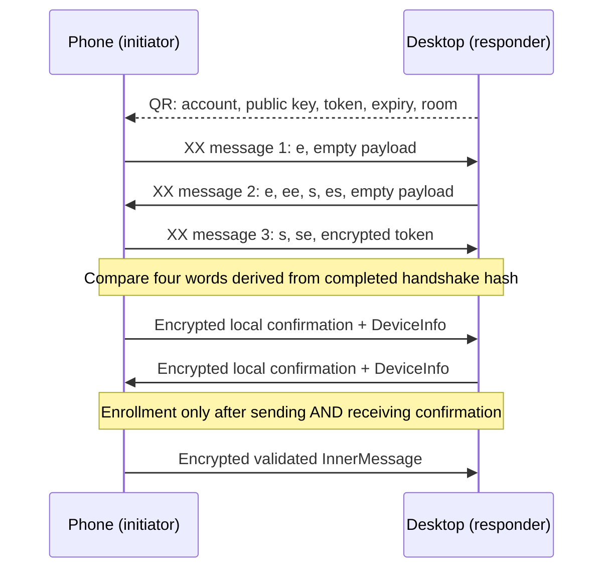

| Item | Exact interoperability profile | Evidence / status |
|---|---|---|
| Pattern | `Noise_XX_25519_ChaChaPoly_BLAKE2s`, phone initiates, desktop responds; no PSK | `snow` 0.10; synthetic tests ✅ |
| QR | Generated `PairingPayload` JSON. 32-byte X25519 public key, random 32-byte one-use token, account, room. LAN issues `expires_at = issued_at + 120000`; relay uses the server-issued invite token/expiry | Codec + runtime tests ✅ |
| Prologue | ASCII `voiceremote/pair/v1` then NUL; account UTF-8 byte length (u32 BE), account bytes; room length (u32 BE), room bytes; decoded desktop public key (32 bytes); expiry (u64 BE) | [Published fixture](vectors/noise/xx-pairing.json) ✅ |
| Handshake payloads | Message 1 empty; message 2 empty; message 3 exactly 32 raw decoded token bytes. Token is encrypted by XX, never a plaintext bootstrap frame | Test peer and wrong-token tests ✅ |
| DH validation | Every X25519 DH result is checked in constant time for all-zero output before use, through a checked `snow` resolver. Tests send both zero and nonzero low-order public keys | Rejection before message 2 ✅ |
| Key binding | Initiator checks decrypted responder static key against QR before message 3 | Wrong-key test ✅ |
| Time | Trusted OS clock required; `0 < expiry - now <= 120000`; issuer additionally checks retained `Instant` deadline, account/room bound by prologue. Token consumed at redemption before confirmation and cleared in issuer payload | Expiry, rollback, unavailable-time, reuse tests ✅ |
| Confirmation | Each direction's first transport plaintext: byte `01`, 32 completed handshake-hash bytes, then generated-codec `DeviceInfo` UTF-8 JSON. Account matches prologue. Local confirmation originates in trusted UI after comparing words. Negative/malformed/wrong-hash messages abort; no automatic confirmation | Both-confirmations and mismatch tests ✅ |
| Enrollment | Only after locally confirming and receiving peer confirmation. Store remote static key, generation, room and DeviceInfo; discard token. A failed confirmation needs a fresh QR | Tests ✅; phone registry integration unverified |
| Application | Small generated-codec `InnerMessage` JSON is one Noise packet. Larger JSON uses authenticated fragments below; no injection until complete reassembly and strict codec validation | Maximum 16,384-character Unicode dictation over signed relay fake ✅ |
| Replay | Stateful Noise implicit receive nonce, initially zero; confirmation consumes nonce zero in each direction. Packets must be ordered across transports. Authentication, grammar or replay failure closes session; never retry a failed write | Tamper/replay tests ✅ |
| Reconnect | Fresh XX, with prologue ASCII `voiceremote/session/v1` + NUL + account/room length-prefixed as above. All handshake payloads empty. Both static keys already enrolled. Responder sends transport plaintext `02` + completed hash before application traffic; this consumes responder nonce zero. No token or new enrollment | Reconnect test ✅ |
| Revocation | Delete peer enrollment; check persisted generation before send, after receive and before delivery. Old session never revived by re-enrollment. CLI closes idle connection/listener on 250 ms polls, including unfinished handshakes | Next-message tests ✅; OS scheduling bound unverified |
| Timeouts / lifetime | Scan wait lasts until token deadline, not 30 seconds. Responder reconnect waits indefinitely for first peer packet on a healthy relay; subsequent XX step deadline 10 seconds. LAN connections have a 10-second admission deadline; authenticated application idle limit 90 seconds. Relay retries 500 ms, 1 s, 2 s … up to 30 s; shutdown/revoke interrupts every wait | Paused-clock 40 s scan / 61 s reconnect, half-open and cancellation tests ✅ |
| Transport switch | Preserve the same Noise state and nonce ordering when changing LAN/relay. Old packets never replay on a new path; do not run both paths concurrently | LAN → relay → LAN test ✅ |

Four-word phrase (no locale translation): take the **first four bytes** of the
completed handshake hash in byte order. Each byte indexes a 256-entry dictionary:
concatenate `prefix[byte >> 4]` with `suffix[byte & 15]`. Join the four words with
single ASCII spaces. Do not hash the hash again.

| Nibble | 0 | 1 | 2 | 3 | 4 | 5 | 6 | 7 | 8 | 9 | a | b | c | d | e | f |
|---|---|---|---|---|---|---|---|---|---|---|---|---|---|---|---|---|
| Prefix | amber | birch | cedar | dawn | elm | fern | gold | hazel | iris | jade | kelp | lunar | maple | north | oak | pine |
| Suffix | ant | bird | cat | deer | elk | fox | goat | hare | ibis | jay | kite | lynx | moth | newt | owl | puma |

This displays 32 handshake-hash bits. Word usability and human comparison time
are **unverified**. This is an application dictionary, not a standardized Noise
word list. Swift needs to reproduce the published fixture byte for byte.

| Transport | Framing / boundary |
|---|---|
| LAN TCP | u32 BE packet length, then exactly that many Noise bytes; length 1–65535. `_voiceremote._tcp.local.` advertises `room` and `version=1`; never the token. Automatically select a private Wi-Fi/Ethernet interface, excluding known virtual/tunnel names; optional explicit override. private/loopback/link-local peers accepted, wildcard/public binding rejected. Listener exists only during active enrollment or paired receiver operation; at most four concurrent connections. Filtered/non-LAN peers are non-fatal. TCP keepalive starts at 10 seconds, probes every 5 seconds; application idle timeout bounds half-open sessions. No UPnP, NAT mapping, public listener or firewall changes. This LAN listener is the task's explicit exception to design's broad “no inbound ports”; it is not a WAN listener. |
| Relay WebSocket | WSS; generated `RelayCiphertext` text frame, account/room/sender constrained to `[A-Za-z0-9_-]{1,128}`, standard padded base64 Noise bytes. One encoded frame ≤16,384 UTF-8 bytes; Noise packet ≤11,000 bytes leaves base64/header margin even for maximum IDs. WS ping every 10 s; no received frame/pong for 30 s closes and triggers reconnect. Linux rustls / Windows native TLS. |
| Relay authorization | Separate endpoint-held Ed25519 key, never Noise key or lasting bearer. Signed `/challenge` request, validate exact returned context/expiry, sign operation challenge for `/connect`, `/invite`, `/revoke`. Sign exact compact JSON-array bytes and SHA-256 of exact operation body per task 2 worker `SECURITY.md`. Challenge replay rejected; fake enforces auth and frame cap. |
| Revocation | Local enrollment deletion rejects next message. Configured CLI `revoke --relay ORIGIN` additionally calls signed relay `/revoke` for the peer; relay removes membership/key/queue and closes its sockets. Server contract has no whole-room deletion endpoint. Phone controller can revoke desktop membership. |

Encrypted fragment profile (Swift needs this before sending large messages):

| Field | Wire bytes |
|---|---|
| Tag | `03`, inside Noise plaintext; small JSON starts with `{` instead |
| Total | u32 big-endian **UTF-8 byte** length of the entire strict JSON value |
| Offset | u32 big-endian byte offset of this chunk |
| Chunk | 1–10,975 raw bytes; split may occur inside a UTF-8 scalar; decode UTF-8 only after reassembly |

Each fragment is independently encrypted, consuming the next Noise nonce, with
ciphertext ≤11,000 bytes. Fragments are contiguous and strictly ordered on one
session; reject gaps, overlap, changed total, overflow or interleaving. Reassembly
is bounded to 2 MiB and the same 90-second application receive deadline. Disconnect
or error discards incomplete data; never inject a partial fragment or reset/retry a
consumed nonce. [Fragment fixture](vectors/noise/xx-fragments.json) continues the
published pairing fixture at initiator nonces 2 and 3.

Relay first-pair flow: a trusted operator explicitly bootstraps the desktop’s
Ed25519 key as room controller (`relay-bootstrap`; provisioning secret is read
only by that privileged command). Ordinary `pair --relay ORIGIN --room ROOM
--phone-device ID --phone-relay-key BASE64` signs an invitation for the phone key
obtained through a **trusted prior exchange**. QR uses that invite’s one-use token
and expiry. Phone signs `/join` using QR data, then signs `/connect` and initiates
XX with that same bootstrap token. Noise enrollment still requires both human
confirmations; relay membership alone grants no endpoint execution authority.
There is no random unbootstrapped-room path.

Remaining relay contract gaps: no anonymous remote QR/key-discovery step, no
whole-room deletion, and no application delivery/fragment acknowledgement. The
32,768-byte offline queue cannot hold the entire largest Unicode dictation
(65,536 text bytes before JSON/encryption/base64); fragmented online delivery is
proven, offline delivery of that size is **unverified / not guaranteed**. Queue
refusal/partial reassembly never counts as successful insertion. Relay API source:
task 2 sibling worktree’s `SW/relay/SECURITY.md`, `src/room.ts`, `src/security.ts`;
deployed integration and Swift agreement remain **unverified**.

Token test evidence: both rejection tests hold a live peer, assert the specific
rule, and finish before reading a packet. The opt-in
[mutation driver](../../SW/desktop/crates/core/tests/check-token-guards.py)
proves baselines pass and removing each used/expiry guard causes a runtime test
failure (exit 101), then restores the original source.

Sources: [Noise specification](https://noiseprotocol.org/noise.html),
[snow Builder](https://docs.rs/snow/0.10.0/snow/struct.Builder.html),
[mDNS daemon](https://docs.rs/mdns-sd/0.13.11/mdns_sd/struct.ServiceDaemon.html).
These document primitives, not an independent security audit of this profile.
Trace: REQ-22–25, REQ-27, REQ-61. Tests are in
[desktop core](../../SW/desktop/crates/core/tests/security.rs); fixture generation
is [vectors.rs](../../SW/desktop/crates/core/tests/vectors.rs).
