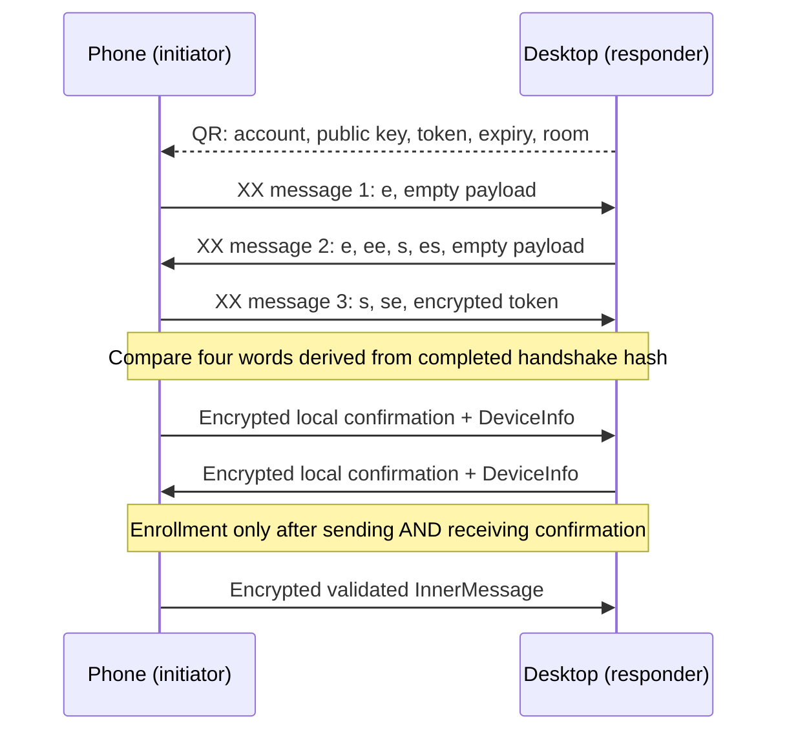
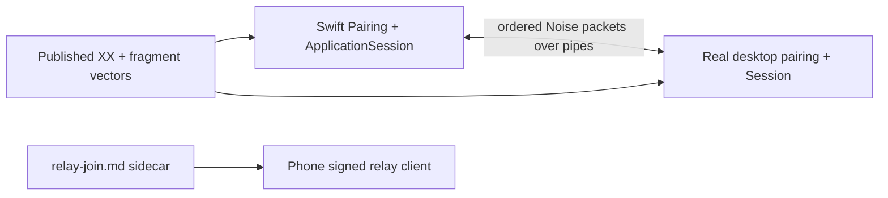
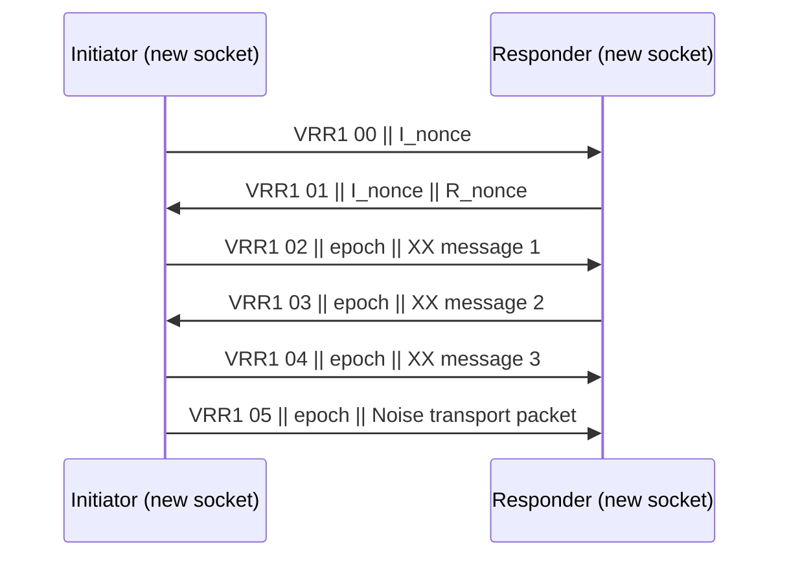

| Item | Exact interoperability profile | Evidence / status |
|---|---|---|
| Pattern | `Noise_XX_25519_ChaChaPoly_BLAKE2s`, phone initiates, desktop responds; no PSK | `snow` 0.10; synthetic tests ✅ |
| QR | Generated `PairingPayload` JSON. 32-byte X25519 public key, random 32-byte one-use token, account, room. LAN issues `expires_at = issued_at + 120000`; relay uses the server-issued invite token/expiry | Codec + runtime tests ✅ |
| Prologue | ASCII `voiceremote/pair/v1` then NUL; account UTF-8 byte length (u32 BE), account bytes; room length (u32 BE), room bytes; decoded desktop public key (32 bytes); expiry (u64 BE) | [Published fixture](vectors/noise/xx-pairing.json) ✅ |
| Handshake payloads | Message 1 empty; message 2 empty; message 3 exactly 32 raw decoded token bytes. Token is encrypted by XX, never a plaintext bootstrap frame | Test peer and wrong-token tests ✅ |
| DH validation | Every X25519 DH result is checked in constant time for all-zero output before use, through a checked `snow` resolver. Tests send both zero and nonzero low-order public keys | Rejection before message 2 ✅ |
| Key binding | Initiator checks decrypted responder static key against QR before message 3 | Wrong-key test ✅ |
| Time | Trusted OS clock required; `0 < expiry - now <= 120000`; issuer additionally checks retained `Instant` deadline, account/room bound by prologue. Token consumed at redemption before confirmation and cleared in issuer payload | Expiry, rollback, unavailable-time, reuse tests ✅ |
| Confirmation | Each direction's first transport plaintext: byte `01`, 32 completed handshake-hash bytes, then generated-codec `DeviceInfo` UTF-8 JSON. Account matches prologue. Local confirmation originates in trusted UI after comparing words. Negative/malformed/wrong-hash messages abort; no automatic confirmation | Both-confirmations and mismatch tests ✅ |
| Enrollment | Only after locally confirming and receiving peer confirmation. Store remote static key, generation, room and DeviceInfo; discard token. A failed confirmation needs a fresh QR | Tests + real local Swift/CLI gate ✅; Apple Keychain unverified |
| Application | Small generated-codec `InnerMessage` JSON is one Noise packet. Larger JSON uses authenticated fragments below; no injection until complete reassembly and strict codec validation | Maximum 16,384-character Unicode dictation over signed relay fake ✅ |
| Replay | Stateful Noise implicit receive nonce, initially zero; confirmation consumes nonce zero in each direction. Packets must be ordered across transports. Authentication, grammar or replay failure closes session; never retry a failed write | Tamper/replay tests ✅ |
| Reconnect | Fresh XX, with prologue ASCII `voiceremote/session/v1` + NUL + account/room length-prefixed as above. All handshake payloads empty. Both static keys already enrolled. Responder sends transport plaintext `02` + completed hash before application traffic; this consumes responder nonce zero. No token or new enrollment | Reconnect test ✅ |
| Revocation | Delete peer enrollment; check persisted generation before send, after receive and before delivery. Old session never revived by re-enrollment. CLI closes idle connection/listener on 250 ms polls, including unfinished handshakes | Next-message tests ✅; OS scheduling bound unverified |
| Timeouts / lifetime | Scan wait lasts until token deadline, not 30 seconds. Responder reconnect waits indefinitely for first peer packet on a healthy relay; subsequent XX step deadline 10 seconds. LAN connections have a 10-second admission deadline; authenticated application idle limit 90 seconds. Relay retries 500 ms, 1 s, 2 s … up to 30 s; shutdown/revoke interrupts every wait | Paused-clock 40 s scan / 61 s reconnect, half-open and cancellation tests ✅ |
| Transport switch | Serialize paths and preserve nonce ordering when both endpoints explicitly retain an authenticated Noise state. Fresh reconnect uses `session/v1` XX with a two-socket epoch; do not run paths concurrently | Generic ordered-carrier test + real reconnect/resume gate ✅ |

Four-word phrase (no locale translation): take the **first four bytes** of the
completed handshake hash in byte order. Each byte indexes a 256-entry dictionary:
concatenate `prefix[byte >> 4]` with `suffix[byte & 15]`. Join the four words with
single ASCII spaces. Do not hash the hash again.

| Nibble | 0 | 1 | 2 | 3 | 4 | 5 | 6 | 7 | 8 | 9 | a | b | c | d | e | f |
|---|---|---|---|---|---|---|---|---|---|---|---|---|---|---|---|---|
| Prefix | amber | birch | cedar | dawn | elm | fern | gold | hazel | iris | jade | kelp | lunar | maple | north | oak | pine |
| Suffix | ant | bird | cat | deer | elk | fox | goat | hare | ibis | jay | kite | lynx | moth | newt | owl | puma |

This displays 32 handshake-hash bits. Word usability and human comparison time
are **unverified**. This is an application dictionary, not a standardized Noise
word list. Swift needs to reproduce the published fixture byte for byte.

| Transport | Framing / boundary |
|---|---|
| LAN TCP | u32 BE packet length, then exactly that many Noise bytes; length 1–65535. `_voiceremote._tcp.local.` advertises `room` and `version=1`; never the token. Automatically select a private Wi-Fi/Ethernet interface, excluding known virtual/tunnel names; optional explicit override. private/loopback/link-local peers accepted, wildcard/public binding rejected. Listener exists only during active enrollment or paired receiver operation; at most four concurrent connections. Filtered/non-LAN peers are non-fatal. TCP keepalive starts at 10 seconds, probes every 5 seconds; application idle timeout bounds half-open sessions. No UPnP, NAT mapping, public listener or firewall changes. This LAN listener is the task's explicit exception to design's broad “no inbound ports”; it is not a WAN listener. |
| Relay WebSocket | WSS; generated `RelayCiphertext` text frame with VRR1 socket-generation records (below), account/room/sender constrained to `[A-Za-z0-9_-]{1,128}`, standard padded base64 Noise bytes. One encoded frame ≤16,384 UTF-8 bytes; Noise packet ≤11,000 bytes leaves base64/header margin even for maximum IDs. WS ping every 10 s; no received frame/pong for 30 s closes and triggers reconnect. Linux rustls / Windows native TLS. |
| Relay authorization | Separate endpoint-held Ed25519 key, never Noise key or lasting bearer. Signed `/challenge`; validate context and expiry against returned `server_time` plus monotonic request elapsed time, independently of endpoint wall-clock skew. Sign exact compact arrays and exact operation-body SHA-256 per `relay-join.md`. Permanent 4xx refusals (except 408/429) surface without retry; phone member 403 removes the retained enrollment when passed to `reconnect(registry:peer:)`. |
| Revocation | Local enrollment deletion rejects next message. Configured CLI `revoke --relay ORIGIN` additionally calls signed relay `/revoke` for the peer; relay removes membership/key/queue and closes its sockets. Server contract has no whole-room deletion endpoint. Phone controller can revoke desktop membership. |

Encrypted fragment profile (Swift needs this before sending large messages):

| Field | Wire bytes |
|---|---|
| Tag | `03`, inside Noise plaintext; small JSON starts with `{` instead |
| Total | u32 big-endian **UTF-8 byte** length of the entire strict JSON value |
| Offset | u32 big-endian byte offset of this chunk |
| Chunk | 1–10,975 raw bytes; split may occur inside a UTF-8 scalar; decode UTF-8 only after reassembly |

Each fragment is independently encrypted, consuming the next Noise nonce, with
ciphertext ≤11,000 bytes. Fragments are contiguous and strictly ordered on one
session; reject gaps, overlap, changed total, overflow or interleaving. Reassembly
is bounded to 2 MiB and the same 90-second application receive deadline. Disconnect
or error discards incomplete data; never inject a partial fragment or reset/retry a
consumed nonce. [Fragment fixture](vectors/noise/xx-fragments.json) continues the
published pairing fixture at initiator nonces 2 and 3.

Relay first-pair flow follows [relay-join.md](relay-join.md): desktop generates a
fresh 128-bit lowercase-hex room and signs `/create` with its separate Ed25519
identity. Optional provisioning authorization is used only where configured.
Desktop generates a token, signs `/invite` with its hash and server-derived
expiry, and displays the existing QR. No phone key is needed in advance. Phone
redeems with its own new relay identity and signed expiry, then both endpoints
use member challenges and Noise XX with mandatory human confirmations.

Remaining relay contract gaps: no whole-room deletion or application delivery/
fragment acknowledgement. Current relay queue limits are defined in
[relay-join.md](relay-join.md); delivery remains best effort. Fragmented online
delivery is proven; endpoint crash recovery of a complete queued maximum message
is **unverified**. Queue
refusal/partial reassembly never counts as successful insertion. Relay API source:
`SW/relay/SECURITY.md`, `src/room.ts`, `src/security.ts`. Swift/Rust agreement and
local production-Worker integration are verified by the gates below; WAN
deployment remains **unverified**.

Token test evidence: both rejection tests hold a live peer, assert the specific
rule, and finish before reading a packet. The opt-in
[mutation driver](../../SW/desktop/crates/core/tests/check-token-guards.py)
proves baselines pass and removing each used/expiry guard causes a runtime test
failure (exit 101), then restores the original source.

Sources: [Noise specification](https://noiseprotocol.org/noise.html),
[snow Builder](https://docs.rs/snow/0.10.0/snow/struct.Builder.html),
[mDNS daemon](https://docs.rs/mdns-sd/0.13.11/mdns_sd/struct.ServiceDaemon.html).
These document primitives, not an independent security audit of this profile.
Trace: REQ-22–25, REQ-27, REQ-61. Tests are in
[desktop core](../../SW/desktop/crates/core/tests/security.rs); fixture generation
is [vectors.rs](../../SW/desktop/crates/core/tests/vectors.rs).

## Phone session and process interop



| Evidence / entry point | Coverage / status |
|---|---|
| `SW/ios/Packages/Pairing/Tests/NoiseInteropTests.swift` + `SW/desktop/crates/core/examples/phone_interop.rs` | ✅ Two live process pairs: XX, QR key pin, matching phrase, both confirmations, 16,384-scalar four-byte Unicode dictation each direction, `session/v1` resume and `02` ready, revoke from either endpoint. Rust uses production pairing/session code; no desktop behavior changes. |
| `NoiseTests.swift` | ✅ Published `xx-pairing.json` and `xx-fragments.json` encrypted bytes agree in independent Swift and Rust implementations. Shared vectors are required; no absent-directory skip. |
| `NoiseSessionTests.swift` | ✅ Ordered fragments, bounds, UTF-8 split, malformed/interleaved fragments, auth/replay closure, whole-message deadline/cancel, persisted generation, invalid resume/key/hash. |
| `NoiseRelayTests.swift` / `NoiseEpochTests.swift` | ✅ Clock-skew/permanent-refusal/lost-join regressions and full old-handshake replay. Phone follows `relay-join.md`: new per-room Ed25519 key/device ID, signed token redemption including expiry, exact member challenge context/body hash, dropped count, bounded reconnect backoff, frame/route validation, ping/pong deadline. Independent signed HTTP/WS fake; actual local Worker exchange also covered by the E2E gate. WAN deployment **unverified**. |
| `NoiseLANTests.swift` / `NoiseURLSessionTests.swift` | ✅ TCP framing/address policy and real HTTP loopback caps/redirect/timeout/cancel. Apple Keychain/Network and native WebSocket upgrade/pong execution **unverified**. |

Reproduce from the repository root; one heavy job, at most four compiler workers:

```sh
export HEAVY_CPUS=4
# Sandbox-writable module caches; no change to HOME:
export CLANG_MODULE_CACHE_PATH=/tmp/voiceremote-clang-cache
export SWIFTPM_MODULECACHE_OVERRIDE=/tmp/voiceremote-swift-cache
heavy swift test -j 4 --package-path SW/ios/Packages/Pairing --filter NoiseInteropTests
heavy swift test -j 4 --package-path SW/ios/Packages/Pairing
```

The first command builds/runs the Rust example automatically (`cargo run --quiet
--manifest-path SW/desktop/Cargo.toml -j4 -p voiceremote-core --example
phone_interop`); one case adds `-- --revoke-from-phone`. Cargo and Python 3 are
required for host tests. No external server, credentials or real audio/text.
Existing `make -C SYS check` remains the schema/codec gate; the interop command is
a separate documented gate. Synthetic success does not prove device networking,
human phrase comparison, cryptographic audit or deployed end-to-end pairing.

## Relay socket generations and recovery



| Record / rule | Exact bytes and behavior |
|---|---|
| Envelope | Inside generated `RelayCiphertext.ciphertext`: ASCII `VRR1` (4 bytes), one-byte tag, body. Worker remains opaque and unchanged. LAN and shared Noise vectors retain raw Noise packets. |
| Socket nonces | Each endpoint generates fresh 32 CSPRNG bytes for each WebSocket; `epoch = I_nonce || R_nonce` (64 bytes). Tags 00/01 carry the nonces above; tags 02–05 carry epoch then raw Noise bytes. |
| Freshness | Initiator accepts only an ack echoing its new nonce. Responder answers hellos statelessly but accepts XX message 1 only when it contains the responder's **current socket** nonce. Old queued hellos/acks/XX/application records cannot select an old generation. |
| Ordering | Tags 02, 03, 04 then 05; mismatched/legacy epochs are discarded before touching Noise. Matching-epoch bad order/grammar/auth/replay closes the session. Record overhead is 69 bytes; encrypted fragment packet budget stays 11,000 bytes and outer JSON stays ≤16,384 bytes. |
| Retained live-session path switch | Only an existing authenticated `Session`/`ApplicationSession` calls `retained_session`/`retainedSession` before I/O. Its first new-carrier packet is tag 06, `I_nonce || 32 zero bytes || Noise ciphertext`; that carrier then uses tag 05. Both endpoints retain their existing Noise keys/nonces and authenticate/reject replay normally. This mode needs no read-before-send rendezvous, preserving ordered LAN → relay → LAN switching. **Fresh XX never enables this mode and discards tag 06**, so queued old retained-state packets cannot poison pairing/resume. |
| Presence | Once an epoch selects a peer, its offline presence closes that transport, allowing the receiver to reconnect and accept fresh XX instead of holding an old Noise session across a new peer socket. |
| Challenge clock | Validate `0 < expires_at - server_time <= 60000`; monotonic HTTP round-trip must fit the remaining interval. Endpoint wall-clock skew cannot reject member challenges. QR trusted-clock checks are unchanged. |
| Join response lost | Retain the same per-room relay key and ID. After a `/join` response failure, phone attempts a fresh signed member connect. Success proves the original join committed and makes retry idempotent **at the client**, without token reuse or relay edits. A different key cannot recover. If the Noise invitation expired/confirmation failed, authenticate with the retained membership, revoke the phone's own member ID, then request a fresh QR. |
| Permanent refusal | 403/other permanent 4xx is surfaced without backoff; 408/429/5xx/network errors remain retryable. `reconnect(registry:peer:)` deletes enrollment on 403. Outgoing Noise revoke deletes local enrollment and closes the phone session; every later send/resume fails. |
| Keychain | `AfterFirstUnlockThisDeviceOnly` supports locked background audio/session work after first unlock since boot. Explicit `synchronizable=false` excludes iCloud Keychain; keys are device-local and not migrated/restored to another device. Apple execution **unverified** here. |

## Real local end-to-end gate

Run `bash SYS/tests/e2e/run.sh` from repo root; see its
[README](../tests/e2e/README.md). This bundles the **actual production Worker** in
Miniflare, starts the real `voiceremote` CLI with an opt-in fixed synthetic
`TextInjector`, and runs the Swift phone executable over real WebSocket/TCP.
No fake relay, test Worker entrypoint or pipe transport is in this path.

The gate proves signed create/invite/redeem, matching XX phrases and both
confirmations, actual literal insertion, restart with saved enrollment, an old
session frame persisted in the Worker's SQLite queue and replayed before resume,
queue drain without stale insertion, outgoing revoke/next-message failure,
desktop exit, and permanent 403 after member removal. LAN independently proves
pairing, insertion, resume and revoke. This also verifies plan task 2's two-client
local exchange. No relay source changes were required. Existing desktop sidecar
mismatches are fixed by the current client/CLI changes; WAN/TLS deployment and
physical iPhone/native Apple adapter execution remain **unverified**.
