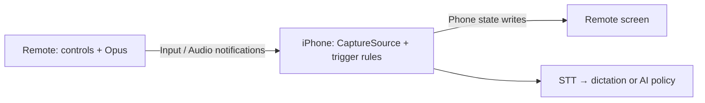

# Remote ↔ iPhone BLE contract



**Draft v1.0 · unimplemented / unverified.** Inputs: [requirements](../requirements.md)
[REQ-4], [REQ-8], [REQ-18], [REQ-49–53], [Q-5]; [design: Modes, Components](../system-design-v1.md).
Byte examples are synthetic, not board measurements. This is a proposed binary,
little-endian GATT contract, separate from the JSON [schema family](protocol.schema.json)
and [wire contract](wire-contract.md); no JSON types/codegen change. Codec generation
and interoperability tests for this contract remain TBD. It does not prove any requirement met.

## Service and common rules

UUIDs below were generated once for this contract; implementations use these exact
128-bit UUIDs through their Bluetooth APIs (not a little-endian integer reinterpretation).
All integer fields in characteristic values are unsigned, little-endian; offsets are
zero-based bytes. No implicit padding, terminators or checksums. Reserved bytes/bits
are zero. Reject invalid lengths, enum values, reserved bits, UTF-8 and inconsistent
fields; never infer an action from malformed input. Bounds below are defensive draft
choices, not measured capacity. Text lengths count UTF-8 bytes; truncate at scalar
boundaries, exclude control characters, and render as plain text.

| GATT object | UUID | Properties / value |
|---|---|---|
| Service | `f934bb04-9472-4805-8ea8-11f9f5bcabbc` | Custom service, not Bluetooth LE Audio |
| Version/info | `cba8d4dd-2aea-4964-a0b7-ef58095a1171` | Read; fixed 20 bytes |
| Input | `9f0f839c-fe73-46e4-acc3-53518ed5689c` | Notify; fixed 14 bytes, including snapshots |
| Phone state | `d9306a59-9e64-48c5-8722-827a0592a412` | Write with response; application fragments |
| Audio | `6df454c4-b29c-4638-b4f5-cc43e81e2427` | Notify; 12-byte header + fragment |

All four characteristics and notification subscriptions require an authenticated,
encrypted bonded link. No capture before subscriptions, compatible info, a fresh
snapshot and a complete phone-state write. Accept only version 1.0 in this draft;
unsupported versions disable capture and show incompatibility. Reconnect resets
all fragment buffers, sequences, segments and trigger history; never replay input or audio.

## Version/info (read)

| Offset | Bytes | Field / encoding |
|---:|---:|---|
| 0 | 1 | Contract major = 1 |
| 1 | 1 | Contract minor = 0 |
| 2 | 2 | Board ID: 1 M5Stack StopWatch; 2 Waveshare ESP32-C6-Touch-LCD-1.69; 65535 synthetic/test; others reserved |
| 4 | 3 | Firmware version: major, minor, patch (one byte each) |
| 7 | 1 | Reserved |
| 8 | 2 | Capabilities: bit 0 Opus profile below; bit 1 screen; bit 2 PTT; bit 3 target-cycle; bit 4 capture control; bit 5 mode control; bit 6 `hw_mic_cut`; others reserved |
| 10 | 1 | Mic count, 1–255; describes hardware inputs, transmitted audio remains mono |
| 11 | 1 | Slider kind: 0 physical, 1 virtual (capture and mode controls use the same kind in v1) |
| 12 | 2 | Screen width in pixels; 0 if no screen |
| 14 | 2 | Screen height in pixels; 0 if no screen |
| 16 | 2 | Maximum encoded Opus packet bytes, 1–4096 |
| 18 | 2 | Reserved |

Required v1 capabilities: bits 0–5. `hw_mic_cut=1` asserts an independent hardware
cut beyond firmware's reach; it is not a software mute indicator or a safety proof.
Both prototype boards report 0. Firmware version has no text suffix in v1.

Example I: synthetic board 65535, firmware 0.1.2, all required capabilities,
no hardware cut, one mic, virtual controls, illustrative 240 × 280 screen,
maximum packet 512 bytes. Exactly 20 bytes (screen values are test data):

```hex
01 00 ff ff 00 01 02 00 3f 00 01 01 f0 00 18 01 00 02 00 00
```

## Input events and snapshots (notify)

Every notification is a full post-event snapshot, with an event discriminator.
The phone owns the shared trigger state machine for [REQ-8]; firmware only
samples/debounces controls, timestamps transitions and reports them. It does not
classify taps, double-taps, locks or approval. Control positions come from the
remote; effective capture/recording state comes from the phone. Phone controls can
stop capture without moving the remote control; remote OFF always wins for this source.

| Offset | Bytes | Field / encoding |
|---:|---:|---|
| 0 | 4 | Input sequence, starts 0 per connection, increments for every notification modulo 2^32 |
| 4 | 4 | Remote monotonic milliseconds since boot, modulo 2^32; event sampling time, not notification arrival time |
| 8 | 1 | Event: 0 snapshot, 1 PTT down, 2 PTT up, 3 target-cycle press, 4 capture position changed, 5 mode position changed |
| 9 | 1 | Capture position: 0 OFF → `off`; 1 PTT → `hold`; 2 REC → `continuous` |
| 10 | 1 | Mode position: 0 TRANSCRIBE → `dictation`; 1 AI → `ai_control` |
| 11 | 1 | PTT level: 0 up, 1 down |
| 12 | 1 | Status: bit 0 audio currently streaming; others reserved |
| 13 | 1 | Reserved |

Example family E0–E5: sequence 42, tick 1000 ms, event byte varies as below;
PTT position, AI mode, audio stopped. Each row is exactly 14 bytes:

| Example | Hex value |
|---|---|
| E0 snapshot, up | `2a 00 00 00 e8 03 00 00 00 01 01 00 00 00` |
| E1 PTT down | `2a 00 00 00 e8 03 00 00 01 01 01 01 00 00` |
| E2 PTT up | `2a 00 00 00 e8 03 00 00 02 01 01 00 00 00` |
| E3 target-cycle press | `2a 00 00 00 e8 03 00 00 03 01 01 00 00 00` |
| E4 capture changed to PTT | `2a 00 00 00 e8 03 00 00 04 01 01 00 00 00` |
| E5 mode changed to AI | `2a 00 00 00 e8 03 00 00 05 01 01 00 00 00` |

Rows are independent examples, not a sequence. Down/up discriminator and PTT
level agree; snapshots carry no synthetic edge. Send a snapshot immediately on
Input subscription, on phone request, and after audio starts/stops. A bonded
reconnect restores the subscription, so that snapshot can arrive before the phone
is listening: the phone must not wait for it, and sets the snapshot-request flag in
its first state write instead (seen on the StopWatch with BlueZ, 2026-11-02). On a gap,
invalid transition or reconnect, the phone cancels the held/locked gesture,
stops this source, requests a snapshot and requires release then a fresh PTT
press (or a fresh deliberate REC selection) before recording. Recovered snapshots
update displays but never cycle a target or start capture. Duplicate/stale events
are ignored; modulo sequence comparison accepts forward distances below 2^31.
Clock wrap uses modulo subtraction; a reboot disconnects and resets the session.

Ignore isolated taps shorter than 300 ms per [REQ-8]. Double-tap window and its
precedence over short-tap rejection remain **TBD**; both endpoints need the same
phone rule before enabling tap-lock. Use remote timestamps so BLE batching does
not change durations. Firmware may acquire/stream provisionally after PTT down
when armed; the phone buffers and discards rejected gestures, with no STT output
or execution before qualification. Buffer/first-word performance is **TBC**.
Capture-position or mode changes close the old audio segment and clear arm;
starting another segment waits for a complete phone state acknowledging the new
Input sequence. The phone pins mode and resolved target when accepting START;
late audio never gets reinterpreted under a new mode. Mode changes never change target. Target-cycle is one press, no implicit autorepeat: the phone
advances its current list, including Auto, then returns the resolved display state.

## Phone state (write with response)

The phone owns target registry, ordering, Auto resolution and effective capture,
mode, recording and error state. Display names are labels, never identities or
authority. The phone maps list indices to its own `Target`/device IDs. Remote
control positions are not writable. The chosen target is independent of mode.

A write carries a 6-byte fragment header followed by part of the logical state:

| Offset | Bytes | Fragment field |
|---:|---:|---|
| 0 | 2 | Transaction ID, increments modulo 2^16 per logical state |
| 2 | 2 | Total logical state length, 19–512 bytes |
| 4 | 2 | Fragment byte offset in logical state |
| 6 | remaining | Contiguous logical state bytes; at least one byte |

Write one fragment at a time with response. Offset 0 replaces an incomplete
transaction; subsequent fragments match ID/total and the exact next offset.
Reject overflow, gaps, overlaps and invalid complete states with an ATT error;
keep the previous display. Only the final valid fragment atomically applies the
state and updates the visible destination before its write response. That response
is the display barrier for [REQ-18]; the phone waits for it before insertion to a
changed resolved destination, otherwise holds insertion and reports unavailable.
Disconnect clears state and disables audio; there is no cross-connection transaction.

| Logical offset | Bytes | Field / encoding |
|---:|---:|---|
| 0 | 1 | Flags: bit 0 request Input snapshot; bit 1 arm remote capture; others reserved |
| 1 | 1 | Capture state: 0 `off`, 1 `hold`, 2 `continuous` (effective phone decision) |
| 2 | 1 | Recording: 0 stopped, 1 recording, 2 paused, 3 error |
| 3 | 1 | Mode: 0 `dictation`, 1 `ai_control` |
| 4 | 1 | Target count N, 1–8 |
| 5 | 1 | Active index, 0–N−1; index 0 always Auto |
| 6 | 4 | Acknowledged Input sequence; arm=1 takes effect only when it equals the latest emitted Input sequence, otherwise the state applies with arm treated as 0 |
| 10 | variable | N entries: one-byte name length (1–32), then UTF-8 name; entry 0 exactly ASCII `Auto` |
| after entries | variable | Resolved destination: one-byte length (1–32), then UTF-8 name, including when active index is Auto |
| next | variable | Link text: one-byte length (0–48), then UTF-8 text |
| next | variable | Error text: one-byte length (0–64), then UTF-8 text; empty clears error |

No trailing bytes. For a named active target, resolved name equals that entry;
Auto shows the actual resolved destination, including iPhone fallback, per [REQ-18].
The snapshot-request flag emits a new event-0 snapshot after state application.
A stale acknowledged sequence is not an error: the display still updates and the
remote stays disarmed, so the phone rearms with a new write after the newer event.
`off` requires stopped/paused/error recording and arm=0; arm=1 requires non-off
capture and recording=1. Remote audio requires arm=1 AND its local capture
position not OFF; in `hold` a PTT level or phone-qualified lock is also needed.
The phone clears arm for pause, error, loss or stop. No state write overrides OFF.
A stale state cannot reopen capture after OFF: OFF clears local arming; only a
subsequent complete write following the OFF snapshot can rearm after leaving OFF.

Example P: transaction 7, 33-byte logical state, snapshot requested, disarmed/off,
stopped, dictation, acknowledged Input 42, targets Auto and PC, Auto resolved to
PC, link `BLE`, error `Mic off`. Split at a 20-byte characteristic-value budget
into three writes (20, 20 and 11 bytes):

```hex
07 00 21 00 00 00 01 00 00 00 02 00 2a 00 00 00 04 41 75 74
07 00 21 00 0e 00 6f 02 50 43 02 50 43 03 42 4c 45 07 4d 69
07 00 21 00 1c 00 63 20 6f 66 66
```

## Audio (notify)

| Profile | Draft decision |
|---|---|
| Codec | One raw Opus packet per frame, no Ogg/RTP wrapper; mono, 16 kHz, 20 ms = 320 PCM samples/frame; profile is a contract choice, not measured performance |
| Capture boundary | Remote Opus decoder feeds PCM into the phone's future `CaptureSource`, then the swappable `SttEngine`; source type `remote`, never a new authority source |
| Identifiers | Segment u32 starts at 1 per connection; increments without reuse, reconnect before overflow. Phone namespaces it with the connection/capture session, not a global JSON ID |
| Frame sequence | u16 starts 0 per segment; increments once per encoded packet, not per fragment. End segment before sequence wrap; no reuse within a segment |
| Packet bound | Nonempty, at most the Version/info maximum (up to 4096 bytes); defensive bound, not bitrate |
| Bitrate / throughput | Encoder bitrate, sustainable iOS throughput, latency, power and both boards' encode capacity **TBC**, to be measured on named hardware; no transport performance claim |

| Offset | Bytes | Field / encoding |
|---:|---:|---|
| 0 | 4 | Segment ID |
| 4 | 2 | Frame sequence |
| 6 | 1 | Flags: bit 0 START segment; bit 1 END segment; bit 2 LAST fragment; others reserved |
| 7 | 1 | Reserved |
| 8 | 2 | Fragment offset in encoded packet |
| 10 | 2 | Total encoded packet bytes |
| 12 | remaining | Fragment bytes |

For data frames, END=0, total>0, fragment nonempty. All fragments of frame 0
carry START=1; other frames START=0. LAST=1 exactly when offset+payload length
matches total. Concatenate exact contiguous offsets, then decode one complete
packet. One frame at a time, ordered fragments; do not interleave segments/frames.

END is a separate header-only notification: END=1, LAST=1, START=0, offset=total=0;
frame sequence is the next sequence after the last encoded frame. Every segment
has at least one frame and exactly one END in normal operation. Control release,
mode switch or phone stop closes the current segment; OFF discards unsent audio
and permits only the empty END marker followed by an Input snapshot with streaming=0.
No queued audio gets flushed after OFF. On disconnection the phone closes the
segment as interrupted even if END never arrives.

Examples A0/A1: segment `0x12345678`, frame 0, synthetic 12-byte packet
`00 01 02 03 04 05 06 07 08 09 0a 0b` split for a 20-byte value budget.
A0 is 20 bytes, A1 is 16 bytes. These verify transport framing only; the synthetic
packet is not a codec test vector. A2 closes the segment, next sequence 1 (12 bytes):

```hex
78 56 34 12 00 00 01 00 00 00 0c 00 00 01 02 03 04 05 06 07
78 56 34 12 00 00 05 00 08 00 0c 00 08 09 0a 0b
78 56 34 12 01 00 06 00 00 00 00 00
```

| Condition | Phone / remote behavior |
|---|---|
| Missing fragment/frame, conflicting duplicate, invalid offset/total, unexpected segment or END | Phone drops the incomplete packet, marks the segment interrupted, clears arm, resets decoder and requests Input snapshot; no retransmission or silent splicing |
| Identical duplicate / stale completed frame | Ignore; never decode twice |
| Silence / missing final notification | Phone watchdog terminates stalled segments; draft timeout 1000 ms (**TBC**, proposed fail-closed setting, not a measured bound). No DTX in v1; encode each 20 ms interval |
| Transport loss or decoder error | Discard uncommitted segment text; retain already committed history with interruption status. No incomplete AI command executes; a new qualified trigger starts a new segment |
| Firmware backpressure / queue overflow | Stop source, drop queued audio, emit END when possible and streaming=0 snapshot; restart only after resync and a fresh deliberate trigger. Queue depth **TBD**, bounded, no indefinite backlog |
| Remote OFF | Stop acquisition/encoding and discard buffered audio immediately, clear arm and report OFF snapshot; phone rejects further data while off, clears provisional audio and stops this source only |

No packet-loss concealment, FEC or retransmission in this first transport profile;
source scoring sees interruption/dropouts rather than an apparently intact stream
([REQ-51]). Measurements, whisper comparison and comfort review ([REQ-53]) remain outstanding.

### MTU and connection scheduling

The phone/OS negotiates ATT MTU; firmware uses the actual negotiated value, never
a compiled assumption. Notification value budget is ATT_MTU−3; audio payload
budget is ATT_MTU−15 after this header. At ATT_MTU 23 that is 20 value bytes / 8
audio bytes, hence the examples above. The ATT limits and default MTU are from
[Bluetooth Core, ATT §§3.2.8, 3.4.7.1](https://www.bluetooth.com/wp-content/uploads/Files/Specification/HTML/Core-62/out/en/host/attribute-protocol--att-.html).
Phone writes use the smaller of the OS-reported write-with-response limit and
the negotiated value budget, subtracting the 6-byte application header. Do not
rely on ATT long writes; this contract fragments at the application layer.

Firmware requests streaming connection parameters that follow
[Apple's connection-parameter guidance](https://developer.apple.com/library/archive/qa/qa1931/index.html);
iOS chooses the accepted interval. Exact requested/accepted intervals are **TBD**
until measured; no guaranteed interval, MTU or notification rate. Support the
small-MTU framing path even if it cannot sustain this codec profile: on inability
to keep up, stop visibly instead of accumulating latency or claiming success.
Recalculate fragment size on link changes; apply a new size at a frame boundary.

## Security and microphone safety

| Boundary | Draft behavior / evidence |
|---|---|
| Enrollment | Enter pairing locally on remote, choose remote on phone. Use LE Secure Connections with bonding and authenticated Numeric Comparison: compare the same number on both screens and explicitly confirm on each. Reject mismatch, timeout, Legacy Pairing and Just Works; no downgrade. [Bluetooth security architecture](https://www.bluetooth.com/wp-content/uploads/Files/Specification/HTML/Core_v6.3/out/en/architecture%2C-change-history%2C-and-conventions/architecture.html) describes Numeric Comparison's MITM protection. ESP-IDF/iOS UI interoperability is **unverified** |
| Reconnect / revoke | Restore encrypted authenticated bond before reads/writes/notifications, then resync. Revoke removes the allowed bond, disconnects and stops audio; require fresh local pairing. Pairing UI is separate from this application service |
| Untrusted remote | Buttons, timestamps, names, capabilities and `hw_mic_cut` are untrusted input. Bonding identifies the remote, not the human actor. No message supplies `authenticated_actor`, `activation_kind`, `approval_credential_class` or `granted_scope_id` |
| Policy | Phone trusted input/policy validates activation and grants. Buttons carry no approval authority; tier 1 still requires a separately authenticated approval. Policy gate denies remote-button approval for tier 3: action-specific phone Face ID/passcode remains required. Medium-risk button approval [Q-5] stays open and disabled in v1 |
| OFF / [REQ-49] | Only capture not OFF permits audio. Phone state cannot override OFF. A compliant final rig cuts microphone power in hardware independently of firmware; software stop is insufficient |
| StopWatch stand-in | Vendor documents a MEMS mic and ES8311; `PYG3 (PYB_AU_EN)` on the I2C GPIO expander controls codec + mic power. Firmware can change it, so the board cannot meet the independent hardware OFF rule as supplied; `hw_mic_cut=0`. [M5Stack board documentation](https://docs.m5stack.com/en/core/StopWatch) |
| Waveshare Proto 1 | Vendor establishes an onboard microphone, ES8311 codec and touch display. No independent physical OFF cut is established. Treat the supplied board as unable to meet [REQ-49], `hw_mic_cut=0`; exact mic power path, software power gating and behavior under reset/fault are **unverified**, not inferred from the StopWatch. [Waveshare board documentation](https://www.waveshare.com/wiki/ESP32-C6-Touch-LCD-1.69) |

**Prototype exception, granted by the owner on 2026-11-02.** Both supplied boards
fail the required hardware OFF guarantee, and the owner accepted that for these test
boards: the mic may stay powered, and OFF is a firmware stop of capture and audio only.
Boards report `hw_mic_cut=0`. The exception does not weaken [REQ-49] or AGENTS.md for
the final design, and it is not evidence of compliance.

## Open questions

| Item | Outstanding decision / verification |
|---|---|
| Prototype safety | Exception granted for test boards (above); the hardware OFF design for the final rig remains open |
| Trigger semantics | Shared double-tap window, short-tap precedence, lock/unlock and REC/PTT interaction; disable tap-lock until defined |
| Capture adapter | On branch `codex/feat-stt-engines`, not yet on this base: `CaptureSource.frames() -> AsyncStream<AudioFrame>`, 16 kHz Int16 PCM. That API has no way to signal an interrupted segment, which this contract's loss handling needs; the iOS side defines how to carry it |
| Mechanical contract | Binary schema/codegen and positive/negative interoperable fixtures; examples here verify layout only |
| Transport / codec | Bitrate, queue bound, timeout tuning, accepted MTU/interval, sustained throughput, background iOS behavior and Opus performance on both boards |
| Controls / hardware | Actual physical/virtual mapping, mic topology and independent OFF implementation; screen rendering barrier behavior on both boards |
| Enrollment | Numeric Comparison confirmation on both screens, revocation and bond reset on actual ESP-IDF/iOS builds |
| Authority | [Q-5] medium-risk approval authentication; no remote approval enabled by this draft |
| Product gate | [REQ-51]/[REQ-53] source-quality and whisper benchmarks, comfort, power and latency remain unverified |
