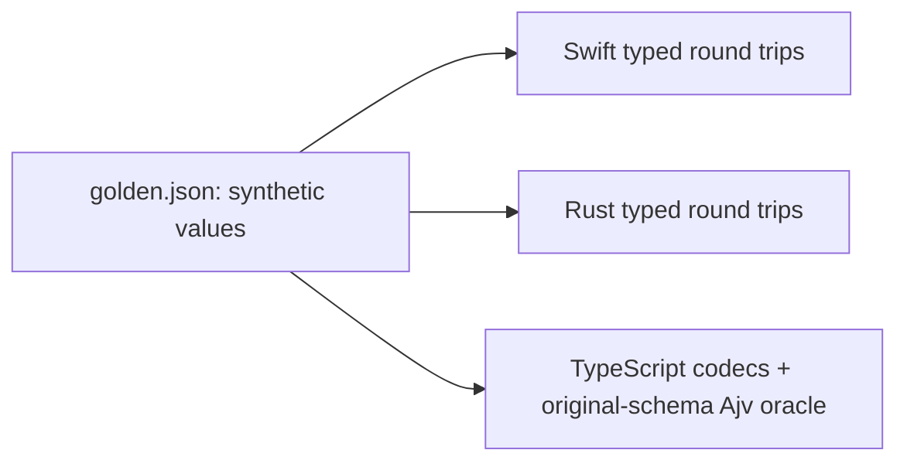

| File | What it is | Status |
|---|---|---|
| [golden.json](golden.json) | Shared positive/negative values and `raw_invalid` JSON strings | ✅ |

Start with `golden.json`. All text is synthetic; base64 strings are fixture
markers, not usable keys or credentials. Zero-filled hashes are shape fixtures,
not computed approvals. No transcripts, contacts, private keys or audio.

All suites compare decoded/encoded JSON values, ignoring object key order and
real-number spelling; byte-identical serialization is not required. An optional
valid `json` fixture preserves escapes and real exponents; integer fields require
literal integer tokens. `raw_invalid` records have `name`, `schema`, and `json`,
without a parsed `value`, so duplicates, malformed Unicode and lossy numbers
reach each public decoder intact. Every record,
union arm, model tool, mode and capture state is exercised. Negative values also
run through the typed codecs. Each forbidden control code point and keypad Enter
has a fixture. `python3 SYS/codegen/probe_regressions.py` proves every new control
and duplicate case fails when its TS guard is removed. Run `make -C SYS check`
after any edit. Trace: [REQ-59](../../requirements.md#extensibility),
[REQ-16](../../requirements.md#dictation-delivery-and-targets),
[REQ-22](../../requirements.md#pairing-and-transport) and
[REQ-28–33](../../requirements.md#authorization-and-policy). Transport and policy integration
remain **unverified**.
