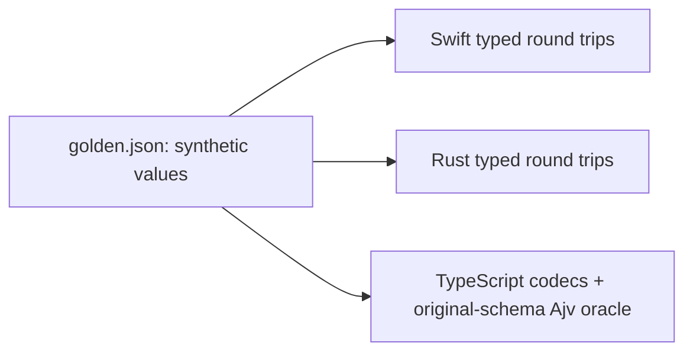

| File | What it is | Status |
|---|---|---|
| [golden.json](golden.json) | Shared positive/negative fixtures; schema name + value + case label | ✅ |

Start with `golden.json`. All text is synthetic; base64 strings are fixture
markers, not usable keys or credentials. Zero-filled hashes are shape fixtures,
not computed approvals. No transcripts, contacts, private keys or audio.

All suites compare decoded/encoded JSON values, ignoring object key order and
integer spelling; byte-identical serialization is not required. An optional
`json` fixture preserves alternate numeric spellings such as `1e0`. Every record,
union arm, model tool, mode and capture state is exercised. Negative values also
run through the typed codecs. Run `make -C SYS check` after any edit.
Trace: product §4/§7; numbered `[REQ-n]` is TBD. Transport and policy integration
remain **unverified**.
