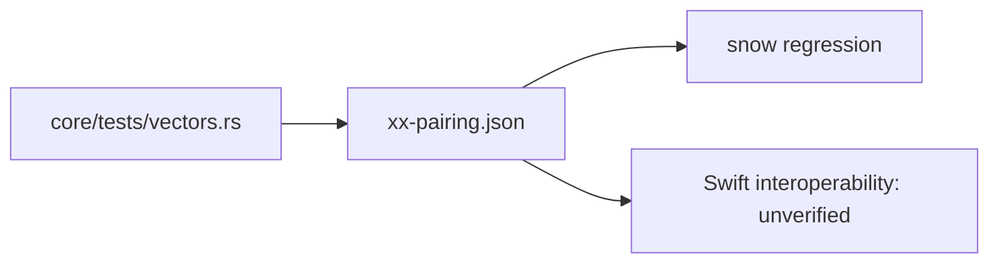

| File | What it is | Status |
|---|---|---|
| [xx-fragments.json](xx-fragments.json) | Encrypted `03` fragment frames, lengths/offsets, nonces and reassembly example | ✅ Rust; Swift unverified |
| [xx-pairing.json](xx-pairing.json) | Deterministic synthetic static/ephemeral test secrets, QR, prologue, XX packets, hash, phrase, confirmations and application ciphertext | ✅ Rust; Swift unverified |

Purpose: publish the [Noise profile](../../noise.md) for REQ-22/23/24.
Inputs: fixed public test secrets and synthetic records, `snow` 0.10.0.
Verified: regenerated and compared in Rust tests; independent implementation
agreement and cryptographic audit **unverified**. Never use these secrets outside tests.

From repository root (review fixture diffs after regeneration):

```sh
VOICEREMOTE_UPDATE_NOISE_VECTORS=1 HEAVY_CPUS=4 heavy cargo test -p voiceremote-core --manifest-path SW/desktop/Cargo.toml -j4 --test vectors
```

Normal tests compare with the published file and never rewrite it. All hex is
lowercase, with bytes in transmission order. Nonces and Noise AEAD details follow
the named pattern; confirmation consumes nonce zero in each direction. Fragment fixture continues the original example after initiator application nonce one.
