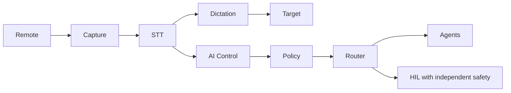

# Voice Control Fabric requirements

**Draft, awaiting owner review** · All requirements and verification outcomes are **unverified**. Phases indicate the planned first delivery or evaluation, not proof of completion. Sources: [System Design v1](system-design-v1.md) (Design) and [Product Definition v0.2](product-definition-v0.2.md) (Product). Where they differ, Design takes precedence. Proposed defaults and targets remain subject to owner review.

## Capture and modes

| ID | Requirement | Phase | Verification | Source section |
|---|---|---|---|---|
| [REQ-1] | Fundamental voice, routing and approval features shall work without the dedicated remote. | P0 | Owner on-device check | Product §1 |
| [REQ-2] | The phone shall support iPhone microphone and paired AirPods capture, with independent recording control and a visible state and stop control. | P0 | Owner on-device check | Product §§3.1, 3.3, 8, 9 |
| [REQ-3] | Capture control shall provide OFF, HOLD and CONTINUOUS; HOLD records while PTT is held and CONTINUOUS captures until stopped. | P0 | Test; owner on-device check | Design: Modes; Product §3.3 |
| [REQ-4] | Dictation and AI Control shall be separate from capture control; changing mode shall not change the target, and mode shall be shown on phone, remote and desktop tray. | P0–P3 | Test; owner on-device check | Design: Modes |
| [REQ-5] | Dictation shall send transcription through vocabulary and cleanup to history and the selected focused field without the LLM brain or tools; AI Control shall route transcription through the brain and policy gate to tools. | P0–P1 | Test | Design: Modes; Control plane |
| [REQ-6] | Capture shall continue while tasks execute, and task state shall be independent of microphone session state. | P1 | Test; owner on-device check | Product §§2 journey D, 6, 9 P1 |
| [REQ-7] | The Action Button recording workflow and locked and unlocked session behavior shall be evaluated on a real phone, including cold-start limitations and fallback controls. | P0 | Owner on-device check | Product §§2 journey B, 9 P0; Design: Risks |
| [REQ-8] | Trigger rules shall support hold to talk, double-tap to lock and ignore taps under 300 ms consistently on phone, remote and desktop. | P0–P3 | Test; owner on-device check | Design: Learnings from open-source dictation apps |

## Speech-to-text

| ID | Requirement | Phase | Verification | Source section |
|---|---|---|---|---|
| [REQ-9] | STT engines shall implement a swappable `SttEngine` interface and stream partial and final text, including Apple, Argmax, WhisperKit and cloud candidates. | P0 | Test | Design: Speech-to-text; Plan task 7 |
| [REQ-10] | STT shall default to on-device, use cloud under the specified availability, heat, battery or max-accuracy conditions, and use on-device only offline without an error. | P0 | Test; owner on-device check | Design: Speech-to-text |
| [REQ-11] | A per-user vocabulary shall bias supported engines and cleanup; cleanup shall preserve meaning and never add Send. | P0 | Test; bench run | Design: Speech-to-text |
| [REQ-12] | Debug builds shall offer an engine picker and A/B comparison of two engines on the same audio. | P0 | Test | Design: Speech-to-text |
| [REQ-13] | The P0 benchmark shall score approximately 200 owner-recorded phrases on AirPods and iPhone mic for WER, term accuracy, clipped first words, time to first text and battery per 10 minutes. | P0 | Bench run on owner's phone | Design: Speech-to-text; Plan task 8 |
| [REQ-14] | The selected engine shall beat Apple on the owner's set before shipping; the proposed 25% fewer errors on personal terms is **TBC**, pending owner confirmation. | P0 | Bench run on owner's phone | Design: Speech-to-text |
| [REQ-15] | P0 shall measure the following **TBC** latency goals: first partial ≤300 ms, final text ≤500 ms, cleanup ≤150 ms, PC delivery 30 ms LAN / 150 ms relay, and end of speech to PC field ≤800 ms LAN. | P0 | Bench run on named devices | Design: Control plane, Latency targets |

## Dictation delivery and targets

| ID | Requirement | Phase | Verification | Source section |
|---|---|---|---|---|
| [REQ-16] | Dictation shall insert into the selected focused field and never press Send or Enter; a separately authorized send command is distinct. | P0 | Test; owner on-device check | Design: Control plane; Plan tasks 4, 5, 9; Product §2 journey B |
| [REQ-17] | The target picker shall support a fixed named device and Auto; Auto shall select the most recently active device with a focused text field within 60 seconds, otherwise the iPhone. | P0 | Test | Design: Modes |
| [REQ-18] | Desktop receivers shall report focus activity without field contents; Auto shall show the chosen target before insertion on the phone and remote and flash the PC tray. | P0–P3 | Test; owner on-device check | Design: Modes |
| [REQ-19] | Windows and Linux receivers shall insert text into focused fields, including Windows Notepad, Chrome and Teams, and GNOME Wayland and X11. | P0 | Owner on-device check | Design: Components; Plan tasks 4–5 |
| [REQ-20] | Desktop insertion shall use clipboard paste with clipboard restoration and a keystroke fallback; Linux shall support X11 and Wayland portal with uinput fallback. | P0 | Test; owner on-device check | Design: Components; Learnings from open-source dictation apps |
| [REQ-21] | Optional rewrite shall fall back to the raw transcript on failure; an insertion overlay shall not take focus. | P0 | Test | Design: Learnings from open-source dictation apps |

## Pairing and transport

| ID | Requirement | Phase | Verification | Source section |
|---|---|---|---|---|
| [REQ-22] | Pairing shall require no manual IP entry and use a QR containing the desktop public key, one-use two-minute token and relay room ID, with a Noise XX handshake over discovered LAN or relay. | P0 | Test; owner on-device check | Design: Pairing, security and authorization |
| [REQ-23] | Both devices shall display the same four-word verification phrase and require confirmation on both before enrollment; the phone shall record role and capabilities. | P0 | Test; owner on-device check | Design: Pairing, security and authorization |
| [REQ-24] | Each device shall have its own key pair; LAN and relay shall use the same Noise session, without open inbound ports, and the relay shall see only ciphertext. | P0 | Test | Design: Pairing, security and authorization; Plan task 2 |
| [REQ-25] | Revocation shall take effect immediately, delete the key and drop the relay room; replayed enrollment codes shall be rejected. | P0 | Test | Design: Pairing, security and authorization; Product §2 journey A |
| [REQ-26] | The relay shall provide rooms, presence, APNs wake and encrypted message delivery, including an offline task queue. | P0–P2 | Test | Design: Components; Plan tasks 2, 13 |
| [REQ-27] | Pairing shall be tested on home LAN and an external network, with a goal of QR pairing in under one minute. | P0 | Owner on-device check | Design: Plan task 3; Product §9 P0 |

## Authorization and policy

| ID | Requirement | Phase | Verification | Source section |
|---|---|---|---|---|
| [REQ-28] | Inferred tier 1 actions shall remain suggestions and shall not enter the execution queue without an authenticated approval event. | P1 | Test | Design: Pairing, security and authorization; Product §7 |
| [REQ-29] | Wake phrase or deliberate PTT shall permit automatic execution only within a granted scope; sensitive actions shall require action-specific Face ID or passcode on the phone. | P1 | Test; owner on-device check | Design: Pairing, security and authorization |
| [REQ-30] | Grants shall be scoped by actor, device, project, capability, risk class and expiry, without a global always-allow grant or model-initiated expansion. | P1 | Test | Design: Pairing, security and authorization; Product §4.3 |
| [REQ-31] | Model output shall never set `authenticated_actor`, `activation_kind`, `approval_credential_class` or `granted_scope_id`; trusted input and policy services shall set them. | P1 | Test | Product §7; Design: Pairing, security and authorization |
| [REQ-32] | Approval shall show the exact operation, affected destination, data or recipient and consequences, and bind to an immutable task preview. | P1 | Test; owner on-device check | Product §§2 journey F, 4.4, 8 |
| [REQ-33] | Voice matching, external content and agent output shall not confer authority; ambiguous meeting activation shall downgrade to a suggestion or no action. | P1 | Test with curated meeting and playback corpus | Product §§4.2, 8, 9 P1 |
| [REQ-34] | Each command shall have an idempotency key and observable status and cancellation; reconnect shall not execute it twice. | P1 | Test | Design: Pairing, security and authorization; Product §§6, 9 P1 |
| [REQ-35] | An append-only audit log shall reside on the phone with an encrypted relay copy. | P1 | Test | Design: Pairing, security and authorization |

## LLM brain

| ID | Requirement | Phase | Verification | Source section |
|---|---|---|---|---|
| [REQ-36] | The brain shall propose tool calls while deterministic phone code controls policy, approvals and execution. | P1 | Test | Design: Control plane |
| [REQ-37] | The `LlmBrain` interface shall support on-device only, hybrid and cloud only settings, with hybrid using an on-device fast path for simple routing and cloud for multi-step tasks and suggestions. | P1 | Test | Design: Control plane |
| [REQ-38] | Inferred suggestions shall provide review, dismissal and target editing, deduplicate repeated ideas, and support rate limiting and muting. | P1 | Test; owner on-device check | Product §§2 journey C, 4.4; Design: Plan task 10 |
| [REQ-39] | The command benchmark shall score approximately 50 spoken commands for correct tool call, latency and battery. | P1 | Bench run on named device | Design: Control plane |
| [REQ-40] | Linked commands shall retain dependencies and individual cancellation, and incomplete or revised commands shall not launch prematurely. | P1 | Test | Product §2 journey D |

## Agents and routing

| ID | Requirement | Phase | Verification | Source section |
|---|---|---|---|---|
| [REQ-41] | Agent adapters shall support Claude Code, Codex CLI and cloud agents, with a project and session registry. | P2 | Test | Design: Components; Plan task 12 |
| [REQ-42] | Routing shall honor an explicitly named provider and machine and configured fallback policy; the chosen destination shall be visible. | P2 | Test; owner on-device check | Product §§2 journey E, 5.2–5.3 |
| [REQ-43] | An offline target-dependent task shall be held or redirected with a visible state, never reported as successful through an unrelated cloud substitute. | P2 | Test | Design: Plan task 13; Product §§2 journey E, 5.2 |
| [REQ-44] | Session identity shall include provider, account, host, project, provider session ID and capability profile; a cloud handoff shall not claim identical session continuity without an official mechanism. | P2 | Test | Product §5.2 |
| [REQ-45] | The router shall follow the documented priority of explicit destination, selected session, active dictation field, recent available project session and configured default. | P2 | Test | Product §5.3 |

## Keyboard

| ID | Requirement | Phase | Verification | Source section |
|---|---|---|---|---|
| [REQ-46] | The iOS keyboard shall insert committed text at the caret via `UITextDocumentProxy`, including in Messages and Mail, without automatic Send. | P0 | Owner on-device check | Design: Components; Plan task 9; Product §2 journey B |
| [REQ-47] | The keyboard extension shall use the app-group bridge and Darwin notifications and shall perform neither microphone capture nor network access. | P0 | Test | Design: Components |
| [REQ-48] | Where a field rejects the keyboard, the product shall provide copy/share or supported app-specific integration rather than promise arbitrary iOS insertion. | P0 | Owner on-device check | Product §2 journey B |

## Voice remote

| ID | Requirement | Phase | Verification | Source section |
|---|---|---|---|---|
| [REQ-49] | The remote's physical OFF switch shall cut microphone power independently of firmware; other capture sources shall remain independently controlled. | P3 | Test; owner on-device check | Design: Components; Product §§3.3, 8 |
| [REQ-50] | The Proto 1 remote rig shall stream Opus audio over BLE to the phone and provide a display, PTT and the board's single microphone; a three-or-four PDM MEMS microphone array shall move to a later rig. | P3 | Test; owner on-device check | Design: Components; Product §3.1 |
| [REQ-51] | Per-utterance source selection shall score valid streams for signal quality, clipping, proximity and dropouts; the rig shall be benchmarked against AirPods and iPhone microphone. | P3 | Bench run on named devices | Product §§3.2, 9 P3; Design: Plan task 14 |
| [REQ-52] | The remote target control shall cycle named devices and Auto, and display recording state and destination. | P3 | Owner on-device check | Design: Modes; Product §3.3 |
| [REQ-53] | Remote inclusion shall depend on measured whisper performance against the best off-the-shelf microphone and owner comfort. | P3 | Bench run; owner on-device check | Product §9 P3 |
| [REQ-62] | The remote shall capture Opus audio while disconnected, preserve capture mode and time metadata, stop visibly without overwriting old audio when full, and synchronize resumably by recording ID to the phone without duplicates; it shall delete audio only after the phone confirms durable storage, and OFF shall stop offline capture. | P3 | Test: disconnect, resume, duplicate transfer, power loss, full storage and OFF; owner on-device check; unverified | Owner offline-recording request, 2026-11-02; [BLE draft](protocol/remote-ble.md#offline-recording-and-deferred-sync-capability-bit-7) |

## HIL

| ID | Requirement | Phase | Verification | Source section |
|---|---|---|---|---|
| [REQ-54] | HIL adapter design and safety review shall be written and approved before HIL adapter code. | P4 | Test: check approved review before implementation | Design: Plan task 15 |
| [REQ-55] | HIL shall use allowlisted lab commands and independent hardware interlocks, E-stop and trusted motor controls; voice or an LLM shall not be the physical safety system. | P4 | Test; owner on-device check | Design: Components; Product §§8, 9 P4 |

## Privacy

| ID | Requirement | Phase | Verification | Source section |
|---|---|---|---|---|
| [REQ-56] | The proposed privacy defaults shall store no raw audio, retain transcripts on the phone for seven days, and show when cloud STT is in use; retention remains open to owner review. | P0 | Test; owner on-device check | Design: Pairing, security and authorization; Risks and open questions |
| [REQ-57] | The system shall minimize presence and focus metadata and shall not capture password-field text or inspect unrelated app contents by default. | P0 | Test | Product §8 |
| [REQ-58] | Recording consent and cloud privacy, retention and encryption policy shall be addressed before release. | P0 | Owner review and on-device check | Product §8 |

**Open conflict with [REQ-56]:** [REQ-62], which the owner asked for on 2026-11-02,
keeps temporary raw Opus audio on the remote until confirmed phone storage.
[REQ-56] is unchanged. Resolve retention/encryption under [REQ-58] and [Q-6].

## Extensibility

| ID | Requirement | Phase | Verification | Source section |
|---|---|---|---|---|
| [REQ-59] | The SYS protocol schema shall generate client types for Swift, Rust and TypeScript, with round-trip tests in all three languages. | P0 | Test | Design: Repo, stack and extensibility; Plan task 1 |
| [REQ-60] | The system shall expose `SttEngine`, `LlmBrain`, `CaptureSource`, `Target` and `AgentAdapter` interfaces for extension. | P0–P2 | Test | Design: Repo, stack and extensibility |
| [REQ-61] | Records shall carry an `account_id` and relay rooms shall support multi-tenancy. | P0 | Test | Design: Repo, stack and extensibility |

## Decisions locked

These record the Design's locked decisions, not verified implementation.

| ID | Decision | Source |
|---|---|---|
| [D-1] | iPhone-first control plane, cloud relay second, no inbound PC ports. | Design: Decisions locked |
| [D-2] | On-device iPhone STT, benchmarked against Apple, with cloud fallback. | Design: Decisions locked |
| [D-3] | Linux is an agent node and desktop receiver, sharing Rust receiver core with Windows. | Design: Decisions locked |
| [D-4] | hwgeekom has integrated GPU only and orchestrates agents rather than hosting heavy STT or LLM workloads. | Design: Decisions locked |
| [D-5] | Design the full system and phased plan, build P0 first and later phases afterward. | Design: Decisions locked |
| [D-6] | Codex CLI on hwgeekom builds task-sized work with acceptance tests. | Design: Decisions locked |
| [D-7] | Separate Dictation / AI Control toggle; dictation skips the LLM brain. | Design: Decisions locked, round 2 |
| [D-8] | Cloud LLM with tools; phone retains policy, registry and tool execution; on-device Apple model handles simple fast commands. | Design: Decisions locked, round 2 |
| [D-9] | Put STT engines behind a switch and test side by side with picker and A/B mode. | Design: Decisions locked, round 2 |
| [D-10] | GitHub Actions macOS runner builds, signs and ships iOS to TestFlight. | Design: Decisions locked, round 2 |

## Source differences

| Topic | Product definition | Newer design used here |
|---|---|---|
| Keyboard network | Discusses full-access permission for a networked keyboard (§2 B). | Keyboard has no network and uses the app-group bridge (Components). |
| Sensitive approval | Allows trusted on-device or desktop confirmation as applicable (§§1, 4.1). | Tier 3 uses Face ID or passcode on the phone (Pairing, security and authorization). |
| Audio ingress | Shows remote and Windows streams entering a general ingest service (§6). | Microphones feed the iPhone; remote streams BLE to it (System at a glance; Components). |
| Dictation cleanup | Product describes streaming ASR and routing without specifying a separate non-brain cleanup path (§6). | Dictation skips the LLM brain and tools while using vocabulary and cleanup (Modes; Speech-to-text). |

## Open questions

| ID | Question | Source |
|---|---|---|
| [Q-1] | What is the wake phrase, can it be changed, and how is the owner distinguished from meeting participants? | Product §10.1; Design: Risks and open questions |
| [Q-2] | When and where should suggestions appear, and what are their notification frequency and expiry? | Product §10.2 |
| [Q-3] | For an unnamed destination, should a wake command default to the selected agent or computer, and must it be spoken back? | Product §10.3 |
| [Q-4] | Which actions are preapproved per project and for how long; what risk class applies to authorized project code changes? | Product §10.4; Design: Risks and open questions |
| [Q-5] | Can the remote button approve medium-risk actions, and how are button approvals authenticated? | Product §10.5; Design: Risks and open questions |
| [Q-6] | Are seven-day transcripts and no raw-audio storage the right defaults, and is encrypted local-first capture mandatory? Resolve the conflict between [REQ-56] and temporary remote raw-audio storage in [REQ-62], including unencrypted test-board flash. | Product §10.6; Design: Risks and open questions |
| [Q-7] | Which keyboard experience and copy/share fallback are acceptable? | Product §10.7 |
| [Q-8] | How should local/cloud handoffs handle local files, live desktop control and private data barred from cloud providers? | Product §10.8 |
| [Q-9] | What budget is available for Argmax licensing and cloud STT? | Design: Risks and open questions |
| [Q-10] | Is the proposed 25% personal-term error reduction the owner-approved STT gate? | Design: Speech-to-text |
| [Q-11] | Should the remote mode control use a second switch or a PTT long-press? | Design: Modes |
| [Q-12] | Does “no inbound ports” in REQ-24 / D-1 mean no public inbound listener and no router port forwarding? The implemented LAN receiver binds a private network interface only (loopback is allowed for tests), accepts private-network peers only, and runs while pairing or paired; relay uses outbound HTTPS/WSS. Owner confirmation of this interpretation is pending; the literal no-inbound claim remains unverified. | REQ-24; D-1; LAN/relay implementation |

## Plan traceability

| Design plan task | Requirements |
|---|---|
| 1 Protocol and codegen | [REQ-59] |
| 2 Relay | [REQ-24], [REQ-26] |
| 3 Pairing and sessions | [REQ-22], [REQ-23], [REQ-25], [REQ-27] |
| 4 Windows injection and focus | [REQ-16], [REQ-18], [REQ-19] |
| 5 Linux injection | [REQ-19], [REQ-20] |
| 6 iPhone app and modes | [REQ-2], [REQ-4], [REQ-5], [REQ-17] |
| 7 STT and cleanup | [REQ-9], [REQ-11] |
| 8 Benchmark kit | [REQ-13], [REQ-14] |
| 9 Keyboard | [REQ-46], [REQ-47] |
| 10 Brain and suggestions | [REQ-28], [REQ-37], [REQ-38] |
| 11 Policy and audit | [REQ-29], [REQ-30], [REQ-35] |
| 12 Agent adapters | [REQ-41], [REQ-44] |
| 13 Routing and fallback | [REQ-42], [REQ-43] |
| 14 Remote rig and source scoring | [REQ-50], [REQ-51] |
| 15 HIL design and review | [REQ-54], [REQ-55] |
