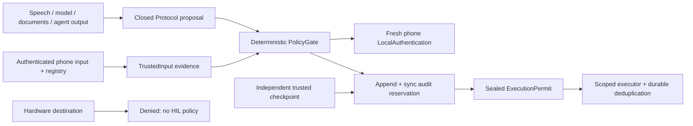

| Item | Status / boundary |
|---|---|
| Implementation | [Policy package](../SW/ios/Packages/Policy/README.md), design plan task 11; Linux unit verification only |
| Sources | [Product §4 and §7](product-definition-v0.2.md#4-activity-and-authorization-architecture), [design authorization](system-design-v1.md#pairing-security-and-authorization), [requirements](requirements.md#authorization-and-policy), [wire contract](protocol/wire-contract.md), [tools](tools/README.md) |
| Trusted computing base | Phone input/registry and grant-settings code; trusted clock; Policy/TrustedInput/Protocol; OS authentication; journal and independent checkpoint adapter; downstream executor |
| Untrusted | All model bytes, candidate IDs/state/hash/risk/confidence/destination hints, speech, playback, remote content, agent output, transport retries |
| Not implemented here | Approval UI; pairing/session authentication; executor sandbox/deduplication; encrypted relay copy; secure checkpoint adapter; HIL policy |
| Release status | **Unverified** on Apple devices; cross-review regressions fixed; independent re-review pending. This package alone does not establish complete REQ-29/32/34/35 compliance. |

Start with `PolicyGate.submit` and the test map below. Scope excludes edits to the SYS
and Packages parent README maps; the iOS Policy row links this work.

## Threats and decisions

| Threat | Deterministic response / limitation |
|---|---|
| Prompt injection fabricates authority | Closed Protocol codec rejects authority fields and unknown tool/risk variants, including nested fields. Sealed evidence has fileprivate constructors in TrustedInput and no Codable conformance. |
| Native caller misuses trusted factories | PhoneInput is a composition-root capability, never a model tool. Swift module access does not isolate malicious native code. The Policy test suite mechanically scans manifests and source files under Brain, BrainApple, Stt and SttApple for TrustedInput references, including conditional/attributed imports; linked source trees fail the lint. This conservative lexical guard is not a sandbox against malicious native code or arbitrary computed manifests. |
| Model understates action risk | Gate-owned exhaustive tool switch computes the minimum; proposed risk can only raise it, and edits retain the prior effective risk as a floor. No language/keyword classifier claims to prove arbitrary instructions safe. |
| Ambient/meeting playback | Inferred and ambiguous meeting wake events remain suggestions, even with a matching grant. Trusted input must authenticate the device/session; speaker matching alone is insufficient. |
| Preview changes during approval | Hash covers retained preview bytes: tool and arguments, account/actor/session, device/project, effective risk, expiry, policy version, trusted request UUID and edit revision. Edits invalidate approvals, including changing back to the original content. |
| Authentication replay or race | Gate creates a unique challenge bound to the hash and deadline. It rechecks challenge, credential, time, approval, revision, state and session after suspension. Concurrent approval, dismissal, edit or revocation cannot release the old action. |
| Overbroad remembered permission | Exact account/actor/device/project/capability/risk comparison plus expiry; no wildcard/global scope, no sensitive grant. TTL caps are measured from the immutable trusted issuance timestamp; revoked grant IDs are durable tombstones. Reconnect revocation compares account/actor/device/project; session revocation covers all projects/devices sharing account/actor/session identity. Grants enter only via trusted settings evidence; explicit approval creates a single-action scope. |
| Retry/reconnect/crash | Persist a queued reservation before returning a permit. Restore consumed request keys from verified audit records; consumed IDs never return another permit, even with changed payload/session. Crash after reservation may lose execution: at-most-once, not exactly-once. |
| Audit modification/truncation | Sequence + previous hash + SHA-256 of canonical record body, exact record-byte validation, and independent count/head checkpoint detect edits, removal (including suffix), reorder, duplicate keys and extra fields. |
| Storage errors or clock rollback | Deny. Uncertain append/checkpoint writes poison the log; startup mismatch requires trusted recovery. A denial cannot itself be appended when storage is broken; no permit is released in that condition. |
| Hardware through a software intermediary | Registry classification is mandatory (no software default); unknown and hardware destinations and unsupported HIL tools are denied. Software executors must lack HIL authority and enforce independent file/network/command permissions. This package cannot infer physical side effects from arbitrary instruction text or URLs. |
| Audit disclosure | Only hashes and fixed metadata are stored; no payload, URI, recipient, instruction, transcript, raw actor or exception text. Hashes are correlatable and susceptible to guessing; they are not encryption. |

## Owned tool policy

| Tool in SYS/tools | Capability | Minimum risk | Additional restriction |
|---|---|---|---|
| `select_target` | `receive_text` | `read_display` | Exact trusted target; selects a target, never inserts text or sends |
| `open_resource` | `open_resource` | `sensitive` | HTTPS only; no embedded credentials. URL safety/side effects are not inferred. |
| `delegate_task` | `delegate_task` | `sensitive` | Exact trusted project/device; downstream sandbox and approvals remain mandatory |
| `cancel_task` | `cancel_task` | `workspace_modify` | Command ownership is an audited account/actor/device/project scope hash. Cancellation survives reconnect and restart; cross-scope or unknown command IDs deny. |
| `prepare_send` | `external_send` | `sensitive` | Preparation only, as contracted; this package supplies no actual send primitive |
| Unknown pay/delete/disclose/secrets/actuate tools | None | Deny | New schema variants need policy review; generic delegation cannot lower sensitive risk |
| Any known tool targeting hardware | None | Tier 3, denied | No HIL policy exists; even phone approval cannot enable it |

`select_target` maps to the existing `receive_text` capability because the schema has
no selection capability. This is a conservative contract assumption, not a schema change.
Opaque opening/delegation are intentionally stricter than the product's examples of
preapproved public dashboards or project research until constrained executor policies exist.

## State, persistence and integration assumptions

| Item | Behavior / integration obligation |
|---|---|
| Proposal state | Suggested → Edited / Approved / Dismissed / Expired; Approved → Queued → Dispatched → Running → Succeeded / Failed / Cancelled. Dispatch can also fail/cancel; queued work can cancel. Only the gate authorizes Approved/Queued. Every transition rechecks proposal expiry, session revocation and any backing grant expiry/revocation. Dismissal tombstones survive restart and changed payloads. |
| Expiry | Default proposal TTL 120 seconds; approval/challenge TTL 30 seconds. Configurable defensive assumptions, **TBC** product defaults. Input/candidate expiry can shorten, never extend, the gate deadline. Edits retain the original deadline. |
| Grant lifetime | Read/display maximum 24 hours; workspace modification maximum 15 minutes; sensitive grants forbidden. Defensive defaults **TBC**. Limits run from PhoneInput issuance, so delayed installation cannot renew a grant. |
| Authentication | One new LAContext per sensitive approval; reuse disabled; `deviceOwnerAuthentication` permits phone biometrics or passcode. Adapter conservatively labels success `passcode` because this policy does not report the factor used. The synchronous callback API is invoked on MainActor; its reply captures only a Sendable continuation, avoiding non-Sendable LAContext transfer to an async executor. Swift 6 isolation reviewed; Apple SDK compilation remains **unverified** in Linux. Non-iOS adapter calls deny. [Apple policy](https://developer.apple.com/documentation/LocalAuthentication/LAPolicy/deviceOwnerAuthentication). |
| UI obligation | Show the exact retained tool, affected destination, content and consequences before minting ApprovalEvidence. UI and `NSFaceIDUsageDescription` integration are **unverified** later work. Remote button approvals are denied at every risk pending Q-5. |
| Router execution boundary | `TaskRouter` accepts only sealed `ExecutionPermit`, never a public conformance-based receipt. `PolicyGate.verifyExecution` compares the exact command and retained preview/expiry with its live issued-permit registry, verifies SHA-256, current proposal state, expiry, session/grant revocation and audit integrity. Router repeats verification on storage load and before dispatch. Raw Codable queue records cannot restore authority. Different selected/resolved destinations or pinned provider sessions hold for a new approved command; fallback never rewrites the original command. A newly instantiated gate has no live permits and requires reapproval with a new request ID. |
| Preview interoperability | Hash the retained bytes, never a different-language reserialization. The permit carries those bytes and expiry beside the generated AuthorizedCommand. Forward/persist both in trusted routing; wire-envelope integration is later work. |
| Replay identity | Input code retains the same trusted request UUID for retries. Distinct deliberate requests get distinct UUIDs. A malicious caller minting a fresh trusted event is outside the model boundary. Executor also deduplicates the stable command key at its side-effect boundary. |
| Restart | Grants/proposals/payloads are not silently restored. Reapproval/regrant is required; consumed command keys, cancellation ownership hashes, dismissed requests, revoked grant IDs and session revocations survive via the audit. Persisted revocation assumes a session ID is never reused. |
| Journal | Exclusive file lock; append-only writes with sync; inode identity checks; private app-owned directory. One gate owns a log. Full verification before append favors correctness over scale; throughput is **unverified**. |
| Checkpoint | Caller supplies durable, rollback-resistant `AuditCheckpointStore`; no production default. Each checkpoint/intent save must be atomic and durable before returning. `loadPending` / `savePending` preserve exact write-ahead audit bytes independently of the journal. Protect the head independently of the journal. Rewriting/rolling back both journal and checkpoint defeats an unkeyed hash chain and is outside this implementation's guarantee. |
| Retention | Configured archive age (default 30 days, **TBC**) selects records due for encrypted archival. No automatic deletion: live history and replay tombstones remain. Encrypted archival, bounded storage and audited compaction are **unverified** future integration. |
| Error recovery | `AuditLog.recover` obtains fresh local biometric/passcode evidence bound to the exact snapshot, trusted session and requested clock epoch. It accepts only an anchored history plus an exact durable append intent; partial intended bytes can be completed without overwriting. The completion and recovery event are staged together, so another crash remains recoverable and audited. A recovered clock epoch permits subsequent timestamps below the old future time, preserving every old record. A new gate is required; old instances fail integrity checks. Unexplained tails, altered/truncated anchored history, stale/mismatched authentication and concurrent changes deny. Legacy unexplained tails without a trusted intent need trusted backup recovery, never automatic acceptance. |

## Invariant → executable test

Tests live in [PolicyTests](../SW/ios/Packages/Policy/Tests/PolicyTests/README.md).
Names below are exact test functions; all suites match `--filter Gate`.

| Requirement / invariant | Test |
|---|---|
| Router authority/binding | `RoutingPermitGateTests.routingPermitReverificationBindsExactCommandPreviewAndLiveApproval`, `routingPermitExpiryAndRealGateRestartRequireReapproval`; [Router tests](../SW/ios/Packages/Router/Tests/README.md) cover injected storage, destination/session mismatch, cancellation isolation and clock-skewed completion |
| REQ-28/29/36: every schema tool at every tier; tier 1 needs approval, tier 3 authentication; every sensitive tool rejects stale/mismatched approval | `everySchemaToolEveryTierRequiresCorrectAuthority` |
| REQ-31: injected authority, unknown tool/risk and duplicate JSON keys deny | `modelAuthorityInjectionUnknownToolsAndRiskDeny` |
| REQ-31: external code cannot directly construct/decode evidence or decode permits | `externalModuleCannotConstructOrDecodeAuthority` |
| REQ-28/31: model state/hash/confidence never authorize | `candidateStateHashAndConfidenceNeverAuthorize` |
| REQ-29/32: stale, wrong-hash/request/actor and remote approvals fail | `tierThreeRejectsStaleMismatchedAndRemoteApprovals` |
| REQ-29: failed, stale, future, mismatched challenge/credential deny; passcode allowed | `authenticationFailureWrongChallengeStaleResultAndPasscode` |
| REQ-32: edits including ABA and mid-authentication changes invalidate approval | `editingInvalidatesApprovalIncludingABAAndDuringAuthentication` |
| REQ-28/29/30: concurrent approval, dismissal and revocation during authentication | `concurrentApprovalsAndRevocationDuringAuthentication` |
| REQ-30: every grant scope dimension, expiry boundary, revocation, no wildcard | `grantsRequireEveryScopeDimensionAndExpiry` |
| REQ-33: ambiguous wake downgraded despite grant | `ambiguousMeetingWakeDowngradesEvenWithGrant` |
| REQ-16/54/55: dictation never dispatches tools; hardware always denied | `hardwareAndDictationNeverRun` |
| REQ-30/61: cross-account/device/project and unknown cancellation deny | `crossContextAndUnsafeSchemesDeny` |
| REQ-32/34/38: proposal expiry and legal/terminal transitions | `proposalLifecycleExpiryAndTerminalStates` |
| REQ-34: reconnect/restart/changed-payload replay gets one permit | `replayRunsOnceIncludingReconnectAndRestart` |
| REQ-30: revoked session survives restart | `revokedSessionPersistsAndGrantsAreNotRestoredImplicitly` |
| REQ-28/35: clock, append, partial write, checkpoint and tamper errors deny | `clockErrorsAndAuditFailuresNeverReleasePermit` |
| REQ-32/35: SHA-256 known answers, padding and large input | `sha256KnownAnswersAndPaddingBoundaries` |
| REQ-35: audit edit, removal, reorder and suffix rollback detection | `chainDetectsEditRemovalReorderAndTailTruncation` |
| REQ-35: added fields, duplicate keys and changed record bytes detected | `extraFieldsDuplicateKeysAndWhitespaceAreTampering` |
| REQ-35: replacing an open journal fails closed | `replacedOpenJournalFailsClosed` |
| REQ-35/58: content absent; retention cannot erase replay history | `auditContainsOnlyHashesAndFixedMetadataAndRetentionNeverErasesReplay` |
| REQ-34/35: actual file reopen/replay and second-writer exclusion | `fileJournalReopensAndExcludesSecondWriter` |
| REQ-34/35: checkpoint failure after queued reservation releases no permit and blocks restart | `queuedReservationCheckpointFailureDeniesAndBlocksRestart` |
| REQ-35: interrupted writes/checkpoint failure require recovery | `interruptedWriteOrCheckpointCannotBeSilentlyRecovered` |
| Review 1: prior raised risk survives raw tool edits | `review1EditsCannotLowerPreviouslyRaisedRisk` |
| Review 2: finite per-risk TTL caps from issuance | `review2GrantsHaveFiniteRiskSpecificLifetimes` |
| Review 3: revoked grant evidence cannot reinstall, including restart | `review3RevokedGrantIDsStayRevokedAfterRestart` |
| Review 4: reconnect scope and cross-project session revocation | `review4RevocationUsesScopeAndSessionIdentity` |
| Review 5: each transition rechecks expiry/session/grant revocation | `review5EveryTransitionRechecksExpiryAndRevocation` |
| Review 6: real repository lint plus injected violations for all four protected packages | `review6ProtectedPackagesCannotImportOrDependOnTrustedInput` |
| Review 7: required registry classification, unknown denies; compiler checks missing argument | `review7RegistryKindMustBeExplicitAtConstruction`, `externalModuleCannotConstructOrDecodeAuthority` |
| Review 8: authenticated recovery preserves queued reservation and original bytes | `review8CrashRecoveryRequiresAuthenticationAndPreservesReservation` |
| Review 8: audited clock correction retains future-dated history | `review8FutureClockRecoveryPreservesHistoryAndAllowsFreshWork` |
| Review 8: partial writes and a second recovery crash preserve both recovery events | `review8PartialWriteAndCrashDuringRecoveryRemainAudited` |
| Review 8: tampering, stale/mismatched authentication, timeout, races and wrong credentials deny | `review8RecoveryCannotHideTamperingOrAcceptFailedBiometrics`, `review8PendingMismatchAndSnapshotRaceDenyRecovery` |
| Review 9: cancellation survives reconnect/restart, cross-project cancellation denies | `review9CancelWorksAcrossReconnectAndRestart` |
| Review 10: dismissal persists even if retried payload changes | `review10DismissalSurvivesRestartAndPayloadChange` |

```sh
swift test -j 4 --package-path SW/ios/Packages/Policy
swift test -j 4 --package-path SW/ios/Packages/Policy --filter Gate
```

Run through `HEAVY_CPUS=4 heavy` on hwgeekom. These are package tests, not evidence
of real-device speaker authentication, phone approval UI, receiver execution, physical
interlocks, encrypted relay backup or rollback-resistant storage. Those remain **unverified**.
