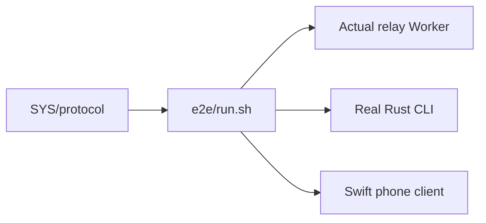

| Path | What | Status |
|---|---|---|
| [e2e/](e2e/README.md) | Real WS and LAN pairing, phrase, insertion, queued-frame resume and revoke | ✅ Linux local |

Start: `bash SYS/tests/e2e/run.sh` from repo root. REQ-22–25/61; plan task 2.
