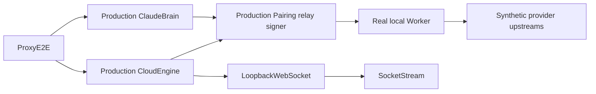

| File | Purpose / inputs | Status |
|---|---|---|
| [ProxyE2E.swift](ProxyE2E.swift) | Phone membership redemption, speech for both vendors, Claude request/model/version; invented PCM/text | ✅ Local Worker gate |
| [LoopbackWebSocket.swift](LoopbackWebSocket.swift) | Linux loopback RFC6455 carrier; query + proof headers, masked text/binary frames | ✅ Both speech upgrades |
| [SocketStream.swift](SocketStream.swift) | Real cancellable loopback TCP, shared carrier design with Pairing's E2E executable | ✅ Linux |

Start with `bash SYS/tests/e2e/run.sh`. Inputs: one ephemeral invitation from the
trusted test provisioner; no provisioning or provider credential enters the phone
process. Verification: real relay accepts production Swift signing bytes, including
apostrophe, literal plus, Unicode and repeated vocabulary terms. Local HTTP is a
test-only adapter; deployed TLS/providers and Apple WebSocket remain **unverified**.

[AgentE2E.swift](AgentE2E.swift) composes the production phone packages. Its only fakes are synthetic capture/STT/Brain output, biometric and private queue/checkpoint stores. Dispatch/status go through production PhoneConnection, Noise, relay and agent receiver.

The agent phone explicitly enrolls open_resource and verifies dispatched/reply holds a dependent task. Fake CLI session arguments are checked; no real provider/session continuation or opened-resource proof is claimed.
