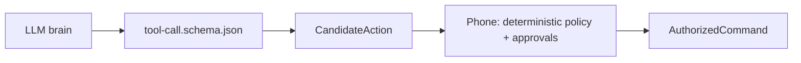

| File / proposal kind | Content | Status |
|---|---|---|
| [tool-call.schema.json](tool-call.schema.json) | Closed `ToolCall` union, generator input | ✅ |
| `select_target` | Proposed device selection | ✅ contract |
| `open_resource` | Target device + resource URI | ✅ contract |
| `delegate_task` | Device, project, optional existing provider session, instruction | ✅ contract |
| `cancel_task` | Proposed command cancellation | ✅ contract |
| `prepare_send` | Target, recipient and exact content preview | ✅ contract; no execution |

Start with the schema, then [protocol boundaries](../protocol/wire-contract.md).
All tools carry `account_id`; none can set actor, activation, approval credential,
scope, source tier, approval event or trusted policy/execution facts. There is no
arbitrary argument object. These initial tool names are
contract assumptions derived from product §4/§7 and design Modes/Components;
provider adapters, policy decisions and execution are **unverified** future work.
Trace: [REQ-36](../requirements.md#llm-brain), [REQ-59](../requirements.md#extensibility).

Check: `make -C SYS check`. A new tool needs regenerated types, shared positive
and negative vectors, and policy review; it never gains authority by schema inclusion.
